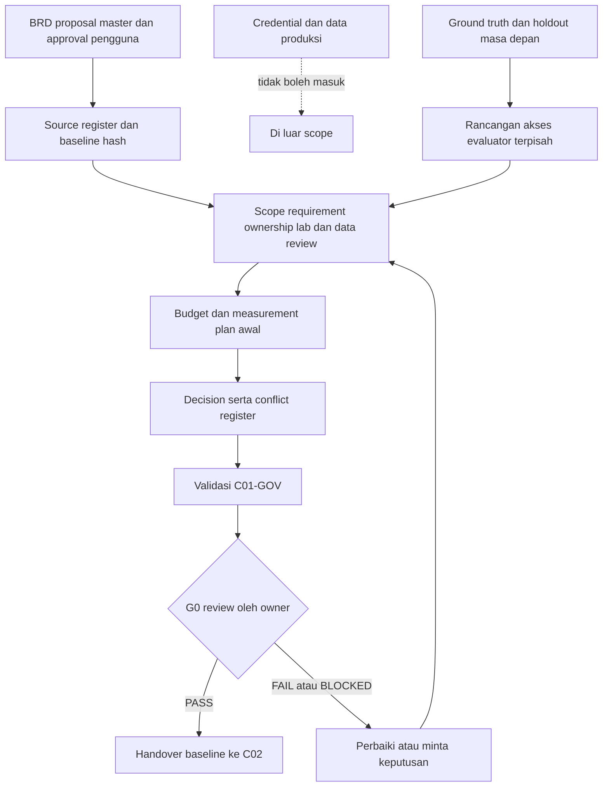

# C01 — Scope, Keputusan, dan G0

## 1. Chapter Information

| Atribut | Nilai |
|---|---|
| Chapter ID / nama | **C01 — Scope, keputusan, dan G0** |
| Phase | **F1 — Foundation** |
| Status dokumen | **Draft** — siap direview, belum Approved/Implemented/Verified |
| Version | **0.1** |
| Status pekerjaan | **Documentation Complete; Implementation NOT STARTED; G0 NOT RUN** |
| Dependencies | Tidak ada chapter sebelumnya. BRD, proposal, master, dan mandat pengguna harus tersedia. |
| Persetujuan master | **Dikonfirmasi dalam percakapan:** pengguna memilih **“Setujui master, lanjut C01”**. Persetujuan ini mencakup dasar penulisan C01, bukan pemilihan semua teknologi, approval C01, atau kelulusan G0. |
| Chapter berikutnya | C02 — Architecture, Contracts, and Evaluation Design; baru dimulai setelah output C01 dan G0 memenuhi roadmap. |
| Estimated effort | **TBD.** Belum ada data jam kerja tersedia, jumlah reviewer, atau lead time keputusan. Catat waktu authoring/review/approval pada pelaksanaan C01; jangan mengubah jendela 16 minggu proposal menjadi estimasi chapter. |

### 1.1 Sumber dan urutan otoritas

1. Instruksi proyek serta persetujuan eksplisit pengguna. Persetujuan master di atas adalah keputusan yang benar-benar diterima; keputusan teknis lain tidak diasumsikan telah disetujui.
2. [BRD v1.0](../../../BRD_AI_Agentic_SRE_RAG_Simulation_PoC_v1.0.md), khususnya §0–5, §7–11, §13–24, Appendix C/D.
3. [Master Implementation Roadmap](../00-IMPLEMENTATION-MASTER-ROADMAP.md), khususnya §2–3, C01 di §6, coverage §7–8, dan evidence §9.
4. [Proposal v2.0](../../../Proposal_AI_Agentic_SRE_RAG_Investigation_Engine_Revisi_2.0-2.docx), khususnya Bab 11–15 dan Lampiran A.
5. ADR dan chapter terdahulu yang telah disetujui, bila kelak tersedia.

**Hasil inventory saat penulisan:** repository memuat BRD v1.0, proposal v2.0, dan master. Acceptance Test Coverage Matrix berada di **§7 master**, bukan file terpisah. Belum ditemukan `AGENTS.md`, ADR, atau dokumen chapter sebelumnya. Master tidak diubah untuk menambahkan approval; rekam persetujuan percakapan di chapter ini dan, saat playbook dijalankan, di evidence C01.

**Label provenance:** `[P §x]` = proposal; `[P A]` = Lampiran A proposal; `[B §x/ID]` = BRD; `[M §x/C01]` = master; `[S-C01]` = elaborasi playbook ini. Contoh format/path dokumentasi berlabel `[S-C01]` bukan pemilihan stack aplikasi.

### 1.2 Related requirements dan acceptance references

- **Baseline inventory:** seluruh **16 BR, 40 FR, 12 RULE, dan 20 NFR** dipertahankan sebagai baseline kebutuhan. C01 tidak membangun seluruh kebutuhan tersebut.
- **Fokus langsung:** BR-008, BR-009, BR-010, BR-016; RULE-001, RULE-002, RULE-003, RULE-009, RULE-010, RULE-011, RULE-012; NFR-001, NFR-009, NFR-011, NFR-012, NFR-013, NFR-014, NFR-015, NFR-017, NFR-019; governance B §5/17/21/24.
- **Rujukan acceptance utama:** **AT-014**, hanya persiapan protokol evaluasi. Rujukan desain lainnya dijelaskan di §9; tidak satu pun acceptance test runtime dinyatakan lulus oleh C01.
- **Pemeriksaan tambahan chapter:** **C01-GOV-001 sampai C01-GOV-011**. Namespace baru ini khusus validasi readiness/dokumen G0; tidak mengganti ID proposal/BRD.

## 2. Objective & Expected Outcome

**Yang dibangun pada C01 adalah paket keputusan dan baseline G0, bukan service atau aplikasi.** Paket ini memberi C02 input yang cukup untuk merancang kontrak tanpa menebak scope, wewenang, data yang boleh digunakan, atau cara mengukur keberhasilan.

Setelah **pelaksanaan** C01 selesai, harus tersedia:

1. Register sumber dengan versi/hash dan bukti persetujuan master.
2. Scope/fidelity baseline yang mempertahankan semua Must, merencanakan Should, serta membedakan Could/Won't.
3. Owner dan approver yang nyata untuk setiap workstream/gate; rangkap peran dan keterbatasan independent review dicatat.
4. Profil target lab serta batas CPU/RAM/storage/biaya yang disepakati, tanpa deployment.
5. Kebijakan synthetic-only, ground-truth isolation, credential handling, retention, dan egress awal.
6. Jalur akses model/embedding yang disetujui atau blocker yang jujur; tanpa mengirim prompt atau menguji model pada C01.
7. Budget/time envelope dan protokol evaluasi awal; definisi/sample size final yang memang jatuh tempo G1 tetap TBD terkontrol.
8. Decision/conflict register, hasil pemeriksaan chapter, dan **G0 PASS/FAIL/BLOCKED** yang disahkan pihak berwenang.

**Hasil penulisan dokumen saat ini hanya file chapter ini.** Semua deliverable operasional di atas masih rencana, kecuali fakta keberadaan sumber dan persetujuan master yang telah diverifikasi.

## 3. Scope & Boundaries

### 3.1 In scope

- Membekukan referensi kebutuhan tanpa mengedit BRD, proposal, atau master secara otomatis.
- Menyelesaikan keputusan wajib G0; menugaskan owner/deadline keputusan G1.
- Menentukan service/fault scope dan tujuan demonstrasi, bukan menulis implementasinya.
- Menentukan data boundary, authority, source registry, measurement plan awal, budget, dan acceptance process.
- Menginventaris resource melalui pemeriksaan lokal read-only yang sempit.
- Menyiapkan kontrak handover dokumentasi ke C02.

### 3.2 Out of scope

- Install dependency, mengunduh image/model, `docker compose up`, membuat cloud resource, provisioning database, menjalankan inference/embedding, atau memanggil API vendor.
- Kode microservices, agent, RAG, MCP, evaluator runtime, CI deployment, fault injection, traffic generation, dan test acceptance aplikasi.
- Membuka `.env`, keychain, vault, credential cloud, log produksi, payload bank, atau file pribadi di luar kebutuhan chapter.
- Menetapkan vendor/framework sebagai final hanya karena tercantum dalam proposal.
- Menyatakan G1–G4 lulus, memberi izin pilot produksi, atau menyatakan compliance/production readiness.

### 3.3 Asumsi dan batas simulasi

- Proyek adalah **Hybrid Self-Built Simulation**. Self-built mencakup layanan dummy, traffic/fault harness, adapters, ingestion/retrieval/evaluation, dan logika investigasi.
- Framework/platform pendukung boleh digunakan setelah keputusan arsitektur yang relevan disetujui. **Tidak ada platform yang dipasang pada C01.**
- Minimal tiga layanan terhubung wajib dipertahankan. Nama/topologi final disahkan dalam scope; detail API/stack ada di C02.
- Harness/operator boleh mengubah layanan lab untuk membuat fault, tetapi hak tersebut terpisah dari investigator read-only. Pernyataan proposal “no write action anywhere” diterapkan pada **jalur investigator**, bukan melarang fault harness yang diwajibkan BRD.
- Identitas layanan/user/transaction di simulasi adalah sintetis. Rekaman approval proyek merupakan metadata administratif manusia; simpan minimum `owner_ref` yang dapat diverifikasi secara lokal dan **jangan masukkan ke dataset/model**.
- Bila pelaksana merangkap evaluator/reviewer, hasil tidak boleh dilabeli validasi independen. Kekurangan SME tidak dihilangkan dari laporan.

### 3.4 Keputusan yang tidak boleh dilompati

G0 adalah **output C01**, bukan prerequisite untuk menulis atau mulai menyiapkan C01. Sebaliknya, keputusan G0 yang belum selesai memblokir kelulusan chapter dan dimulainya C02 menurut roadmap. Jangan memaksa pilihan Dify/Qdrant/backend telemetry menjadi final di C01; keputusan tersebut mempunyai pekerjaan analisis/capability proof pada chapter berikutnya.

## 4. Prerequisites & Readiness Checklist

Pisahkan readiness **menulis panduan** dari readiness **menjalankan panduan**.

| Checklist | Cara memeriksa | Status saat penulisan / tindakan jika gagal |
|---|---|---|
| [x] BRD, proposal, master dapat dibaca | Cocokkan tiga tautan sumber §1 dan versi yang tertulis di dokumen | Tersedia; BRD adalah v1.0, proposal v2.0 |
| [x] Master mendapat persetujuan eksplisit | Periksa respons pengguna, bukan hanya kata “Draft” pada file | Pilihan “Setujui master, lanjut C01” diterima |
| [x] C01 adalah chapter pertama yang belum dibuat | Periksa daftar chapter/master dan file dalam `docs/roadmap/` | Tidak ada chapter pendahulu; tidak melompati dependency |
| [x] Aturan/ADR tambahan sudah dicari | Periksa `AGENTS.md`, ADR, serta chapter approved yang tersedia | Belum ditemukan pada inventory penulisan; periksa lagi bila repository berubah |
| [ ] Chapter ini disetujui untuk dipakai sebagai playbook | Rekam review/approval pengguna atas versi chapter | Masih Draft; jangan mengklaim pelaksanaan/approval C01 sudah terjadi |
| [ ] Terminal berada di root proyek | `pwd`; lalu periksa tiga path file dengan `test -f` pada Step 01 | Jika salah, pindah secara manual ke root proyek sebelum membuat evidence |
| [ ] Utilitas lokal dasar tersedia | `command -v bash`, `command -v shasum`, `command -v date`, `command -v mkdir` | Jangan install otomatis. Jika belum tersedia, gunakan metode checksum resmi yang telah tersedia dan catat perbedaannya |
| [ ] Izin membuat evidence lokal untuk run C01 | Owner menyetujui lokasi dan akses; pastikan tidak menimpa run lama | Tetapkan sebelum Step 01; tidak memakai lokasi publik sebagai evidence administratif |
| [ ] Tidak diperlukan akses produksi/credential untuk pemeriksaan | Review perintah chapter; tidak ada network/API call atau secret read | Jika pemeriksaan meminta credential, hentikan dan kaji scope |

**Bukan prerequisite yang harus sudah final:** nama sponsor, jumlah pelaksana, resource budget, provider model, scope service, serta protokol G0. Menyelesaikannya adalah pekerjaan chapter ini; jangan membuat circular dependency dengan meminta G0 PASS sebelum C01 dimulai.

## 5. Architecture & Data Flow

C01 merupakan **alur kontrol dokumentasi/keputusan**. Diagram ini bukan deployment architecture dan tidak menetapkan vendor.



### 5.1 Input, output, dan trust boundaries

| Interface | Input | Output / pemeriksaan |
|---|---|---|
| Source → baseline | File sumber, versi, approval eksplisit | Source register dan SHA-256; perubahan hash memicu review, bukan update diam-diam |
| Owner → scope/decision | Pernyataan pilihan, alasan, tanggal, otoritas | Decision record dengan status yang jelas; rekomendasi tanpa approval tetap TBD |
| Local inventory → lab plan | OS/arsitektur, jumlah CPU, RAM, free disk; bukan benchmark | Profil resource dan alokasi yang disetujui; tidak mengklaim stack pasti muat |
| Data/model review → policy | Daftar source yang diizinkan, klasifikasi, egress/provider facts | Rules yang harus ditegakkan C02/C06/C08/C13; tidak ada payload dikirim sekarang |
| Measurement plan → evaluator design | Definisi kandidat KPI, fairness, splits, timing | Protokol awal approved di G0; ukuran/ambang final dijadwalkan G1 |
| C01 → C02 | Paket E01 beserta keputusan G0 | Baseline terverifikasi untuk desain kontrak, bukan running service |

**Trust boundary:** artifacts E01 hanya berisi sumber sintetis/ringkasan administratif tersanitasi. Jangan menyimpan token, credential, contoh PII nyata, raw hardware serial number, transkrip pribadi lengkap, atau label jawaban insiden. Lokasi ground truth/holdout masa depan harus terpisah dari mount, index, credential, dan tools investigator; implementasinya berada di C02/C04/C06/C17.

## 6. Detailed Step-by-Step Implementation

### 6.0 Konvensi menjalankan playbook

- **Semua command di bawah adalah instruksi untuk pelaksanaan mendatang. Command tidak dijalankan ketika chapter ini ditulis.** Expected result menjelaskan kondisi yang harus diamati, bukan transkrip hasil nyata.
- Jalankan blok command di **satu sesi Bash** dari root repository, agar variabel Step 01 tetap tersedia. `bash` adalah shell dokumentasi, bukan pilihan bahasa aplikasi.
- Nama artifact di bawah memakai `evidence/<run_id>/C01/` sesuai master. Pemilihan ekstensi/nama berkas adalah konvensi dokumentasi `[S-C01]`; belum ada directory evidence yang dibuat dalam iterasi penulisan ini.
- Gunakan editor lokal untuk menulis Markdown/CSV dari template. Jangan menimpa sumber atau evidence lama. Jika memperbaiki baseline setelah approval, buat revisi/run baru dan catat `supersedes`.
- `TBD — Decision Required` adalah status keputusan dengan owner dan deadline, bukan nilai konfigurasi yang boleh dipakai runtime.
- Command pemeriksaan keberadaan file hanya membuktikan file ada. **Content review dan approval tetap wajib**; `test -s` tidak mengesahkan G0.

### Step 01 — Verifikasi sumber, approval, dan workspace evidence

**Objective:** memperoleh input yang autentik dan satu lokasi evidence baru tanpa mengubah source of truth.

**Why:** seluruh keputusan berikut harus terikat pada versi BRD/proposal/master yang sama. File master boleh masih bertuliskan Draft walaupun approval percakapan ada; keduanya harus dicatat tanpa mengedit sumber.

**Prerequisites:** tiga dokumen sumber tersedia; persetujuan master terverifikasi; izin penyimpanan lokal E01 dan utilitas checksum tersedia.

**Actions:**

1. Buka root proyek dan periksa path/versi dokumen. Jangan menebak adanya BRD v2.0 atau matrix terpisah.
2. Buat run ID berbasis UTC dan evidence directory baru menggunakan blok berikut. Jika path sudah ada, berhenti; jangan menimpa.
3. Hitung SHA-256 sumber dan chapter yang dipakai untuk pelaksanaan. Gunakan hash sebagai baseline perubahan, bukan bukti approval.
4. Tulis `source-register.md`: file, versi, status sumber, bagian relevan, waktu snapshot, serta pointer ke hash manifest.
5. Tulis `approval-record.md`: keputusan master yang sudah dikonfirmasi, pihak yang memberi keputusan dengan `owner_ref`, tanggal yang diketahui, referensi percakapan, dan batas approval. Jangan membuat tanggal/waktu atau tanda tangan fiktif.

**Files & Directories:** `evidence/<run_id>/C01/source-hashes.sha256`, `source-register.md`, `approval-record.md`.

**Configuration:** `BRD`, `PROPOSAL`, `MASTER`, `CHAPTER`, `RUN_ID`, `EVIDENCE_DIR`. Variabel hanya menyimpan path lokal, bukan secret.

**Commands:**

```bash
BRD='BRD_AI_Agentic_SRE_RAG_Simulation_PoC_v1.0.md'
PROPOSAL='Proposal_AI_Agentic_SRE_RAG_Investigation_Engine_Revisi_2.0-2.docx'
MASTER='docs/roadmap/00-IMPLEMENTATION-MASTER-ROADMAP.md'
CHAPTER='docs/roadmap/01-SCOPE-DECISIONS-AND-G0.md'

if test -f "$BRD" && test -f "$PROPOSAL" && test -f "$MASTER" && test -f "$CHAPTER"; then
  printf '%s\n' 'Sumber ditemukan. Cocokkan versi dan approval secara manual.'
else
  printf '%s\n' 'STOP: path sumber tidak lengkap atau terminal bukan di root proyek.'
fi
```

**Hanya setelah pemeriksaan di atas lulus**, jalankan:

```bash
RUN_ID="c01-$(date -u +%Y%m%dT%H%M%SZ)"
EVIDENCE_DIR="evidence/$RUN_ID/C01"

if test -e "evidence/$RUN_ID"; then
  printf '%s\n' 'STOP: run ID sudah ada; pilih run baru, jangan overwrite.'
else
  umask 077
  if mkdir -p "$EVIDENCE_DIR" \
    && shasum -a 256 "$BRD" "$PROPOSAL" "$MASTER" "$CHAPTER" \
      > "$EVIDENCE_DIR/source-hashes.sha256"; then
    printf 'Evidence directory: %s\n' "$EVIDENCE_DIR"
  else
    printf '%s\n' 'STOP: pembuatan directory atau checksum gagal; jangan gunakan manifest parsial.'
  fi
fi
```

Template minimal `approval-record.md`:

```markdown
# Approval record
- Approval subject: struktur Master Implementation Roadmap untuk penulisan C01
- Decision evidence: pengguna memilih “Setujui master, lanjut C01”
- Date known: 2026-11-09
- Exact time: tidak direkam; jangan diisi dengan perkiraan
- Approver reference: TBD — tetapkan owner_ref administratif yang dapat diverifikasi
- Scope: penulisan C01; pilihan teknologi tetap TBD
- Source reference: percakapan persetujuan; simpan kutipan minimum, bukan transkrip pribadi lengkap
- C01 approval for execution: PENDING
- G0 decision: NOT RUN
```

Tanggal di atas hanya untuk keputusan master yang sudah diterima, bukan tanggal pelaksanaan G0. Jika memakai chapter pada hari lain, catat tanggal run terpisah.

**Expected Result:** empat input teridentifikasi; hash manifest dibuat pada run baru; approval master dapat dibedakan dari approval chapter dan gate.

**Validation:** jalankan `shasum -a 256 -c "$EVIDENCE_DIR/source-hashes.sha256"` dari root; cocokkan versi sumber dan kutipan persetujuan secara manual. Catat **C01-GOV-001**; approval pointer yang belum dapat diverifikasi tidak boleh dianggap PASS.

**Common Failures:** terminal bukan root; file berubah; utilitas checksum tidak tersedia; approval master disalahartikan sebagai G0 PASS.

**Troubleshooting:** perbaiki path; review perubahan sumber dan buat snapshot baru; gunakan checksum tool yang sudah tersedia dengan metode dicatat bila berbeda. Jangan install otomatis atau mengubah status dokumen sumber untuk memaksa konsistensi.

**Evidence:** source register, manifest hash, approval record, hasil pemeriksaan sumber. **Lanjut ke Step 02 hanya jika sumber/approval terverifikasi.**

### Step 02 — Susun scope, fidelity, dan requirement baseline

**Objective:** memastikan seluruh kebutuhan masuk rencana dengan prioritas yang benar dan scope maket tidak bergeser ke enterprise.

**Why:** mengecilkan arsitektur tidak berarti menghilangkan Must atau menutupi skenario gagal. C02 memerlukan daftar service/fault yang jelas untuk merancang kontrak.

**Prerequisites:** Step 01 PASS; BRD §4/7–11/14/21 dan master §7–8 tersedia.

**Actions:**

1. Buat draft `scope-baseline.md` dengan tujuan, in/out-of-scope, fidelity per dimensi, batas data, jumlah/nama service kandidat, serta demonstrasi yang akan dibuktikan. Final approval dilakukan setelah authority ditetapkan pada Step 03.
2. Inventaris **88 ID kebutuhan**: 16 BR + 40 FR + 12 RULE + 20 NFR. Salin pernyataan dan prioritas dari BRD, bukan menulis ulang dengan makna lebih sempit. RULE dicatat sebagai aturan, bukan diberi MoSCoW yang tidak ada pada sumber.
3. Untuk setiap ID, isi `planned_chapters` dan `validation_ref` dari RTM master. `INCLUDED` berarti direncanakan, bukan diimplementasikan. Should tetap INCLUDED. Could diberi `CONDITIONAL`; Won't diberi `EXCLUDED_BY_SOURCE` beserta boundary verification.
4. Buat daftar SC-01–SC-14 dengan priority dan pemilik chapter. Pastikan pilihan minimal tiga service tetap mendukung auth/queue scenarios yang direncanakan, melalui tambahan layanan/komponen yang disetujui. Jangan menghilangkan SC-06/07 hanya karena memilih tiga service awal.
5. Ajukan draft scope service/fault dan fidelity untuk review. Authority ditetapkan pada Step 03, lalu scope final disahkan dan direkonsiliasi pada Step 09 sebelum G0. Jika meminta perubahan Must/Should, buka change request dengan dampak requirement/test/gate; **jangan edit BRD/master sendiri**.

**Files & Directories:** `scope-baseline.md`, `requirements.csv`, `scenario-scope.csv` di E01.

**Configuration:** `minimum_linked_services=3` berasal dari BRD; jumlah/nama aktual **TBD-07 — Decision Required**. Runbook count, corpus size dan concurrency belum dipilih otomatis.

**Commands:** pemeriksaan inventory read-only berikut menampilkan ID unik dari BRD; tidak menghasilkan runtime/test aplikasi:

```bash
LC_ALL=C grep -Eo '(BR-[0-9]{3}|FR-(SIM|OBS|RAG|AGT|OUT)-[0-9]{3}|RULE-[0-9]{3}|NFR-[0-9]{3})' "$BRD" \
  | LC_ALL=C sort -u
```

Gunakan output sebagai checklist; hitung per keluarga dan cocokkan dengan 88 ID baseline. Jangan menganggap jumlah cocok membuktikan makna/priority sudah benar.

Header `requirements.csv`:

```csv
requirement_id,source_section,source_priority,source_statement,planned_chapters,disposition,decision_ref,validation_ref
```

Contoh **format**, bukan row yang sudah diterima:

```csv
BR-001,BRD-7,Must,"Menyediakan maket digital microservices yang berfungsi mandiri",C03;C05;C22,INCLUDED,TBD-07,AT-001;AT-013
```

Saat mengisi file nyata, salin teks **persis dari BRD**; contoh di atas hanya menunjukkan quoting CSV dan wajib diperiksa terhadap sumber. Field berisi koma harus diapit tanda kutip ganda. Gunakan `INCLUDED`, `CONDITIONAL`, `EXCLUDED_BY_SOURCE`, atau `CHANGE_PENDING`; `CHANGE_PENDING` pada Must memblokir G0 sampai diselesaikan.

Template fidelity minimal:

| Dimensi | Harus dibuktikan | Penyederhanaan yang dipilih | Tidak dibuktikan | Approval |
|---|---|---|---|---|
| Layanan | ≥3 linked services dan failure propagation | TBD-07 | Seluruh portofolio aplikasi enterprise | PENDING |
| Telemetry | Logs/RED metrics/traces berkorelasi | Volume lab terbatas | Traffic/seasonality produksi | PENDING |
| Knowledge | Current/obsolete/restricted synthetic SOP | Corpus berlabel sintetis | SOP resmi bank | PENDING |
| Security | Read-only, isolation, synthetic negative tests | Identity lab sesuai ADR mendatang | ACL/IAM/pentest enterprise | PENDING |
| Human review | Approve/reject/correction | Reviewer simulasi | Validasi pengguna operasional nyata | PENDING |

**Expected Result:** requirement/scenario inventory lengkap; draft scope dapat ditelusuri; batas enterprise jelas. Approval scope belum menjadi syarat untuk menentukan authority pada Step 03.

**Validation:** **C01-GOV-002**: cek seluruh ID, prioritas, owner chapter dan mapping test; review negative scope seperti akses produksi/auto-remediation dan pastikan ditolak. Semua Must/Should tetap tercakup kecuali ada perubahan eksplisit yang disahkan.

**Common Failures:** duplikasi BR dari RTM dihitung sebagai requirement baru; Should dianggap boleh dibuang; memilih tiga service tetapi tidak punya jalur untuk skenario auth/queue; source text berubah makna.

**Troubleshooting:** dedup berdasarkan ID; gunakan tabel requirement asli BRD, bukan hanya RTM ringkas; perbaiki scope atau ajukan perubahan yang sah. Jangan memalsukan “N/A” untuk requirement yang belum dikerjakan.

**Evidence:** draft scope, requirements/scenario registers, completeness review, change request jika ada. **Lanjut ke Step 03 jika draft koheren dan tidak ada pengurangan kebutuhan diam-diam; approval scope wajib selesai sebelum G0.**

### Step 03 — Tetapkan ownership, reviewer, dan otoritas keputusan

**Objective:** memberikan satu accountable owner per area dan jalur approval yang dapat diverifikasi.

**Why:** seseorang yang menulis keputusan tidak otomatis mempunyai wewenang menyetujui semuanya. Proyek mandiri tetap perlu mencatat siapa yang menerima risiko/budget dan apakah evaluasi independen tersedia.

**Prerequisites:** scope Step 02 tersedia; pengusul/pemilik proyek dapat memberikan keputusan.

**Actions:**

1. Buat `ownership.md` berisi workstream, responsible, accountable, consulted, evidence reviewer, serta status penerimaan tanggung jawab.
2. Isi role untuk scope/outcome, technical architecture, service/fault, telemetry/tools, KB, AI workflow, evaluator, L1/L2 reviewer, data/security review, serta biaya/support lab.
3. Gunakan `owner_ref` yang terhubung dengan orang/otoritas nyata secara lokal. Jangan menunjuk APS/IDS, InfoSec, atau committee organisasi tanpa bukti.
4. Untuk role rangkap, tulis konflik kepentingan dan mitigation: blind split, immutable run records, independent review jika tersedia; jika tidak, deklarasikan developer-generated labels.
5. Sahkan owner G0, lalu minta authority tersebut meninjau dan menyetujui scope dari Step 02 sebelum dipakai sebagai baseline final. Penunjukan independent SME final boleh tetap TBD-08 hingga G1, tetapi role penanggung jawab pencari reviewer dan dampak keterlambatan harus sudah jelas.

**Files & Directories:** `ownership.md`; update metadata `approval-record.md` bila `owner_ref` sudah dikonfirmasi, serta approval scope di `scope-baseline.md`.

**Configuration:** **TBD-01** sign-off authority; **TBD-02** role/headcount; **TBD-08** independent SME. Jangan mengasumsikan “mandiri” berarti tidak boleh punya reviewer eksternal.

**Commands:**

```bash
test -s "$EVIDENCE_DIR/ownership.md" \
  && printf '%s\n' 'Ownership file ada; periksa authority dan penerimaan role secara manual.'
```

Template row yang harus diisi:

| Workstream/decision | Responsible | Accountable | Reviewer | Role accepted? | Conflict/limitation |
|---|---|---|---|---|---|
| Scope dan G0 | TBD-02 | TBD-01 | TBD | PENDING | Jangan menganggap penulis sebagai sponsor |
| Data/model egress | TBD-02 | TBD-01 atau delegated owner | TBD | PENDING | Approval egress harus eksplisit |
| Evaluation/labels | TBD-02 | TBD-01 | TBD-08 | PENDING | Catat jika self-evaluation |
| Budget/support lab | TBD-02 | TBD-01 | TBD | PENDING | Bukan production on-call |

**Expected Result:** tiap keputusan G0 punya approver; tiap pekerjaan punya owner; absence independent review terlihat.

**Validation:** **C01-GOV-003**: tidak ada accountable kosong untuk kewajiban G0; setiap assignment mempunyai penerimaan yang dapat ditunjukkan. PENDING independent reviewer G1 mempunyai owner/deadline.

**Common Failures:** semua kolom diisi nama role generik tanpa orang penanggung jawab; satu approval dianggap mencakup security/vendor; reviewer fiktif.

**Troubleshooting:** minta owner menerima perannya secara eksplisit; untuk proyek personal, catat authority personal dan keterbatasannya. Jangan menyatakan sign-off institusi.

**Evidence:** ownership acceptance, role conflicts, reviewer availability/disposition. **Lanjut jika ownership G0 dapat diverifikasi.**

### Step 04 — Inventaris target lab tanpa deployment

**Objective:** memperoleh batas resource awal dan memastikan target benar-benar lab yang diizinkan.

**Why:** pilihan stack di C02/C08 bergantung pada kapasitas. Jumlah CPU/RAM bukan bukti performa, tetapi cukup untuk menetapkan envelope awal dan risiko.

**Prerequisites:** owner lab ditetapkan; target execution environment diizinkan untuk diperiksa; tidak perlu credential produksi.

**Actions:**

1. Tetapkan apakah target lab adalah host lokal atau environment lain yang diotorisasi. Jangan menjalankan probe pada host remote yang belum disetujui.
2. Periksa OS/arsitektur, logical CPU, total RAM dan available disk dengan command read-only di bawah.
3. Tulis `lab-readiness.md`: target label sintetis, fakta yang terukur, waktu pemeriksaan, resource yang boleh dialokasikan, network/egress restrictions, dan batas storage evidence.
4. Pisahkan **observed host capacity**, **approved allocation**, dan **future workload estimate**. Allocation tidak boleh disimpulkan otomatis dari semua RAM/disk yang tersedia.
5. Daftar tools yang sudah tersedia boleh diperiksa dengan `command -v`; tidak perlu menjalankan daemon/container, mengunduh binary atau mencoba model untuk lulus C01.

**Files & Directories:** `lab-readiness.md`; optional sanitized `lab-observations.txt` bila akses/retention E01 mengizinkan. Raw identifiers tidak perlu disimpan.

**Configuration:** **TBD-03 — Decision Required**: target lab dan resource budget; `available_to_project` berbeda dari `host_total`.

**Commands:** pilih cabang sesuai host target. Output terminal berikut **belum diukur oleh chapter ini**.

```bash
uname -s
uname -m

case "$(uname -s)" in
  Darwin)
    sw_vers -productVersion
    sysctl -n hw.ncpu
    sysctl -n hw.memsize
    ;;
  Linux)
    getconf _NPROCESSORS_ONLN
    grep '^MemTotal:' /proc/meminfo
    ;;
  *)
    printf '%s\n' 'STOP probe platform: gunakan inventory read-only resmi yang tersedia; dokumentasikan metodenya.'
    ;;
esac

df -Pk .
command -v bash
command -v shasum
```

`hw.memsize` memakai byte; `/proc/meminfo` menampilkan satuan yang tercetak; `df -Pk` memakai blok 1024 byte. Catat satuan asli sebelum konversi. Jangan menambahkan output `env`, keychain, serial number, cloud metadata, atau daftar koneksi ke evidence.

Tabel `lab-readiness.md`:

| Parameter | Observed value | Unit/source/time | Approved allocation | Owner approval |
|---|---|---|---|---|
| CPU | Isi dari probe | logical CPUs | TBD-03 | PENDING |
| RAM | Isi dari probe | byte/kB sesuai sumber | TBD-03 | PENDING |
| Free disk | Isi dari probe | 1024-byte blocks | TBD-03 | PENDING |
| Target network | Label lab | Review operator | Egress/ingress rule TBD | PENDING |
| Existing tools | Hanya yang tersedia | `command -v` | Tidak ada install di C01 | Review |

**Expected Result:** fakta resource dan alokasi disepakati tersedia; tidak ada klaim stack sudah berjalan atau kapasitas stress test sudah terbukti.

**Validation:** **C01-GOV-004**: setiap angka punya unit/source/time; alokasi tidak melebihi capacity yang tersedia saat pemeriksaan dan mempunyai owner; target bukan lingkungan produksi.

**Common Failures:** RAM host dianggap seluruhnya bebas; free disk disamakan storage budget; command platform salah; hasil pemeriksaan mengandung identitas pribadi.

**Troubleshooting:** gunakan cabang OS yang sesuai; koreksi satuan; tulis ringkasan tersanitasi; sepakati allocation konservatif. Jika target belum jelas, tandai G0 BLOCKED, bukan memilih host lain diam-diam.

**Evidence:** lab profile dan allocation approval. **Lanjut setelah target dan resource envelope G0 disepakati; benchmark performa tetap pekerjaan chapter berikutnya.**

### Step 05 — Tetapkan data handling dan isolation baseline

**Objective:** menetapkan data apa yang boleh diproses, siapa yang dapat membacanya, dan jalur yang dilarang sebelum memilih integrasi.

**Why:** synthetic data tetap dapat mengandung fixture secret/PII dan instruksi adversarial. Ground truth yang bocor membuat demonstrasi tidak valid walaupun tidak berisi data nyata.

**Prerequisites:** scope, owners dan lab boundary Steps 02–04 tersedia.

**Actions:**

1. Inventaris data groups B §13: scenario registry, service catalog, telemetry, KB, agent trace, dossier, evaluation labels. Tambahkan administrative gate records sebagai metadata proyek di luar dataset AI.
2. Buat `data-handling.md` dengan owner, classification, allowed readers, allowed sinks, storage/access boundary, retention/delete rule, dan approval status untuk setiap group.
3. Pisahkan harness/evaluator/GT/holdout dari investigator, RAG index, prompts, cache, traces dan tools. Jangan hanya menuliskan “LLM jangan membaca GT”; C02 harus mendesain identitas/storage/network enforcement.
4. Tetapkan synthetic PII/secret fixture harus disanitasi sebelum embedding, model, AI tracing dan export. Jika sanitizer gagal, blocked payload + audit event; tidak ada raw-payload fallback.
5. Sahkan egress, retention dan classification awal. Nilai 30 hari hanya contoh BRD; **jangan menjadikannya default** tanpa approval. Pastikan penyimpanan evidence pada cloud-synced folder, bila ada, termasuk dalam review sink/retention; jangan menganggap folder lokal selalu offline.

**Files & Directories:** `data-handling.md`, termasuk approved-source registry; tidak membuat credential file, GT dataset atau bucket.

**Configuration:** **TBD-13** classification/retention; **TBD-04** model/embedding egress; desain implementasi encryption/identity/transport **ADR-S03** di C02.

**Commands:** tidak ada command network atau secret inspection. Pemeriksaan kelengkapan lokal:

```bash
test -s "$EVIDENCE_DIR/data-handling.md" \
  && printf '%s\n' 'Data handling file ada; lakukan review group, sink, retention, dan approval.'
```

Isi minimum matriks, lalu ganti TBD dengan keputusan yang telah disahkan:

| Data group | Allowed reader/sink | Forbidden path | Retention | Owner/approval |
|---|---|---|---|---|
| Synthetic telemetry | Bounded tools; sanitized model/trace context | Produksi; raw fixture ke provider | TBD-13 | TBD / PENDING |
| Synthetic KB | Authorized retrieval/reranker/model | GT atau holdout answers di index | TBD-13 | TBD / PENDING |
| Ground truth / labels | Harness/evaluator terpisah; join setelah CLOSED | Agent/tools/RAG/model/AI tracing/demo umum | TBD-13 | TBD / PENDING |
| Dossier/review | Authorized human; sanitized export | Secret/GT mentah dalam dossier | TBD-13 | TBD / PENDING |
| Gate/admin record | Authorized project reviewer | Dataset/prompt/telemetry AI | TBD-13 | TBD / PENDING |

**Expected Result:** allowed data/source/sink dan tanggung jawab jelas; rule implementasi ke C02 dapat diturunkan tanpa memilih backend.

**Validation:** **C01-GOV-005**: setiap group memiliki owner/reader/sink/retention; review dua negative examples secara tertulis: “GT dimount ke agent” dan “raw fixture dikirim ke provider”. Keduanya harus ditolak. Ini review desain, bukan AT-008/SEC-03 runtime.

**Common Failures:** label jawaban disimpan bersama KB; bukti approval berisi credential; retention unresolved dianggap optional; raw output sink diabaikan.

**Troubleshooting:** perbaiki boundary/register; hapus data sensitif dari draft lokal melalui prosedur pemilik data, bukan menyalinnya ke laporan. Jika secret nyata terlanjur tercatat, hentikan distribusi dan minta owner menangani exposure; jangan menyalin secret ke chat.

**Evidence:** signed data-handling baseline dan daftar sink; keputusan mengenai kebutuhan formal DPIA/security review. Review lab ini bukan sertifikasi kepatuhan. **Lanjut jika keputusan data wajib G0 selesai.**

### Step 06 — Sahkan jalur model, egress, dan batas lisensi

**Objective:** memastikan proyek mempunyai jalur model/embedding yang dapat diotorisasi tanpa diam-diam memilih provider atau mengirim data untuk mencoba-coba.

**Why:** F3 memerlukan model nyata; ingestion C06 juga mungkin menggunakan provider embedding. Biaya/egress/legal constraints harus diketahui sebelum integrasi.

**Prerequisites:** data-handling baseline Step 05 dan owner keputusan tersedia.

**Actions:**

1. Buat `model-and-license-review.md` dengan opsi **local model** versus **external approved provider**; catat dampak resource, egress, retention, no-training, akses akun dan biaya. Tidak ada opsi yang otomatis terpilih.
2. Catat fakta yang sudah diverifikasi dari dokumen/provider yang sah beserta tanggal/referensi; “belum diperiksa” tetap unknown. Jangan menganggap synthetic-only menghapus kebutuhan review egress.
3. Sahkan batas jalur LLM dan embedding: deployment route, provider/model family yang diizinkan, allowed data classes, egress policy, retention/training constraints dan akses yang dibutuhkan. Catat rate/cost assumptions sebagai input Step 07; approval jalur ini **belum mengizinkan penggunaan berbayar atau egress**. Budget cap disahkan sesudahnya pada Step 07 dan dicocokkan kembali pada Step 10 sebelum G0. Credential disimpan di luar evidence/repository; catat **availability/status**, bukan nilainya.
4. Untuk model lokal, cocokkan kebutuhan resource yang diketahui dengan Step 04. Untuk provider eksternal, tentukan apa yang belum tersedia seperti account approval; jangan membuat API request atau connectivity test pada C01.
5. Review batas lisensi/self-hosting untuk teknologi kandidat. Bedakan policy lisensi yang disahkan G0 dari review versi komponen yang akan dilakukan pada ADR berikutnya. Dify, LangGraph, Qdrant, Elasticsearch, Langfuse, telemetry backend tetap kandidat sesuai roadmap.

**Files & Directories:** `model-and-license-review.md`; tidak membuat `.env`, API key, deployment manifest atau model cache.

**Configuration:** **TBD-04** model/provider/egress/embedding; **TBD-12** lisensi/self-hosting. Model exact version sebelum C13 dan embedding version sebelum C06 tetap keputusan bertenggat jika tidak diperlukan untuk menetapkan jalur G0.

**Commands:** tidak ada `curl`, SDK call, model download atau login. Pemeriksaan dokumen:

```bash
test -s "$EVIDENCE_DIR/model-and-license-review.md" \
  && printf '%s\n' 'Review tersedia; verifikasi keputusan dan referensi ketentuan secara manual.'
```

Template decision row:

| Field | Nilai yang wajib diisi |
|---|---|
| Route / authorized option | TBD-04 — local atau provider yang secara eksplisit diizinkan |
| Allowed input | Synthetic-only, sanitized; GT/labels/secret tidak diizinkan |
| Residency/retention/training policy | Verified fact + source/date, atau unresolved blocker |
| Access status | AVAILABLE / APPROVAL_PENDING / UNAVAILABLE; tanpa token |
| Budget linkage | TBD-09 ditutup pada Step 07; rate assumptions disiapkan sekarang. Penggunaan tetap diblokir sampai cap disahkan; tidak boleh unlimited. |
| License constraints | Allowed/self-hosting restrictions + source |
| Approver / date / decision ref | Identitas administratif yang dapat diverifikasi |

**Expected Result:** jalur model/embedding disetujui pada tingkat G0 atau blocker nyata tercatat; belum ada klaim inference bekerja.

**Validation:** **C01-GOV-006**: keputusan jalur model/embedding, egress dan lisensi mempunyai authority/reference; data/resource compatible; fakta retention/no-training punya rujukan. Pemeriksaan biaya/cap berada di C01-GOV-007/010 setelah Step 07, bukan prerequisite melingkar untuk Step 06. Jika model access sama sekali belum disepakati, G0 BLOCKED. Akses berubah setelah G0 harus masuk decision update; model nyata tetap prerequisite C13.

**Common Failures:** trial account dianggap approval; memilih external embedding tetapi kebijakan hanya menilai LLM; lisensi/vendor disebut approved tanpa dasar; “local” dipilih walau resource tidak diketahui.

**Troubleshooting:** lengkapi review dan authority; pertahankan beberapa opsi sebagai TBD bila belum dipilih. Jangan beralih vendor secara diam-diam untuk mengatasi blocker.

**Evidence:** decision record, sanitized policy/license references, availability statement. **Lanjut setelah jalur G0 dan batas akses/egress disahkan.**

### Step 07 — Tetapkan budget, jadwal, dan workload envelope

**Objective:** membuat batas biaya/waktu eksplisit dan terhubung ke scope, bukan mengadopsi target ilustratif sebagai komitmen.

**Why:** alert storm, model calls, embeddings dan indexing dapat melampaui kapasitas walaupun dataset sintetis. Tanpa budget cap, keputusan teknologi sulit dievaluasi.

**Prerequisites:** scope, resource profile dan authorized model route tersedia.

**Actions:**

1. Buat `budget-and-schedule.md` dengan mata uang, cap, periode, funding owner, batas per eksperimen jika diperlukan, serta tindakan saat budget tercapai. Nilai diputuskan owner; jangan mengisi nominal rekaan.
2. Pisahkan recurring model/embedding costs, hardware/compute, storage/index, telemetry/AI observability, serta waktu developer/SME. Tandai yang measured, quoted, estimated, atau unknown.
3. Tuliskan rumus unit economics dan data yang harus dikumpulkan C15/C20. Failed runs tetap menggunakan biaya; denominator per completed incident harus diungkap.
4. Tentukan availability time pelaksana/reviewer dan target review dates. Pertahankan empat fase/gate; ilustrasi 16 minggu tidak menjadi deadline otomatis.
5. Sahkan scope workload awal untuk perencanaan: core incidents, burst test 100 duplicate alerts, concurrency ladder bila lab mendukung. Ini bukan janji 50 concurrent incident pasti berjalan.

**Files & Directories:** `budget-and-schedule.md`; tidak membeli resource atau membuka akun berbayar.

**Configuration:** **TBD-09** budget/time cap; final resource allocation terkait TBD-03; KPI/corpus final TBD-10 di G1.

**Commands:**

```bash
test -s "$EVIDENCE_DIR/budget-and-schedule.md" \
  && printf '%s\n' 'Budget plan ada; periksa cap, periode, owner dan stop policy.'
```

Rumus perencanaan yang harus diberi satuan dan basis rate:

- Inference cost = input tokens × input rate + output tokens × output rate, ditambah biaya lain yang dinyatakan provider; konversi rate per token/per juta token secara eksplisit.
- Embedding cost = tokens baru/berubah × embedding rate; re-index dapat menimbulkan biaya ulang.
- Total lab cost = inference + embedding + compute/hardware allocation + storage + monitoring + effort yang dicatat + contingency yang disetujui.
- Budget exhaustion response = hentikan eksperimen baru, simpan bounded evidence/audit, laporkan status incomplete; tidak menyembunyikan uji yang belum dijalankan.

**Expected Result:** biaya/waktu mempunyai batas dan owner; unknown diberi tindakan, bukan angka seolah-olah terukur.

**Validation:** **C01-GOV-007**: cap memiliki currency/period/owner; workload tidak mengasumsikan kapasitas di luar Step 04; stop policy tidak melanggar preservation audit. Anggaran belum disetujui → G0 BLOCKED.

**Common Failures:** rate unit salah; hanya menghitung successful runs; 16 minggu dianggap SLA; tidak ada biaya embedding/storage; cap bernilai TBD tetapi G0 ditandai PASS.

**Troubleshooting:** perbaiki satuan dan kategorisasi; minta keputusan cap; jadwalkan ulang berdasarkan gate. Jangan membeli kapasitas atau mengurangi Must sebagai solusi otomatis.

**Evidence:** budget approval, assumption/rate references, milestone review calendar. **Lanjut jika budget/time envelope G0 jelas.**

### Step 08 — Susun measurement plan awal dan kriteria gate

**Objective:** menetapkan bagaimana keberhasilan akan diukur sebelum melihat hasil, tanpa mengunci parameter G1 terlalu dini.

**Why:** satu happy-path demo tidak membuktikan akurasi, manfaat operasional atau keamanan. Baseline manual 15–30 menit di proposal bukan hasil nyata.

**Prerequisites:** scope/scenario list, owner/evaluator role, data boundary dan budget envelope tersedia.

**Actions:**

1. Buat `measurement-plan.md` yang membedakan smoke, functional, retrieval, diagnosis/evidence, safety, operational, human review dan final acceptance.
2. Daftar KPI-01–KPI-14 menggunakan definisi/target kandidat di master §8.5. Catat status `CANDIDATE`, owner, approval deadline G1 dan alasan bila perlu klarifikasi. Kontrol no-write/no-GT/no-forbidden-current tetap mandatory safety, bukan threshold yang bisa dinegosiasi setelah gagal.
3. Rancang dev/H-G3/H-G4 terpisah sesuai rekomendasi master. Bekukan metodologi isolasi sekarang; ukuran, stratifikasi, repeats dan denominator final disahkan G1. Tidak perlu membuat dataset/GT di C01.
4. Definisikan baseline manual AS-IS: same difficulty, same tool/KB access, timing alert-received→dossier-ready, blinded to GT/AI answers, anti-learning/carryover. Ukur human effort terpisah dari latency. Bila baseline fair tidak tersedia, KPI efisiensi harus not-evaluable dengan limitasi.
5. Tetapkan definisi metric ambigu dan jadwal keputusan: BRD “Recall@5” adalah query-level hit rate, berbeda dari classical recall@5. Laporkan terpisah jika keduanya dipakai; jangan mengganti denominator setelah hasil.
6. Daftar critical NO-GO dan cara gate diputuskan. G0 mengesahkan protokol awal; G1 mengesahkan ukuran/ambang final; G3/G4 membuktikan hasil nyata.

**Files & Directories:** `measurement-plan.md`; optional `kpi-candidates.csv`. Tidak membuat evaluator runtime, label holdout atau hasil benchmark.

**Configuration:** **TBD-10**, **ADR-S08**. Kandidat 100–200 retrieval queries, 30–50 incident replays, P95 dossier ≤120 s, P95 retrieval ≤2 s dan target KPI lain tetap PROPOSED hingga keputusan G1.

**Commands:**

```bash
test -s "$EVIDENCE_DIR/measurement-plan.md" \
  && printf '%s\n' 'Measurement plan ada; tinjau definisi dan aturan blind evaluation.'
```

Isi minimum setiap entri KPI:

```text
metric_id: ID asli KPI
purpose: manfaat/risiko yang dinilai
numerator_and_denominator: definisi; jika belum final, owner + deadline G1
eligibility_and_exclusions: termasuk failed/timeout/healthy/multi-fault policy
unit_and_timestamps: satuan dan event sumber
candidate_target: nilai sumber; status PROPOSED
split_and_slice: dev/H-G3/H-G4, service/scenario/severity
measurement_owner: owner_ref
approval_status_and_reference: PENDING sampai disahkan
no_posthoc_change_rule: perubahan setelah hasil -> eksperimen/evaluasi baru
```

**Expected Result:** protokol awal bisa diterjemahkan menjadi desain evaluator C02/C17 tanpa mengubah target sesudah melihat hasil; belum ada dataset acceptance atau skor.

**Validation:** **C01-GOV-008**: seluruh KPI terdaftar; metode baseline, isolation, holdout sequencing, unknown/failed-case treatment dan NO-GO jelas. Kontrol GT/write/leak/fabrication/failure tanpa audit tidak dapat “lulus rata-rata”. Ini kesiapan AT-014, **bukan AT-014 PASS**.

**Common Failures:** hit rate diberi nama classical recall; memakai H-G3 untuk tuning kemudian mengklaim H-G4 yang sama blind; sample smoke dianggap acceptance final; manual baseline diketahui dari asumsi.

**Troubleshooting:** dokumentasikan definisi alternatif dan pending decision G1; pisahkan split; tetapkan pembanding yang adil; larang klaim efisiensi tanpa measurement sah.

**Evidence:** approved initial measurement plan, list kandidat KPI, definisi ambigu dan owner/deadline. **Lanjut jika metodologi G0 disetujui dan keputusan G1 terkontrol.**

### Step 09 — Rekonsiliasi decisions, conflicts, dan blockers

**Objective:** memastikan tidak ada rekomendasi yang berubah menjadi keputusan tanpa persetujuan, atau konflik sumber yang diselesaikan diam-diam.

**Why:** master menyusun langkah dan adaptasi simulasi; itu tidak otomatis memilih stack, membuat sponsor resmi, atau menghapus batas BRD.

**Prerequisites:** artifacts Steps 01–08 tersedia untuk direkonsiliasi.

**Actions:**

1. Buat `decision-log.md`, satu row per TBD-01–TBD-13 dan ADR-S01–ADR-S08 dari master yang relevan. Cantumkan options, recommendation, selected option, authority, evidence reference, impact, required-by, status.
2. Tutup keputusan wajib G0: TBD-01/02/03/04/07/09/12/13 dan protocol awal. `Selected` kosong/TBD tidak boleh berstatus APPROVED.
3. Pertahankan TBD-05/06/08/10/11 dan ADR runtime/transport/parameters sebagai open keputusan G1/C02 sesuai roadmap, dengan owner/deadline. Jangan menandai seluruh G0 selesai hanya karena masing-masing punya recommendation.
4. Buat `conflict-log.md` dan review konflik/perbedaan sumber yang tercantum di bawah. Hasil review sumber tanpa konflik tetap dicatat dengan scope pemeriksaan, bukan diisi konflik fiktif.
5. Ajukan konflik baru yang memengaruhi approval/scope ke pengguna; lanjutkan hanya pekerjaan dokumentasi yang tidak bergantung keputusan tersebut.

**Files & Directories:** `decision-log.md`, `conflict-log.md`; tidak membuat ADR final atau mengubah dokumen sumber.

**Configuration:** status decision: `OPEN`, `PROPOSED`, `APPROVED`, `REJECTED`, `SUPERSEDED`. Status konflik: `OPEN`, `RESOLVED_WITH_REFERENCE`, `BLOCKING`.

**Commands:**

```bash
test -s "$EVIDENCE_DIR/decision-log.md" \
  && test -s "$EVIDENCE_DIR/conflict-log.md" \
  && printf '%s\n' 'Registers tersedia; cocokkan selected option, approval dan deadline.'
```

Template decision contract:

| Decision ID | Options | Recommendation | Selected | Status | Owner/approver | Required by | Evidence / impact |
|---|---|---|---|---|---|---|---|
| TBD-04 | Local / authorized external | Synthetic-only dan bounded cost | TBD | OPEN | TBD | G0 | Blok model/embedding egress sampai disahkan |

Conflict checklist minimum:

| Isu | Dampak | Rekomendasi / status yang harus direkam |
|---|---|---|
| BRD disebut v2.0, file aktual v1.0 | Salah baseline | Gunakan versi file aktual; bila ada sumber baru, lakukan review baseline. Bukan alasan mengubah versi file sendiri. |
| Master file masih meminta approval, percakapan sudah menyetujui | Dokumentasi status berbeda | Referensikan pilihan eksplisit pengguna di approval record; tidak mengedit master otomatis. |
| Proposal Dify-first vs BRD stack nonbinding | Risiko mengunci vendor sebelum ADR | Pertahankan referensi kandidat dan capability proof C08; keputusan runtime tetap TBD. |
| Enterprise pilot/DPIA/IAM vs lab-only | Risiko klaim authorization/compliance | Terapkan boundary simulasi yang sudah dinyatakan master; review applicability formal, bukan mengklaim bank sign-off. |
| “No write anywhere” vs reversible fault harness | Risiko melarang requirement simulasi atau memberi agent write | No-write untuk investigator; harness terpisah boleh mengubah layanan dummy. Catat interpretasi dari BRD/master; jika diperselisihkan, minta keputusan. |
| G0 protocol approved vs KPI/sample size final di G1 | Circular gate atau approval terlalu dini | G0 approve metode/batas; G1 approve definisi/ukuran/ambang final; tidak menjalankan formal acceptance sebelum G1. |
| ≥3 linked services vs auth/queue Should scenarios | Skenario terlewat | Pertahankan seluruh skenario rencana; pilih topology pendukung atau minta perubahan scope eksplisit. |

**Expected Result:** tidak ada konflik berdampak G0 yang belum ditangani; open decisions berikutnya punya pemilik dan deadline yang jelas.

**Validation:** **C01-GOV-009**: periksa bahwa setiap APPROVED memiliki selected option dan approval evidence; semua G0 blocker terselesaikan; rekomendasi bukan approval; perubahan kebutuhan tidak tersembunyi.

**Common Failures:** status approved tanpa approver; deadline “nanti”; opsional dianggap N/A tanpa keputusan; mengubah source text untuk menghapus konflik.

**Troubleshooting:** kembalikan status yang tidak sah ke OPEN/PROPOSED; minta keputusan authority; pertahankan perubahan sebagai request sampai disahkan. Jangan mengedit source of truth untuk menutupi gap.

**Evidence:** reconciled decision/conflict registers dan approval references. **Lanjut jika G0 tidak memiliki keputusan kritis terbuka.**

### Step 10 — Jalankan review dan validation suite C01

**Objective:** membuktikan paket keputusan konsisten, lengkap dan aman untuk handover.

**Why:** keberadaan file atau checklist yang dicentang penulis tidak cukup; hasil review harus menyertakan actual observations, defect dan disposition.

**Prerequisites:** Steps 01–09 selesai; seluruh evidence draft tersedia; reviewer/authority sudah ditentukan.

**Actions:**

1. Jalankan C01-GOV-001–C01-GOV-009 sesuai §8 terhadap artifact nyata. Catat expected/actual, reviewer dan evidence untuk setiap test. Jangan memindahkan status PLANNED menjadi PASS tanpa pemeriksaan.
2. Jalankan C01-GOV-010: periksa source hashes, antarregister, data minimization dan readiness package. Manual review wajib menemukan mismatch antara scope/service, resource, model route, budget dan measurement plan jika ada.
3. Review source/admin evidence untuk secrets/data nyata yang tidak diperlukan. Jangan menggunakan regex scan sebagai satu-satunya bukti tidak ada exposure.
4. Catat defects: severity, affected artifact/decision, owner, corrective action, revalidation result. Critical G0 defect belum selesai → BLOCKED.
5. Rekonsiliasi output actual review; jangan membuat hasil aplikasi, P95, cost/incident atau acceptance runtime yang belum diuji.

**Files & Directories:** `validation-results.csv`, `review-findings.md`; update draft artifact terkait bila belum disahkan, dengan version/change note.

**Configuration:** test status `NOT_RUN`, `PASS`, `FAIL`, `BLOCKED`; `N/A` hanya untuk checks kondisional dengan alasan/approval, bukan source/authority/safety gates.

**Commands:**

```bash
shasum -a 256 -c "$EVIDENCE_DIR/source-hashes.sha256"

for name in source-register.md approval-record.md scope-baseline.md \
  requirements.csv scenario-scope.csv ownership.md lab-readiness.md \
  data-handling.md model-and-license-review.md budget-and-schedule.md \
  measurement-plan.md decision-log.md conflict-log.md; do
  if test -s "$EVIDENCE_DIR/$name"; then
    printf 'PRESENT %s\n' "$name"
  else
    printf 'MISSING %s\n' "$name"
  fi
done
```

`PRESENT` hanya hasil inventory; isi dan approval masih harus direview. Bila hash berubah, jangan memperbarui manifest lalu menganggap tidak ada masalah; review perubahan dahulu.

Header `validation-results.csv`:

```csv
test_run_id,test_id,preconditions,procedure_reference,expected_result,actual_result,status,evidence_ref,defect_id,reviewer_ref,reviewed_at
```

**Expected Result:** test ledger berisi hasil nyata pemeriksaan dokumen; tidak ada credential atau klaim implementasi palsu dalam paket.

**Validation:** **C01-GOV-010** PASS jika inventory lengkap, content review konsisten, hashes cocok atau perubahan telah disahkan melalui baseline baru, serta tidak ada critical defect terbuka. Step 11 belum boleh menyatakan G0 PASS sebelum pemeriksaan ini lulus.

**Common Failures:** semua test ditandai PASS hanya karena file ada; review dilakukan terhadap versi berbeda; perbaikan tidak direview ulang; sensor data meninggalkan token dalam history/evidence lama.

**Troubleshooting:** re-open affected tests; lakukan corrective review; gunakan versi/run baru jika baseline sudah approved. Untuk exposure nyata, ikuti respons pemilik data dan jangan menyebarkan salinan tambahan.

**Evidence:** complete validation ledger, findings/defect dispositions, source integrity result. **Lanjut ke Step 11 hanya jika seluruh checks kritis pra-G0 PASS.**

### Step 11 — Lakukan keputusan G0 dan handover ke C02

**Objective:** menghasilkan keputusan formal yang jujur dan paket input chapter berikutnya yang dapat dipakai.

**Why:** selesai menulis dokumen tidak sama dengan G0 PASS. Hanya authority yang sudah ditetapkan dapat menerima scope, biaya, data route dan risiko.

**Prerequisites:** Steps 01–10 selesai; C01-GOV-001–010 PASS; approver tersedia; tidak ada blocker kritis G0.

**Actions:**

1. Buat `g0-record.md` dengan input versions/hashes, scope, owner, data route, budget, measurement protocol, hasil test, open G1 decisions, residual risks dan keputusan.
2. Presentasikan paket kepada approver yang berwenang. Pilihan: `PASS` jika seluruh syarat G0 terpenuhi; `FAIL` jika persyaratan ditolak/tidak memenuhi; `BLOCKED` jika informasi/approval belum ada. C01 tidak mengeluarkan GO feasibility final; itu C24/G4.
3. Rekam keputusan aktual, approver_ref, date/time yang benar, rationale dan evidence. Jangan membuat signature atau timestamp hanya untuk mengisi kolom.
4. Susun `handover-to-c02.md` dengan baseline yang harus dipertahankan, keputusan yang boleh/harus dibuat C02, G1 deadlines, serta blockers jika ada.
5. Jalankan C01-GOV-011: cek record bukan draft/template dan handover menunjuk versi yang sama. Jika PASS, chapter dapat ditandai Verified **oleh proses yang disetujui**; tidak otomatis mengubah status pada saat authoring ini.

**Files & Directories:** `g0-record.md`, `handover-to-c02.md`, append hasil C01-GOV-011 ke `validation-results.csv`.

**Configuration:** `gate=G0`; status awal `NOT_RUN`. Tidak ada `CONDITIONAL_PASS` yang dipakai untuk melewati safety/critical missing approval. Open decisions G1 diperbolehkan hanya sesuai master, tidak termasuk keputusan wajib G0.

**Commands:**

```bash
test -s "$EVIDENCE_DIR/g0-record.md" \
  && test -s "$EVIDENCE_DIR/handover-to-c02.md" \
  && printf '%s\n' 'Record tersedia. C02 hanya boleh lanjut jika G0 benar-benar PASS dan authority terverifikasi.'
```

Template gate record:

```markdown
# G0 Record
- Run ID: isi RUN_ID aktual
- Input baseline: source-hashes.sha256 + source-register.md
- Gate status: NOT_RUN
- Decision date/time: belum ada; isi hanya setelah keputusan
- Approver reference: TBD-01
- Scope and ownership: scope-baseline.md + ownership.md
- Lab/data/model: lab-readiness.md + data-handling.md + model-and-license-review.md
- Budget and protocol: budget-and-schedule.md + measurement-plan.md
- Validation results: validation-results.csv
- Critical blockers: tulis daftar aktual; jangan isi “none” sebelum review
- Deferred G1 decisions: ID, owner, due chapter/gate, impact
- Decision rationale: diisi approver saat review
- C02 authorized to start: NO sampai G0 PASS
- Supersedes: none untuk baseline pertama; referensi versi sebelumnya bila revisi
```

**Expected Result:** G0 mempunyai keputusan nyata dan dapat diaudit; C02 menerima input konsisten atau blocker yang eksplisit.

**Validation:** **C01-GOV-011**: status/authority/date/evidence valid; G0 PASS hanya jika seluruh syarat DoD §12 terpenuhi. Menulis kata PASS pada template tanpa bukti bukan kelulusan.

**Common Failures:** G0 PASS disimpulkan dari approval master; G0 diganti GO produksi; approval model/anggaran masih PENDING; handover merujuk artifact lama.

**Troubleshooting:** koreksi status menjadi BLOCKED/NOT_RUN sesuai fakta; minta keputusan yang hilang; update handover ke baseline reviewed. Jangan mulai C02 untuk menghindari blocker.

**Evidence:** signed/confirmed G0 decision, final validation ledger, versioned handover. **Berhenti di sini; jangan otomatis menulis C02 atau membangun aplikasi.**

## 7. Integration & Interface Contracts

Tidak ada endpoint HTTP, database, queue atau runtime service yang dibuat C01. Interface chapter ini adalah **kontrak artifact dan keputusan** untuk C02.

### 7.1 Document contracts

| Artifact | Required fields / invariant | Consumer | Error handling |
|---|---|---|---|
| Source register/hash manifest | File, version, source status, hash method/value, snapshot time, authority order | C02 dan semua review | Missing/mismatch → BLOCKED sampai baseline direview; tidak auto-refresh |
| Requirements register | ID asli, source priority/text, scope disposition, planned chapters, validation refs | C02/RTM/evaluator design | ID hilang/duplikat/makna dipersempit → FAIL review |
| Decision record | ID, options, recommendation terpisah dari selection, owner, status, approval_ref, required_by, impact | C02/ADR author | APPROVED tanpa selection/approval → invalid; deadline G0 unresolved → BLOCKED |
| Data-handling baseline | Data group, owner, classification, readers/sinks, prohibited paths, retention, decision refs | C02/C06/C08/C13/C15 | Unapproved external sink → tidak boleh digunakan; GT access to agent dilarang |
| Measurement plan | KPI IDs, definitions/candidate targets, eligibility, split/blinding/fairness, owner/deadline | C02/C08/C17 | Definisi belum final harus punya deadline G1; benchmark formal tidak boleh mulai sebelum final approval |
| Gate record | G0 status, input baseline refs, results, approver/time, residual risks, G1 TBDs | C02 readiness | Hanya G0 PASS yang membuka C02; record template bukan approval |

### 7.2 Paths, auth, timeout, retry, dan perubahan

- **Path convention:** E01 = `evidence/<run_id>/C01/`. Gunakan relative artifact references di dalam paket; hindari absolute path pribadi dalam paket presentasi.
- **Authentication/authorization:** belum ada runtime auth. File administratif hanya diakses project owner/reviewer yang ditunjuk; access ACL konkret pada media penyimpanan ditetapkan pemilik lab. Jangan mengasumsikan semua anggota share folder berwenang.
- **Timeout:** tidak ada timeout API C01. Tetapkan due date keputusan dan review; lewat deadline berarti blocker/escalation, bukan auto-approval.
- **Retry:** ulang pemeriksaan setelah defect diperbaiki; simpan record lama dan run/revision baru bila sudah disahkan. Jangan overwrite hasil gagal agar terlihat PASS.
- **Versioning:** ubah input material → catat change request, analisis dampak, persetujuan, dan snapshot baru. Jangan memperbarui BRD/master tanpa izin.
- **Dependency C02:** menerima G0 baseline; memilih desain detail/kontrak sesuai scope. Tidak boleh membaca OPEN recommendation sebagai selected architecture.
- **Scope interface bukan runtime schema:** service/API/tool/dossier schemas dirancang di C02, bukan disisipkan sebagai keputusan final pada C01.

## 8. Testing & Validation

### 8.1 Jenis pengujian dan batas klaim

| Jenis | Berlaku pada C01? | Bukti yang sah |
|---|---|---|
| Unit aplikasi | Tidak — belum ada source aplikasi | Tidak dibuat atau diklaim lulus |
| Integration aplikasi | Tidak — belum ada adapter/backend/workflow | Tidak ada mock result untuk menggantikan evidence |
| End-to-end aplikasi | Tidak | Dilaksanakan C12 dan tahap berikutnya |
| Security | **Ya, review boundary/administrative data**; bukan runtime security acceptance | Data/source/sink review, prohibited-path decisions, sanitized artifacts |
| Performance | Tidak ada load test | Hanya read-only host inventory; bukan P95/capacity benchmark |
| Document/decision contract | **Ya** | Source integrity, completeness, cross-document consistency, authority dan G0 record |

### 8.2 Executable validation plan

**Preconditions umum:** jalankan setelah artifact terkait dibuat; gunakan versi/hash yang sama; reviewer_ref nyata; semua hasil ditulis ke `validation-results.csv`. Test data berupa sumber/dokumen/decision variants, **bukan data produksi atau fault yang dijalankan**. Setiap prosedur di bawah mempunyai outcome PASS/FAIL/BLOCKED, bukan “sepertinya cukup”.

| Test ID / tujuan | Preconditions | Test procedure | Test data | Expected result | Pass/fail criteria | Evidence artifact |
|---|---|---|---|---|---|---|
| **C01-GOV-001** — source/approval integrity | Step 01 selesai | Jalankan checksum verification; cocokkan versi dan approval quote/reference | BRD, proposal, master, chapter, approval record | Baseline dapat diidentifikasi; approval master tidak disamakan G0 | PASS jika hash konsisten dan authority evidence terverifikasi; mismatch/missing → FAIL/BLOCKED | Source register, hash check, approval record |
| **C01-GOV-002** — scope/requirement coverage | Step 02 selesai | Cocokkan 16 BR/40 FR/12 RULE/20 NFR satu per satu dengan BRD dan RTM; review semua SC; uji request tertulis “tambahkan akses produksi” | 88 ID kebutuhan; SC-01–14; scope exception contoh | Tidak ada ID hilang/perubahan prioritas; request di luar scope ditolak | PASS jika draft cakupan/makna/priority utuh; omission/unauthorized reduction → FAIL. Approval scope setelah Step 03 diperiksa C01-GOV-009/011 sebelum G0 | requirements.csv, scenario-scope.csv, scope review |
| **C01-GOV-003** — authority/ownership | Step 03 selesai | Periksa setiap kewajiban G0 punya responsible/accountable dan bukti menerima role; cek rangkap evaluator | Ownership matrix dan approval refs | Authority jelas; bias self-review disclosed | PASS jika owner G0 terkonfirmasi; fictitious/empty approver → FAIL; belum ada keputusan → BLOCKED | ownership.md, role acceptance |
| **C01-GOV-004** — lab feasibility envelope | Step 04 selesai | Jalankan probe platform yang sesuai; bandingkan unit/capacity dengan approved allocation; cek target lab | Local inventory dan allocation decision | Observed vs allocated vs estimated dibedakan | PASS jika target authorised dan allocation masuk akal/approved; no benchmark claim; unsupported angka → FAIL | lab-readiness.md, sanitized observations |
| **C01-GOV-005** — data/trust boundary | Step 05 selesai | Review semua data groups; lakukan tabletop “GT ke agent” dan “raw fixture ke provider” | Data-handling matrix + dua negative examples | Kedua prohibited paths ditolak; allowed sink/retention jelas | PASS jika owner/classification/readers/sinks/retention lengkap dan mandatory rules tidak dilanggar; policy conflict → FAIL | data-handling.md, tabletop notes |
| **C01-GOV-006** — model/license authorization | Step 06 selesai | Cocokkan pilihan route dengan data/resource; periksa sumber retention/no-training/license; verifikasi availability tanpa secret/API call | Model/embedding options dan authority record | Authorized route jelas; facts tidak diarang; belum mengizinkan usage sebelum budget cap | PASS jika subkeputusan model/egress/lisensi lengkap; belum disetujui → BLOCKED; token tersimpan/claim palsu → FAIL. Budget cross-check di C01-GOV-007/010 | model-and-license-review.md |
| **C01-GOV-007** — budget/schedule bounds | Step 07 selesai | Review cap/currency/period/owner, cost components dan stop policy; cek ilustrasi 16 minggu tidak jadi komitmen tanpa approval | Budget plan, rates/assumptions, workload scope | Bounded spend/time dengan transparent unknowns | PASS jika cap dan policy approved; unknown budget diperlakukan unlimited → FAIL | budget-and-schedule.md |
| **C01-GOV-008** — pre-registered measurement readiness | Step 08 selesai | Review KPI-01–14, manual comparison, H-G3/H-G4, no-posthoc-change, failure/healthy/multi-fault handling dan G1 deadlines | Measurement plan; kandidat KPI sumber | Protokol G0 approved; final thresholds/samples clearly deferred | PASS jika metode lengkap, baseline bukan asumsi, critical safety fixed; label leakage/metric swap → FAIL | measurement-plan.md, KPI review |
| **C01-GOV-009** — decisions/conflicts reconciliation | Step 09 selesai | Audit tiap APPROVED terhadap selection/authority; cari deadline G0 unresolved; cocokkan conflicts dengan sumber | decision-log.md, conflict-log.md | Rekomendasi/TBD tidak diperlakukan final | PASS jika semua G0 decisions tertutup dan G1 TBDs punya owner/deadline; unresolved critical → BLOCKED | Decision/conflict review notes |
| **C01-GOV-010** — package consistency/security | Step 10 siap | Jalankan inventory dan source hash checks; review lintas scope→resource→model→budget→measurement; periksa secret/real data/unsupported results | Seluruh draft E01, defects | Paket konsisten, tersanitasi, dapat diaudit | PASS jika lengkap dan critical defects=0; file presence saja tidak cukup | validation-results.csv, review-findings.md |
| **C01-GOV-011** — G0/handover validity | C01-GOV-001–010 PASS; approver tersedia | Review record keputusan, authoritas/date, baseline refs, G1 deferred list dan C02 prerequisite | g0-record.md, handover-to-c02.md | G0 diputuskan berdasarkan evidence; C02 hanya jika PASS | PASS jika actual G0 PASS memenuhi DoD; template/approval hilang → BLOCKED; false approval → FAIL | G0 decision, handover, final test ledger |

### 8.3 Negative review procedure tanpa mengubah baseline

Untuk memeriksa apakah reviewer mengenali pelanggaran, gunakan tabel contoh terpisah dalam `review-findings.md`, **bukan mengedit baseline approved**:

1. Proposal perubahan: investigator dapat membaca GT agar diagnosis lebih akurat.
2. Proposal perubahan: synthetic secret boleh dikirim mentah karena tidak nyata.
3. Proposal perubahan: target Recall@5 diganti setelah melihat hasil holdout.
4. Proposal perubahan: G0 diberi PASS ketika budget/provider approval masih PENDING.

Reviewer harus menolak keempat usulan dan menyebut rule/gate terdampak. Simpan jawaban aktual dan attribution. Jika belum ada reviewer independen, catat self-review; jangan membuat reviewer fiktif. Tabletop ini tidak menggantikan AT-008, SEC-03, AT-014 atau runtime policy tests.

## 9. Acceptance Test Mapping

**Semua acceptance test proposal/BRD di bawah tetap PLANNED / NOT RUN pada C01.** C01 menyediakan input/desain/protokol yang diperlukan, bukan implementation proof. Pemilik pengujian runtime tetap sesuai master; tidak dipindah ke C01.

| Original test ID | Kontribusi C01 | Step / pemeriksaan lokal | Pelaksanaan acceptance sesuai master |
|---|---|---|---|
| **AT-014** | Protokol awal, blind holdout, fairness, KPI definitions/deadline dan no-posthoc-change | Step 08; C01-GOV-008 | C17 runner, C18 H-G3, C21 H-G4 |
| AT-008 | No GT access rule, ownership dan separate trust boundary | Steps 02/05; C01-GOV-002/005 | C04 boundary, C12/C18/C21 end-to-end |
| AT-005, MCP-01, MCP-02 | Read-only scope, no shell/write, bounded query policy requirement; parameter final belum dipilih | Steps 02/05/09 | C08 gateway, C09 adapters, C13 model-path, C18/C21 |
| SEC-01 | Source/group/service/environment authorization requirement; no forbidden doc to sink | Step 05 | C06/C07/C08 controls, C15/C18/C21 full sink proof |
| SEC-02, AT-011 | Untrusted logs/docs tidak boleh mengubah policy; adversarial scenario tetap scope | Steps 02/05/08 | C13/C18/C21 |
| SEC-03 | Synthetic PII/secret treated sensitive; sanitizer fail blocks payload; egress approved | Steps 05/06 | C06/C08/C09 redaction, C15/C18/C21 end-to-end |
| RAG-01, RAG-02, AT-007 | Version/service/env/ACL applicability tetap requirement, bukan hanya semantic relevance | Steps 02/05/08 | C07/C14/C18/C21 |
| EV-01, EV-02, AT-009 | Conflict/missing evidence cases dan uncertainty rule termasuk evaluasi | Steps 02/08 | C09/C14/C18/C21 |
| OPS-01 | Tetap masukkan 100 duplicate burst; bedakan dari 100 independent incidents | Steps 02/07/08 | C10/C12/C20/C21 |
| OPS-02, AT-012 | Provider outage/manual fallback/audit requirement dan safe-failure criterion | Steps 05/06/08 | C13/C15/C18/C20/C21 |
| HUM-01, AT-010 | Reviewer authority; critical recommendation tidak auto action | Steps 03/08 | C12/C16/C18/C19/C21 |
| AT-013 | Reproducibility plan, seed/version/evidence requirements | Steps 02/08 | C22 dua clean replay |
| AT-015 | Measurement cost basis dan budget/capture requirements | Step 07 | C15/C20/C21 |
| AT-017 | Dummy ticket sebagai Could; keputusan conditional tidak hilang | Steps 02/09 | C16/C21 hanya jika dipilih |

**Namespace tambahan:** C01-GOV-* menguji kebenaran paket governance. Kegagalan prerequisite ini dapat memblokir G0, tetapi kelulusannya tidak boleh dihitung sebagai success rate acceptance runtime atau membuktikan KPI-09/10/11 sudah terpenuhi.

## 10. Troubleshooting & Recovery

| Symptom | Possible cause | Diagnostic procedure | Resolution | Recovery/rollback |
|---|---|---|---|---|
| Source file tidak ditemukan | Terminal salah root atau nama/versi berubah | `pwd`, `test -f` path Step 01; baca inventory aktual | Betulkan root/path dan source register | Jangan buat evidence dari path rekaan; gunakan run baru bila baseline berganti |
| Checksum mismatch | Source/chapter berubah setelah snapshot | Bandingkan versi/change record dengan hash manifest | Review dampak, minta approval jika material | Pertahankan manifest lama; buat baseline/run baru, jangan overwrite untuk menyembunyikan perubahan |
| Run ID sudah ada | Pengulangan dalam waktu sama atau memakai sesi lama | Periksa `test -e "evidence/$RUN_ID"` | Buat run ID baru; jangan memakai `rm -rf` | Evidence lama tetap utuh |
| G0 belum jelas siapa approver | RACI masih role generik | Audit Step 03/C01-GOV-003 | Minta pemilik proyek menetapkan authority | G0 BLOCKED, C02 tidak dibuka |
| Scope tiga service tidak mendukung skenario | Pemilihan topology hanya happy path | Cocokkan SC-01–14 dengan capabilities | Lengkapi scope service/komponen atau ajukan perubahan eksplisit | Revisi scope draft; jangan menghapus Should diam-diam |
| Resource terlalu kecil untuk opsi kandidat | Host totals dipakai tanpa allocation/overhead | Periksa satuan dan approved resource envelope | Pilih opsi untuk dievaluasi di ADR; revisi budget/scope melalui owner bila perlu | Tidak ada deployment untuk di-rollback pada C01 |
| Model/embedding approval belum ada | Provider/egress/retention belum direview | Cek selected route dan approval_ref | Minta keputusan; local route tetap memerlukan approval/resource review | Stop rencana external calls; jangan mengganti provider otomatis |
| Evidence mengandung secret/PII nyata | Copy log/env/transkrip terlalu luas | Review akses terbatas; jangan tampilkan nilai rahasia dalam report | Hentikan distribusi, minta owner menangani exposure dan sanitasi | Ikuti prosedur owner termasuk revocation/cleanup bila diperlukan; chapter ini tidak mengeksekusinya |
| Metric ambigu | Recall/hit-rate atau denominator tidak didefinisikan | Cocokkan B §15.2 dengan measurement plan | Tulis definisi alternatif, owner dan deadline G1 | Jangan benchmark formal atau mengubah target post-hoc |
| Semua test PASS tapi actual result kosong | Checklist dianggap bukti | Audit validation-results.csv terhadap artifact | Kembalikan ke NOT_RUN/BLOCKED dan lakukan review nyata | Simpan riwayat koreksi, jangan menghapus failures |
| Master Draft berbeda dengan approval percakapan | Approval belum dicatat dalam sumber | Verifikasi pilihan eksplisit pengguna | Referensikan approval di E01; tidak edit master otomatis | Jika approval tidak dapat diverifikasi, BLOCKED dan konfirmasi pengguna |
| C02 membutuhkan keputusan G1 terlalu awal | Milestone dan prerequisite tertukar | Cek required-by pada master §3 | Tutup hanya keputusan yang benar-benar diperlukan; pertahankan G1 deadlines | Jangan mengubah urutan gate atau menandai semua rekomendasi approved |

## 11. Deliverables & Evidence Artifacts

### 11.1 Yang dibuat dalam iterasi penulisan ini

- **Satu file chapter:** `docs/roadmap/01-SCOPE-DECISIONS-AND-G0.md`.
- **Tidak dibuat:** source code, deployment/config runtime, dataset, gate evidence directory, test scripts aplikasi, artifacts pengujian runtime, atau chapter C02.

### 11.2 Yang harus dibuat ketika C01 dijalankan nanti

Seluruh baris berikut **PLANNED**, bukan klaim tersedia. Semua berada di E01 kecuali sumber asli yang tidak diubah.

| Deliverable | Isi wajib / producer step | Pemeriksaan |
|---|---|---|
| `source-hashes.sha256` | Hash input baseline; Step 01 | C01-GOV-001/010 |
| `source-register.md` | Source/version/status/authority/snapshot | C01-GOV-001 |
| `approval-record.md` | Master approval evidence; chapter/G0 status terpisah | C01-GOV-001/011 |
| `scope-baseline.md` | In/out-of-scope, fidelity, topology/fault scope | C01-GOV-002 |
| `requirements.csv` | 88 requirement IDs, priority, owner chapter, validation refs | C01-GOV-002 |
| `scenario-scope.csv` | SC-01–14, priority, build/test owner, selected scope/disposition | C01-GOV-002 |
| `ownership.md` | Accountable/responsible/reviewer dan rangkap peran | C01-GOV-003 |
| `lab-readiness.md` | Observed resources, units, allocation, authorization | C01-GOV-004 |
| `data-handling.md` | Source/data group/sink/retention/GT boundary | C01-GOV-005 |
| `model-and-license-review.md` | Authorized route/constraints/facts/unknowns | C01-GOV-006 |
| `budget-and-schedule.md` | Cap/time/rates/assumptions/stop policy | C01-GOV-007 |
| `measurement-plan.md` | Initial method approved G0, KPI/split deadlines G1 | C01-GOV-008 |
| `decision-log.md` | Selections vs recommendations, approval/deadlines | C01-GOV-009 |
| `conflict-log.md` | Source difference, impact, recommendation, disposition | C01-GOV-009 |
| `validation-results.csv` | Actual expected/result/status/reviewer/evidence per test | C01-GOV-010/011 |
| `review-findings.md` | Defects, security/content review, corrective results | C01-GOV-010 |
| `g0-record.md` | Actual authority decision dan immutable baseline refs | C01-GOV-011 |
| `handover-to-c02.md` | Inputs, preserved constraints, open G1 decisions | C01-GOV-011 |

Optional `lab-observations.txt` dan `kpi-candidates.csv` hanya bila membantu dan tersanitasi. Screenshot tidak wajib karena tidak ada UI/runtime surface; teks approval yang dapat diverifikasi lebih berguna daripada screenshot yang mengandung data pribadi.

**Source code/config/test scripts:** tidak diperlukan untuk C01. Contract/schema aplikasi ada di C02 dan pembangunan runtime mulai chapter sesudahnya. Command snippets pada chapter ini merupakan prosedur inventory/review, bukan implementasi aplikasi atau script yang sudah dibuat.

## 12. Definition of Done

### 12.1 Documentation Complete — status iterasi ini

- [x] Satu chapter C01 ditulis dengan 14 bagian yang diminta dan 11 implementation steps.
- [x] Persetujuan master terverifikasi tanpa mengubah master/source documents.
- [x] Seluruh step memuat objective, why, prerequisites, actions, files, configuration, commands, expected result, validation, common failures, troubleshooting, evidence.
- [x] Original acceptance IDs dibedakan dari C01-GOV-* dan dari runtime PASS.
- [x] Semua TBD memiliki konteks, owner role dan waktu keputusan; tidak ada pemilihan vendor tersembunyi.
- [x] Future deliverables/commands tidak diklaim sudah dibuat/dijalankan.
- [ ] Pengguna menyetujui dokumen C01 — **masih menunggu**.

### 12.2 Implementation Complete / Verified — belum tercapai

Checklist berikut hanya boleh dicentang setelah playbook dijalankan dan dibuktikan:

- [ ] Seluruh mandatory E01 artifacts tersedia, versi/source hashes konsisten.
- [ ] Requirement baseline 88 ID dan scenario scope lengkap, prioritas/meaning dipertahankan.
- [ ] Scope/fidelity, owners, authorized lab, resource/budget/time envelope disahkan.
- [ ] Data/classification/retention/egress/model route dan license constraints G0 disahkan.
- [ ] Protokol evaluasi awal disahkan; KPI/sample-size final G1 mempunyai owner/deadline.
- [ ] Tidak ada critical decision/conflict G0 yang OPEN/PENDING.
- [ ] C01-GOV-001–C01-GOV-011 telah dijalankan dan PASS; actual results/evidence/reviewer tersedia.
- [ ] Tidak ada secrets, data produksi, fabricated approval atau fabricated runtime results dalam paket.
- [ ] G0 benar-benar PASS oleh authority yang ditetapkan; bukan inferensi dari approval master.
- [ ] `handover-to-c02.md` mengacu baseline yang sama dan menjelaskan open G1 decisions.
- [ ] Penerima C02 dapat menggunakan input tanpa menebak scope/otoritas/metode evaluasi.

**Tidak diperlukan:** AT runtime PASS, deployment berjalan, LLM berhasil dipanggil, atau KPI numerik tercapai. Meminta itu di C01 akan menciptakan dependensi terbalik. Sebaliknya, ketiadaan bukti governance tidak boleh ditutupi dengan label “Documentation Complete”.

### 12.3 Self-review dokumen

**Status: SELESAI — self-review dokumentasi, bukan verifikasi implementasi.**

| Review | Hasil dan bukti pemeriksaan |
|---|---|
| Architecture Review | C01 tetap bagian Foundation tanpa prerequisite chapter; G0 adalah output, bukan prerequisite C01. Scope/input/handover sesuai master. Tidak ada ADR atau chapter approved sebelumnya yang perlu dimigrasikan. |
| Implementation Review | Sebelas step mempunyai seluruh 12 field wajib dan kondisi lanjut. Dua potensi ketergantungan terbalik diperbaiki: draft scope disiapkan sebelum authority, tetapi approval setelah authority; jalur model dinilai sebelum budget, sedangkan cross-check biaya sesudah cap. |
| Quality Review | Sebelas C01-GOV checks mempunyai tujuan, preconditions, procedure, test data, expected result, pass/fail criteria dan evidence. ID proposal/BRD yang dirujuk valid; kontribusi desain dibedakan dari runtime acceptance. DoD dokumentasi dan G0 terpisah. |
| Security Review | Command terbatas pada inventory/checksum/file dokumentasi lokal; tidak ada instalasi, API call, secret read, deployment atau fault injection. Pembuatan evidence menggunakan `umask 077` dan menghentikan alur bila directory/checksum gagal; izin share/sink tetap memerlukan review owner, bukan diasumsikan aman oleh umask. |
| Documentation Review | Pemeriksaan terstruktur menemukan 14 heading utama, 11 step lengkap, 3 relative source links valid dan code fences seimbang. Dua belas blok Bash lolos pemeriksaan syntax `bash -n`; blok yang diperbaiki diperiksa kembali. **Isi command tidak dieksekusi.** |

Temuan yang dapat diperbaiki tanpa keputusan arsitektur telah dikoreksi, termasuk contoh teks requirement. Tidak ditemukan blocker **penulisan panduan** setelah koreksi. Keputusan TBD tetap terbuka dan akan memblokir **G0/implementasi** sesuai tenggatnya; hasil self-review tidak mengesahkannya. C01 tetap Draft sampai pengguna menyetujui.

## 13. Handover to Next Chapter

Chapter berikutnya adalah **C02 — Architecture, Contracts, and Evaluation Design**, dengan nama rencana `02-ARCHITECTURE-CONTRACTS-AND-EVALUATION-DESIGN.md`. File tersebut belum dibuat pada iterasi ini; nama tidak ditautkan sebagai dokumen yang sudah tersedia.

### 13.1 Input yang diserahkan setelah G0 PASS

| Input C01 | Pemakaian oleh C02 | Yang harus dipertahankan |
|---|---|---|
| Scope + requirement/scenario registers | Menentukan service/API/telemetry contracts dan scenario requirements | Must/Should priorities, minimum 3 linked services, seluruh planned scenario |
| Owners/authority | Menentukan interface owner, reviewer dan ADR approver | Tidak mengarang authority institusi |
| Lab/resource/budget baseline | Mengevaluasi runtime, telemetry backend, persistence dan orchestrator candidates | Bounded resource/cost dan synthetic-only isolation |
| Data/model/egress decisions | Mendesain identity/storage/network boundaries, redaction, source/sink rules | GT tidak dapat dibaca agent; credential tidak masuk evidence/prompt |
| Initial measurement plan | Merancang schemas/run manifests, split registry dan evaluator contracts | Blind evaluation, fair baseline, no post-hoc threshold change |
| Decision/conflict log | Menutup ADR-S01/02/03 dan merencanakan keputusan G1 lainnya | Recommendation tetap bukan selection |
| G0 + validation results | Memverifikasi readiness sebelum mulai C02 | Actual approval dan consistent input versions |

### 13.2 Sisa risiko dan pekerjaan yang memang belum selesai

- Kapasitas runtime, kualitas model dan retrieval belum dibuktikan; C01 hanya resource/policy baseline.
- Vendor/framework, backend storage/telemetry, transport/security implementation, retry/budget values dan UI belum dipilih kecuali ada approval terpisah yang nyata.
- Independent SME mungkin masih TBD-08 hingga G1; jangan mengklaim label independen sebelum tersedia.
- Final KPI, sample sizes, split allocation dan rubric ditutup G1; tidak boleh dibiarkan lewat formal benchmark.
- Evidence E01 administratif tidak boleh di-index ke KB atau dikirim ke model hanya karena berada dalam repository.
- Jika G0 FAIL/BLOCKED, handover berisi blockers dan **tidak** mengizinkan C02 dimulai.

**Batas iterasi:** setelah dokumen C01 disampaikan, tunggu persetujuan pengguna sebelum membuat dokumen chapter berikutnya. Approval penulisan C02 tidak boleh disalahartikan sebagai bukti bahwa G0 telah dijalankan; jika pelaksanaan belum ada, status dependency harus dijelaskan dan keputusan pengguna diperlukan sebelum mengubah urutan roadmap.

## 14. Open Questions & Decisions

### 14.1 Keputusan yang sudah terverifikasi

| Keputusan | Bukti / batas |
|---|---|
| Master dipakai sebagai dasar penulisan C01 | Pengguna memilih “Setujui master, lanjut C01”. Tidak mengubah pilihan teknologi menjadi approved. |
| Hanya satu chapter pada iterasi ini | Instruksi pengguna; tidak membuat C02 atau aplikasi. |
| Hybrid Self-Built Simulation, bukan integrasi bank | Konteks pengguna/BRD; batas synthetic-only/lab-only/read-only investigator dipertahankan. |

### 14.2 Keputusan sumber yang masih terbuka

Tidak ada nama/pilihan/budget yang diisi otomatis. Owner berikut adalah **role usulan**, bukan penunjukan orang yang sudah disahkan.

| ID | Pertanyaan / keputusan | Rekomendasi | Owner role | Deadline / dampak |
|---|---|---|---|---|
| TBD-01 | Siapa owner/sponsor dan authority sign-off? | Authority nyata sesuai konteks mandiri; tanpa klaim approval bank | Pengusul | G0; blocker bila belum ada |
| TBD-02 | Siapa mengerjakan dan menilai setiap workstream? | Satu accountable per area; rangkap peran/bias dicatat | Project owner | G0; blocker ownership |
| TBD-03 | Target lab dan alokasi CPU/RAM/storage/network? | Read-only inventory, allocation terpisah dari totals | Technical owner | G0; resource plan blocked |
| TBD-04 | Jalur model/embedding/provider/egress/retention/no-training? | Synthetic-only, sanitized, budget capped; local hanya bila approved dan feasible | Technical/data owner | G0 route approval; versi tepat sebelum C06/C13 |
| TBD-05 | Dify wajib/candidate, coordinator apa? | Dify-first capability proof sesuai proposal; alternatif berdasarkan bukti | Architecture owner | G1/C08; tidak dipilih C01 |
| TBD-06 | Qdrant+Elasticsearch vs native hybrid? | Comparative experiment sebelum selection | RAG owner | Sebelum C07, sahkan G1 |
| TBD-07 | Service topology dan scope fault final? | Minimum 3 linked services; semua Must/Should skenario tetap tercakup | Project owner | G0; scope blocked |
| TBD-08 | Independent SME/L1/L2 evaluator? | Nominasi reviewer; nyatakan limitation jika self-evaluation | Project owner | G1; owner penugasannya sudah jelas G0 |
| TBD-09 | Budget/time cap dan jadwal? | Gate-based; 16 minggu hanya ilustrasi | Sponsor/project owner | G0; blocker biaya/waktu |
| TBD-10 | Final KPI/metric definitions/sample sizes/strata/repeats? | Bekukan sebelum formal acceptance; hit rate/recall jangan tertukar | Owner + evaluator/SME | Initial protocol G0; final G1 |
| TBD-11 | UI review atau report interface? | Pilih yang memenuhi correction/approval/audit dan usability | Project owner | G1; tidak dibangun C01 |
| TBD-12 | Lisensi dan self-hosting constraints? | Review constraints G0; review versi kandidat saat ADR selection | Technical owner | G0 constraints; versi per ADR |
| TBD-13 | Classification/retention/delete dan allowed evidence sinks? | Minimum administrative data; sanitized evidence; GT terpisah | Data/project owner | G0; blocker data handling |

ADR-S01–ADR-S08 dari master tetap terbuka sesuai deadline di sana: service/runtime/persistence, telemetry backend, identity/transport/encryption, retrieval parameters, quotas/retries, AI tracing/buffer, optional ticket/APM, serta holdout/fairness. Chapter ini tidak mengesahkannya.

### 14.3 Persetujuan yang diminta setelah dokumen ini selesai

1. Review dan setujui atau minta revisi **panduan C01**.
2. Ketika akan menjalankan C01, selesaikan keputusan wajib G0 melalui langkah di atas dan simpan actual evidence.
3. Setelah G0 benar-benar PASS, konfirmasi kesiapan serta izin penulisan C02.

**Status akhir iterasi ini: dokumentasi C01 selesai; implementasi C01/G0 belum dilakukan. Berhenti dan tunggu persetujuan pengguna.**
