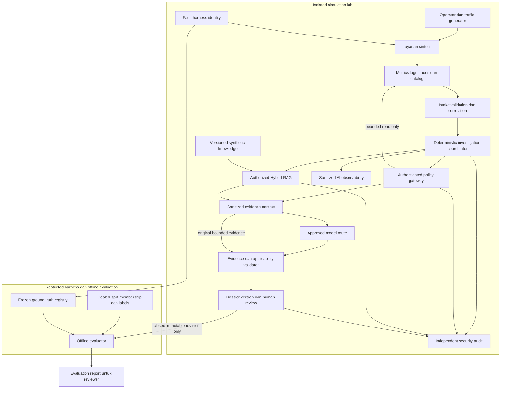

# C02 — Architecture, Contracts, and Evaluation Design

## 1. Chapter Information

| Atribut | Nilai |
|---|---|
| Chapter ID / nama | **C02 — Arsitektur, kontrak, dan desain evaluasi** |
| Phase | **F1 — Foundation** |
| Version | **0.1** |
| Status | **Draft — bersyarat untuk review** |
| Status penulisan | **Documentation Complete**; bukan approval desain/schema/ADR |
| Status pelaksanaan | **NOT STARTED / BLOCKED pada prerequisite G0 yang belum terverifikasi** |
| Dependencies | C01 beserta paket E01, **G0 PASS**, dan keputusan yang relevan sebelum aktivitas yang bergantung padanya |
| Izin penulisan bersyarat | Pengguna memilih **“Setujui C01; draft C02 bersyarat”** setelah diberi tahu bahwa evidence G0 belum tersedia. |
| Batas izin | C01 diterima sebagai panduan; C02 boleh ditulis lebih dahulu. **Tidak mengesahkan G0, memilih stack, atau mengubah urutan implementasi.** |
| Chapter berikutnya | C03 — Lab, Services, and Synthetic Traffic; tidak dibuat pada iterasi ini |
| Estimated effort | **TBD**; bergantung pada baseline G0, jumlah interface, keputusan stack dan review. Tidak ada estimasi terukur yang dapat dijadikan komitmen. |

### 1.1 Sumber, approval, dan konflik status

Urutan otoritas: instruksi/approval eksplisit → BRD → master → proposal → chapter sebelumnya yang disetujui.

- [BRD v1.0](../../../BRD_AI_Agentic_SRE_RAG_Simulation_PoC_v1.0.md): §4, §8–9, §11–16, §17–24 dan Appendix A/B.
- [Master roadmap](../00-IMPLEMENTATION-MASTER-ROADMAP.md): C02 di §6, decisions §3, coverage §7–8, evidence §9.
- [Proposal v2.0](../../../Proposal_AI_Agentic_SRE_RAG_Investigation_Engine_Revisi_2.0-2.docx): Bab 3–11, Bab 12, Lampiran A/B.
- [C01 — Scope, keputusan, dan G0](01-SCOPE-DECISIONS-AND-G0.md): **seluruh chapter dibaca**, khususnya artifact contracts §7, DoD §12 dan handover §13.

**Inventory saat penulisan:** belum tersedia directory evidence C01, G0 record, ADR, atau `AGENTS.md`. Acceptance matrix berada di master, bukan file terpisah. C01 masih bertuliskan Draft/NOT STARTED di file, tetapi penerimaan **dokumennya** dikonfirmasi pengguna pada percakapan ini. C01, master, BRD dan proposal **tidak diubah** untuk menyamakan label.

**Conflict/disposition C02-AUTH-01:** master/C01 mensyaratkan G0 sebelum C02, sedangkan permintaan pengguna adalah melanjutkan dokumentasi. Dampaknya: tidak boleh mengklaim baseline implementasi telah siap. Penyelesaian yang disetujui pengguna adalah **pengecualian urutan authoring saja**. Seluruh readiness implementasi tetap wajib diperiksa pada Step 01; tanpa G0 PASS, jangan menjalankan langkah pembuatan artifact/contract baseline.

### 1.2 Provenance dan status rancangan

- `[P §x]`, `[P A]`: proposal dan acceptance tests aslinya.
- `[B ID/§x]`: BRD; `[M C02/§x]`: master; `[C01 §x]`: chapter sebelumnya.
- `[S-C02]`: elaborasi desain/playbook. **Semua nama field tambahan, enum, endpoint kandidat, JSON Schema, fixture dan konvensi versi pada chapter ini merupakan usulan** sampai disahkan melalui decision record terkait.
- `D-C02-*`: keputusan detail kontrak dalam chapter ini; tidak mengganti TBD/ADR master. Daftar di §14.
- Nilai `TBD` adalah blocker keputusan, bukan literal konfigurasi produksi/lab yang boleh dijalankan. Contoh numerik diberi label **TEST-ONLY**, bukan default runtime.

### 1.3 Related requirements dan acceptance references

Fokus langsung: BR-004/006/007/008/009/010/016; FR-SIM-001/002/004/005; FR-OBS-001–007; FR-RAG-001–009; FR-AGT-001–010; FR-OUT-001–005; RULE-001–012; NFR-001–006/011/012/014/015/016/017/019/020. NFR-007/008/010/013/018 dan FR-OUT-006 dicakup pada desain measurement/observability, bukan klaim performa; FR-OUT-007 tetap conditional. C02 mendefinisikan kontrak dan metode validasinya; pembangunan runtime tetap milik chapter pada master.

Rujukan utama master untuk C02: **AT-005, AT-008, AT-014, SEC-01, SEC-02, SEC-03**. Rujukan pendukung ada di §9. Pemeriksaan baru menggunakan namespace **C02-CON-001–C02-CON-014**, khusus desain/contract qualification; bukan penggantian acceptance test runtime.

## 2. Objective & Expected Outcome

**Yang dibangun saat playbook C02 kelak dilaksanakan:** baseline arsitektur dan paket interface contracts yang cukup rinci untuk membangun producer dan consumer tanpa menebak field, trust boundary, state transition, atau metode evaluasi.

Output yang diharapkan:

1. Context/data-flow diagram, component responsibility, identity/access matrix, network/storage boundary dan initial threat model.
2. Source registry dan schema manifest versi: service/catalog, telemetry, alert, bounded tools, KB/retrieval, workflow, dossier/review, audit dan offline evaluation.
3. Positive/negative **synthetic contract examples**, terpisah dari ground truth/holdout nyata.
4. Protokol evaluasi dengan manifest/split design, no-leakage rules, rubric, denominator dan keputusan G1 yang masih terbuka.
5. ADR candidates dan keputusan minimum untuk C03/C05; rencana capability spike orkestrasi yang baru dieksekusi di C08.
6. Contract validation report, traceability matrix, baseline hashes dan handover ke C03.

**Bukan output C02:** services yang menyala, authenticated gateway yang sudah terpasang, data incident nyata, indeks KB berjalan, model reasoning, atau nilai KPI. Pelaksanaan C02 menyelesaikan desain/schema; G1 tetap membutuhkan bukti runtime dari C03–C08.

## 3. Scope & Boundaries

### 3.1 In scope

- Mengubah kebutuhan menjadi kontrak terikat: siapa memproduksi/membaca, field wajib, tipe, semantik, error, authorization, deadline, retry/idempotency dan evidence.
- Menentukan **logical interfaces** sebelum binding HTTP/MCP/library/backend disahkan.
- Menentukan current/obsolete document handling, missing-data semantics, scope filtering, claim provenance, review versioning dan isolation evaluasi.
- Menyiapkan schema qualification dan adversarial contract cases yang bisa dijalankan secara offline setelah tool validator disetujui/tersedia.
- Mencatat pilihan arsitektur dan impacts; tidak mengambil keputusan teknologi diam-diam.

### 3.2 Out of scope

Instalasi dependency, deployment, provisioning, model download/inference, external API call, ingest dataset, fault/traffic execution, runtime ACL tests, tuning prompt, atau formal holdout benchmark. Saat **penulisan** ini, hanya file chapter dibuat; schema/config/test files di bawah merupakan deliverable **mendatang**.

### 3.3 Prinsip yang dipertahankan dari C01

- Synthetic-only, isolated lab, tidak ada sistem bank atau credential perusahaan.
- Investigator tidak memiliki write/restart/deploy/shell/SQL/arbitrary query tool. Harness fault terpisah mempunyai hak terbatas pada layanan dummy.
- GT/labels/holdout membership tidak tersedia bagi runtime agent, RAG, model, tool adapter, AI trace atau demo package umum.
- Missing ≠ zero; runbook ≠ telemetry; temporal correlation ≠ proven causality.
- Status investigasi `SUPPORTED`, `PARTIAL`, `INCONCLUSIVE`; `VERIFIED` tidak dipakai tanpa aturan SME yang disahkan.
- Human review bukan izin agent melakukan remediasi. Feedback tidak otomatis menjadi SOP approved.
- Langfuse/equivalent bukan satu-satunya audit record. Tidak meminta atau menyimpan hidden chain-of-thought.
- Platform eksternal hanya pendukung; business logic, contracts, adapters, evaluation dan kontrol investigasi dibangun sendiri.

### 3.4 Keputusan yang tetap terbuka

Runtime/bahasa, jumlah/nama service, telemetry backend, queue/store, transport MCP, IAM lab/encryption, retrieval engine, embedding/LLM, UI, quota/deadline dan retention belum dipilih pada dokumen ini. Contoh `svc-a → svc-b → svc-c` menggambarkan ≥3 layanan dan ≥2 dependencies; **bukan keputusan topology final** atau pengganti auth/queue scenarios.

## 4. Prerequisites & Readiness Checklist

### 4.1 Readiness penulisan — sudah dipenuhi

- [x] Master disetujui dan C01 dibaca penuh.
- [x] Pengguna menerima panduan C01 dan mengizinkan **draft C02 bersyarat**.
- [x] Batas pengecualian authoring dicatat tanpa mengklaim G0 PASS.
- [x] Tidak ditemukan ADR/aturan repository tambahan yang harus ditimpa.

### 4.2 Readiness pelaksanaan — belum terbukti

| Checklist | Pemeriksaan | Jika belum terpenuhi |
|---|---|---|
| [ ] G0 benar-benar PASS | Baca `g0-record.md`, authority/date, source hashes dan C01-GOV results; jangan hanya mencari teks PASS | **BLOCKED**, bukan auto-approval dari percakapan authoring |
| [ ] E01 lengkap | Cocokkan mandatory artifacts C01 §11, terutama scope/requirements/ownership/lab/data/model/budget/measurement/decisions/handover | Kembali melengkapi C01; jangan menulis jawaban rekaan |
| [ ] Baseline service/fault disetujui | Scope mendukung semua Must/Should yang dipertahankan, ≥3 linked services | ADR service design belum dapat ditutup |
| [ ] Resource dan model/egress constraints tersedia | Lab allocation, approved route, license/retention constraints | Tidak memilih stack/provider berdasarkan asumsi |
| [ ] Owner kontrak dan approver diketahui | Ownership matrix dan authorized decision refs | Contract baseline tetap DRAFT |
| [ ] Lokasi evidence dan restricted evaluator workspace disetujui | Allowed sinks, shared-folder/cloud-sync implications, akses pembaca | Jangan menyimpan label/GT di root repository sebagai jalan pintas |
| [ ] Validator/tooling lokal disetujui | D-C02-06: validator yang mendukung dialect dan format checking; versi dicatat | Automated qualification BLOCKED; syntax check tidak menggantikannya |
| [ ] Chapter ini disetujui untuk pelaksanaan | Approval pengguna atas versi panduan | Draft bukan izin menjalankan semua perintah |

**Yang tidak diwajibkan sebelum C02:** service berjalan, telemetry backend hidup, auth gateway terpasang, Dify telah terbukti, atau benchmark retrieval. Itu output chapter berikutnya; mewajibkannya sekarang menciptakan dependency terbalik.

## 5. Architecture & Data Flow

### 5.1 Arsitektur logis — vendor-neutral

Diagram mempertahankan batas master. Node adalah tanggung jawab, bukan produk/host yang telah dipilih.



Tidak ada panah evaluator/GT kembali ke runtime. Model tidak memiliki direct backend credentials. Implementasi single-process pun harus mempunyai enforcement nyata yang mencegah code path/runtime identity mengakses GT; pemisahan folder saja tidak cukup.

### 5.2 Responsibility dan interface ownership

| Komponen | Dibangun sendiri / platform pendukung | Producer → consumer utama | Chapter implementasi |
|---|---|---|---|
| Service + traffic/fault harness | Self-built; runtime/container sesuai ADR | Synthetic request/fault → observable signals; labels hanya restricted registry | C03/C04 |
| Telemetry/catalog | Instrumentation dan mapping self-built; OTel/backend kandidat | Service signals → typed queryable observations | C05 |
| Intake/correlation | Self-built | Authenticated alert → normalized incident context | C10 |
| Tool gateway/adapters | Policy/contracts/adapters self-built; MCP transport bila dipilih | Bounded tool request → sanitized evidence envelope | C08/C09 |
| KB/RAG | Ingestion, filters/fusion/lifecycle/eval self-built; search engine kandidat | Approved synthetic docs → authorized cited context | C06/C07 |
| Coordinator/investigator | State/control logic self-built; workflow/model integration kandidat | Incident/evidence → hypotheses, validation, dossier | C11–C14 |
| Review/audit/AI observability | Review/audit glue self-built; Langfuse/equivalent kandidat | Versioned dossier → human decision + traceable audit | C12/C15/C16 |
| Offline evaluator | Self-built, identity terpisah | Closed dossier + protected labels → scores/report | C17–C21 |

### 5.3 Trust decisions yang wajib nyata nanti

Authorization terjadi **sebelum dispatch/query/context assembly**, bukan setelah dokumen forbidden sudah dikirim ke model/reranker/log. Sanitization dilakukan sebelum embedding/model/AI tracing/export. Credential, identity groups, allowed scope dan limits diturunkan oleh server dari authenticated context; bukan dipercaya dari argumen yang dibuat LLM.

## 6. Detailed Step-by-Step Implementation

### 6.0 Konvensi dan batas eksekusi

**Semua langkah di bawah adalah playbook pelaksanaan mendatang setelah G0 PASS.** Izin draft bersyarat tidak menjalankan langkah ini. File selain chapter belum dibuat.

Jalankan command pelaksanaan dari **root repository dalam satu sesi Bash** agar relative paths dan variabel E01/E02 konsisten. Tidak ada command di playbook yang dijalankan otomatis oleh persetujuan draft.

- E01 = `evidence/<run_id-C01>/C01/`, sesuai C01; jangan menggantinya dengan folder contoh yang kosong.
- E02 = `evidence/<run_id-C02>/C02/`, berisi desain tersanitasi, bukan label/GT.
- `contracts/`, `examples/`, `plans/` di E02 adalah usulan organisasi artifact `[S-C02]`; runtime repo layout ditetapkan melalui ADR-S01, bukan otomatis memakai E02 sebagai source aplikasi.
- `RESTRICTED_EVAL_ROOT` adalah lokasi yang **ditentukan dan diotorisasi**, terpisah dari seluruh runtime/KB/AI sinks. Jangan membuat contoh path rahasia atau menganggap subfolder repository sudah terisolasi.
- Perintah memakai Bash dan, untuk contoh validasi JSON, Python 3 sebagai **tool dokumentasi**, bukan keputusan bahasa service. Tidak ada instruksi install otomatis. Jika tool tidak tersedia, catat BLOCKED untuk pemeriksaan yang membutuhkannya.
- Setiap “Expected Result” adalah kondisi yang harus dibuktikan kelak; bukan hasil eksekusi yang telah terjadi.

### Step 01 — Validasi handover C01 dan bekukan input C02

**Objective:** memastikan kontrak diturunkan dari baseline yang disahkan, bukan dari contoh/TBD C01.

**Why:** jumlah service, data egress, budget dan authority memengaruhi desain. Kontrak tidak boleh disahkan bila prerequisite G0 belum tersedia.

**Prerequisites:** E01 aktual, G0 PASS, izin pelaksanaan chapter dan lokasi evidence lokal.

**Actions:**
1. Temukan run E01 yang diterima; baca seluruh mandatory artifacts, validation results dan handover. Periksa G0 authority, date dan source version.
2. Catat discrepancy: template NOT_RUN, unresolved G0 decision, source mismatch, atau missing review. Berhenti jika ada blocker.
3. Setelah review manusia PASS, buat E02 baru tanpa overwrite. Salin **referensi/hash** ke E01, bukan credential/admin data atau GT.
4. Tulis `readiness-assessment.md` dan `source-register.md` dengan source precedence, izin authoring bersyarat, status G0 aktual, daftar ADR yang tersedia dan batas approval.

**Files & Directories:** E02 `readiness-assessment.md`, `source-register.md`, `source-hashes.sha256`; subdirectory `contracts/`, `examples/`, `plans/` untuk deliverable mendatang.

**Configuration:** `E01` diisi dari evidence nyata; `RUN_ID` unik; `E02` hanya dibuat setelah readiness review.

**Commands:** input path dan pemeriksaan read-only:

```bash
read -r -p 'Path E01 yang telah disahkan: ' E01
export E01
(
  set -eu
  test -n "$E01"
  for name in g0-record.md source-hashes.sha256 source-register.md approval-record.md \
    scope-baseline.md requirements.csv scenario-scope.csv ownership.md lab-readiness.md \
    data-handling.md model-and-license-review.md budget-and-schedule.md \
    measurement-plan.md decision-log.md conflict-log.md validation-results.csv \
    review-findings.md handover-to-c02.md; do
    test -s "$E01/$name" || { printf 'BLOCKED: missing %s\n' "$name"; exit 1; }
  done
  shasum -a 256 -c "$E01/source-hashes.sha256"
  printf '%s\n' 'Inventory/hash selesai; G0 authority dan hasil review masih wajib diperiksa manusia.'
)
```

**Hanya setelah hasil pemeriksaan dan G0 authority benar-benar valid**, jalankan:

```bash
RUN_ID="c02-$(date -u +%Y%m%dT%H%M%SZ)"
E02="evidence/$RUN_ID/C02"
export RUN_ID E02
(
  set -eu
  umask 077
  mkdir -p evidence
  mkdir "evidence/$RUN_ID"
  mkdir -p "$E02/contracts" "$E02/examples" "$E02/plans"
  shasum -a 256 \
    BRD_AI_Agentic_SRE_RAG_Simulation_PoC_v1.0.md \
    Proposal_AI_Agentic_SRE_RAG_Investigation_Engine_Revisi_2.0-2.docx \
    docs/roadmap/00-IMPLEMENTATION-MASTER-ROADMAP.md \
    docs/roadmap/01-SCOPE-DECISIONS-AND-G0.md \
    docs/roadmap/02-ARCHITECTURE-CONTRACTS-AND-EVALUATION-DESIGN.md \
    > "$E02/source-hashes.sha256"
)
```

`mkdir "evidence/$RUN_ID"` gagal jika run sudah ada; gunakan run baru, jangan menghapus/menggunakan ulang untuk menutupi failure.

**Expected Result:** satu baseline input diketahui dan E02 terikat kepadanya; tidak ada G0 PASS yang diasumsikan.

**Validation:** C02-CON-001: semua input cocok, authority/evidence valid, critical G0 TBD selesai. Check file/hash saja tidak cukup.

**Common Failures:** E01 tidak ada; G0 masih template; hash berbeda; master approval dianggap G0.

**Troubleshooting:** hentikan pelaksanaan dan selesaikan C01. Draft chapter ini tetap boleh direview sesuai izin pengguna, tanpa membuat artifact seolah-olah implementasi siap.

**Evidence:** readiness assessment, source refs/hash dan review G0. **Lanjut hanya setelah C02-CON-001 PASS.**

### Step 02 — Bentuk component map dan ADR decision plan

**Objective:** menyatakan komponen/tanggung jawab dan keputusan yang harus ditutup tanpa menetapkan vendor lewat contoh diagram.

**Why:** typed contracts harus bertahan jika platform pendukung berubah. Platform dipilih berdasarkan constraints G0 dan kemampuan yang diperlukan, bukan popularitas.

**Prerequisites:** Step 01 PASS; scope/lab/data/budget/owner C01 tersedia.

**Actions:**
1. Turunkan diagram §5 ke topology yang disetujui G0. Daftar producer, consumer, data yang dimiliki, trust zone, state yang persisten dan operational owner.
2. Buat `architecture.md` serta `adr-candidates.md`; pisahkan recommendation, selected option, evidence dan approval status seperti C01.
3. Untuk ADR-S01, bandingkan bahasa/service runtime, reproducible environment, serta kebutuhan persistence/idempotency. Jangan memutuskan workflow engine yang masih menunggu spike C08.
4. Untuk ADR-S02/03, catat pilihan telemetry backend, alert transport, MCP binding, identity/network/encryption; evaluasi kemampuan query/filter/audit dan batas resource, bukan mengklaim benchmark yang belum dijalankan.
5. Rencanakan keputusan minimum sebelum C03/C05 dan proof-of-capability C08. Lengkapi desain kontrak pada Steps 03–10 sebelum review keputusan akhir Step 12.

**Files & Directories:** E02 `architecture.md`, `adr-candidates.md`, `component-interfaces.csv`.

**Configuration:** ADR-S01/02/03; TBD-05/06 tetap pada tenggat master; D-C02-* untuk detail kontrak. Semua pilihan belum disahkan tetap OPEN/PROPOSED.

**Commands:**

```bash
test -s "$E02/architecture.md" && test -s "$E02/adr-candidates.md"
```

Ini hanya inventory. Gunakan matriks keputusan berikut untuk content review, bukan hasil perintah sebagai approval:

| Decision | Options yang perlu dibandingkan | Kriteria | Batas keputusan |
|---|---|---|---|
| Service/runtime | Stack yang dikuasai dan tersedia; container/equivalent | Resource, OTel, API tests, reproducibility, license | Bagian yang diperlukan C03 disahkan sebelum C03 |
| Telemetry | Kandidat metrics/logs/traces sesuai BRD | Typed query support, units, retention, cardinality, resource | Pilihan yang diperlukan C05 diselesaikan pada baseline C02 |
| Workflow | Dify-first; external coordinator/LangGraph jika perlu | Persistence, cancel/replay/idempotency, policy outside prompt | **Rencana** spike C02; execution/selection evidence C08 |
| Hybrid retrieval | Qdrant+BM25 engine / Qdrant-native hybrid | ACL/lifecycle/filter parity, relevance, latency, resource | Before C07, G1 confirmation; tidak dikunci oleh C02 |

**Expected Result:** setiap interface dan keputusan mempunyai owner dan required-by; desain tidak bergantung keputusan final dari chapter masa depan untuk sekadar didefinisikan.

**Validation:** C02-CON-002: component map mendukung seluruh scope G0; tidak ada hidden write/GT access atau platform selection tanpa decision ref.

**Common Failures:** diagram vendor diperlakukan deployment approved; “custom coordinator” dianggap harus dibangun sebelum capability spike; semua backend proposal diwajibkan sekaligus.

**Troubleshooting:** kembalikan pilihan menjadi candidate; pisahkan contract requirement dari product binding; eskalasikan perubahan scope ke owner.

**Evidence:** component map dan decision plan. **Lanjut setelah responsibility/decision ownership jelas; approval akhir dilakukan Step 12.**

### Step 03 — Definisikan identity, trust boundary dan threat model

**Objective:** menerjemahkan read-only dan GT isolation menjadi kontrol yang punya enforcement point.

**Why:** prompt instruction dan folder naming tidak membatasi credential/network/file access.

**Prerequisites:** component map Step 02; data-handling/authority C01.

**Actions:**
1. Buat identity matrix berdasarkan §7.2: investigator, intake, gateway/adapters, KB ingestion, reviewer, fault harness dan evaluator. Satu identity tidak otomatis mewarisi privilege identity lain.
2. Daftar jalur network/storage/mount yang diizinkan dan dilarang; investigator tidak bisa membaca evaluator workspace ataupun memanggil harness endpoint.
3. Tetapkan server-side scope binding: user/service/environment/group entitlement, per-incident quota, raw-to-sanitized boundary dan sink ownership.
4. Modelkan prompt injection, cross-service/env request, data/secret leakage, GT leakage, arbitrary query, stale SOP, query surge, audit loss dan supply-chain risk.
5. Untuk setiap ancaman, tulis prevention, detection, fail behavior, test fixture, build owner dan evidence. Pisahkan enforcement gateway C08 dari policy output validator C14.

**Files & Directories:** E02 `trust-boundaries.md`, `identity-access.csv`, `source-registry.csv`, `threat-model.md`.

**Configuration:** ADR-S03 menentukan auth/transport/TLS/encryption/storage boundary; retention dari C01. Nilai atau mekanisme yang belum disetujui tetap blocker deployment, bukan fallback insecure.

**Commands:**

```bash
test -s "$E02/identity-access.csv" && test -s "$E02/threat-model.md"
```

**Expected Result:** setiap read/write/data egress mempunyai principal, scope, enforcement point dan negative test; label/secret tidak menyeberang ke model.

**Validation:** C02-CON-003: tabletop request investigator→GT, investigator→harness, A→restricted B, forged groups, serta raw fixture→model harus ditolak di titik yang jelas sebelum dispatch/sink.

**Common Failures:** shared administrator credential; evaluator mount ada di container agent; sanitizer dianggap hanya urusan AI tracing; unauthorized content dikirim dulu baru difilter.

**Troubleshooting:** perbaiki trust map dan credential/storage/network design; jangan mengandalkan prompt atau menyatakan synthetic-only sebagai alasan mengizinkan leak.

**Evidence:** access matrix dan threat review termasuk explicit deny paths. **Lanjut jika semua critical boundaries punya enforcement owner.**

### Step 04 — Tetapkan canonical fields, waktu, versi, dan schema registry

**Objective:** memberi semua producer/consumer kamus yang sama dan aturan compatibilitas yang dapat diuji.

**Why:** beda `service.name`/`service_id`, metric unit, observation time, atau status enum akan merusak korelasi meskipun JSON valid.

**Prerequisites:** Steps 02–03; source contracts proposal/BRD tersedia.

**Actions:**
1. Tulis `contract-conventions.md` dari §7.1: canonical identifiers, time semantics, units, versions, missing/empty dan source/reference rules.
2. Selesaikan naming differences melalui D-C02-01/02, bukan menerima alias tak terbatas. Rekomendasi: `service_id` sebagai catalog key; `service.name` sebagai telemetry attribute yang dipetakan eksplisit.
3. Buat `schema-manifest.csv`: logical contract, version, schema file/ID, producer, consumer, classification, owner, decision status dan tests.
4. Tetapkan JSON Schema dialect/tooling kandidat melalui D-C02-06; dokumentasikan pemeriksaan yang harus dilakukan semantic validator karena tidak dapat dinyatakan oleh schema dasar.
5. Rancang breaking-change policy, migration ownership dan startup rejection untuk versi tidak kompatibel. Jangan menyediakan silent fallback ke schema lama.

**Files & Directories:** E02 `contract-conventions.md`, `schema-manifest.csv`, `contracts/` untuk schema yang dibuat pada langkah terkait.

**Configuration:** D-C02-01/02/03/06. `schema_version` dibedakan dari `workflow_version`, `policy_version`, `document_version` dan dossier revision.

**Commands:** periksa artifact yang dihasilkan pada langkah ini, tanpa bergantung pada schema Step 06:

```bash
test -s "$E02/contract-conventions.md" \
  && test -s "$E02/schema-manifest.csv"
```

Perintah hanya memeriksa keberadaan artifact. Content review C02-CON-004 memeriksa semantik dan producer/consumer mapping; syntax/schema qualification dilakukan setelah schema terkait dibuat, pada Step 11.

**Expected Result:** setiap field punya makna/owner, versi tidak tercampur, keputusan naming/time eksplisit.

**Validation:** C02-CON-004: telusuri satu service ID, incident ID, timestamp dan source_ref dari produsen ke dossier; tidak ada mapping ambigu atau model-generated correlation ID.

**Common Failures:** timestamp pengambilan dianggap waktu kejadian; document version dianggap schema version; null dipakai sebagai nol; normalisasi nama service membocorkan scope lain.

**Troubleshooting:** definisikan mapping/canonicalization sekali; tolak versi/identity ambigu; masukkan keputusan yang belum selesai ke decision register sebelum freeze.

**Evidence:** approved conventions dan draft manifest. **Lanjut setelah semantics konsisten; schema instance checks belum diklaim PASS.**

### Step 05 — Rancang service, catalog, telemetry, dan alert contracts

**Objective:** memastikan layanan C03 menghasilkan data yang bisa dikoleksi C05 dan diinvestigasi C09/C10.

**Why:** log/trace correlation tidak boleh diciptakan belakangan oleh model; alert harus membawa identitas/waktu yang cukup tanpa membawa jawaban fault.

**Prerequisites:** canonical conventions Step 04; topology/scope G0; identity boundary Step 03.

**Actions:**
1. Definisikan API request chain dan service catalog dari §7.3. Rekomendasi health/readiness endpoints diidentifikasi sebagai kandidat ADR, bukan endpoint yang sudah berjalan.
2. Definisikan required log fields, RED metrics/unit, span summaries serta build/environment/instance identity. Gunakan OTel context propagation sesuai ADR.
3. Tentukan dependency edge provenance/freshness; catalog-declared dan trace-observed edges tidak dianggap identik tanpa atribut sumber.
4. Definisikan alert envelope, auth/signature handling, fingerprint input, time normalization, catalog mapping dan ambiguous-service failure. Semua signature diperiksa atas raw request sebelum canonicalization.
5. Buat positive/negative contract examples; negative mencakup invalid timestamp, unknown service, missing trace, duplicate alert dan dua independent alerts. Jangan menjalankan traffic/fault.

**Files & Directories:** future E02 `contracts/service-catalog.v1.schema.json`, `telemetry-log.v1.schema.json`, `alert-event.v1.schema.json`, `dependency-edge.v1.schema.json`; `service-api-design.md`; examples tersanitasi.

**Configuration:** ADR-S01/02; D-C02-01/02. Service name, binding endpoints, unit conversion, signature mechanism dan correlation TTL harus ditutup pada deadline masing-masing.

**Commands:** syntax-only setelah artifact dibuat:

```bash
python3 -m json.tool "$E02/contracts/alert-event.v1.schema.json"
python3 -m json.tool "$E02/examples/alert-valid.json"
```

**Expected Result:** request→log/metric/span→alert dapat ditelusuri pada tingkat kontrak; sample label/fault type tidak disisipkan sebagai telemetry “hint”.

**Validation:** C02-CON-005: schema examples dan semantic review menunjukkan service/env/time/trace mapping konsisten; duplicate key deterministik dan unknown service tidak menyebabkan broad query.

**Common Failures:** IDs dibuat LLM; all 401 dianggap outage; graph stale dianggap current; alert memuat `scenario_id`/expected root cause; timestamp tanpa offset.

**Troubleshooting:** perbaiki producer contract; gunakan catalog/time conversion; unknown source/service menjadi manual triage, bukan fabricated mapping.

**Evidence:** telemetry/event schemas, example cases, propagation/normalization review. **Lanjut setelah produsen C03 dan konsumen C05/C10 memahami kontrak yang sama.**

### Step 06 — Rancang bounded read-only tools dan policy envelope

**Objective:** mendefinisikan interface yang tidak dapat diperluas menjadi arbitrary backend query oleh model.

**Why:** nama tool “read-only” tidak cukup jika menerima query bebas, scope yang dipalsukan atau hasil tanpa batas.

**Prerequisites:** identity, catalog/telemetry semantics dan schema conventions Steps 03–05.

**Actions:**
1. Tulis input/output contracts empat tool wajib di §7.4; `get_apm_health` hanya jika sumber/scope disetujui. Jangan membuat fake APM result.
2. Pisahkan model-visible arguments dari trusted auth/incident context. Runtime server mengisi identity, groups, allowed services/environments dan policy limits.
3. Definisikan validation order, parameterized backend query, window/depth/count caps, deadline/quota, response size, redaction, error dan audit.
4. Bedakan `available-empty`, `partial/truncated`, `source_unavailable` dan rejected request. Over-limit **window ditolak** sesuai MCP-02, bukan silently clamped.
5. Tulis metrics-request schema contoh §7.4 dan negative cases. Lengkapi response schema dan tool input schemas lain menggunakan field tables sebelum baseline disahkan.

**Files & Directories:** E02 `contracts/metrics-request.v1.schema.json`, `logs-request.v1.schema.json`, `trace-request.v1.schema.json`, `dependencies-request.v1.schema.json`, `tool-result.v1.schema.json`; `tool-policy-design.md`; `examples/schema-cases.json`, `examples/policy-cases.csv`.

**Configuration:** ADR-S03 transport/auth, ADR-S05 limits/deadlines, D-C02-03 errors. Numeric TEST-ONLY profile §7.4 bukan production/lab runtime default.

**Commands:**

```bash
python3 -m json.tool "$E02/contracts/metrics-request.v1.schema.json"
python3 -m json.tool "$E02/examples/schema-cases.json"
```

Tidak ada `curl`, PromQL/SQL/shell tool execution, atau backend call pada C02.

**Expected Result:** setiap tool mempunyai input allowlist, trusted scope, output provenance dan fail behavior. No-source tidak berubah menjadi angka nol atau trace palsu.

**Validation:** C02-CON-006 dan 007: schema-level negatives serta manual semantic policy cases mempunyai alasan reject/partial yang deterministik; live enforcement baru diuji C08/C09.

**Common Failures:** schema menerima `query` bebas; groups disuplai model; `sanitized=true` dipercaya dari tool/model tanpa enforcement; raw exception berisi credential; timeout tetap mencoba query baru.

**Troubleshooting:** keluarkan privilege fields dari model schema; fail closed sebelum dispatch; sanitize error body; pisahkan schema validation dari semantic authorization/window check.

**Evidence:** tool schema catalog, policy decision order, boundary cases dan expected errors. **Lanjut setelah semua exposed tool dirancang lengkap dan tidak ada generic execution path.**

### Step 07 — Rancang knowledge lifecycle dan retrieval contract

**Objective:** menjaga relevansi, versi, applicability dan authorization konsisten di lexical, dense, fusion, reranker dan context builder.

**Why:** retrieval yang relevan secara semantik tetap salah jika service/ACL/versi tidak sesuai atau dokumen lama dianggap kebijakan aktif.

**Prerequisites:** canonical IDs, entitlement context, source registry dan data-handling policy.

**Actions:**
1. Definisikan metadata minimum §7.5 termasuk owner/classification/groups/effective window/hash/provenance; tentukan pending naming decisions untuk `document_id` versus output `doc_id`.
2. Definisikan ingestion/publish/update/delete/tombstone/cache invalidation dan rebuild/index version contract. Tanpa atomic cross-index publish, rancang version fence yang menolak mixed releases.
3. Definisikan authorized retrieval request/result, ranking mode, filters, dedup key dan citation resolver. Scope diterapkan sebelum content menuju model/reranker/log; unauthorized content tidak masuk cache shared.
4. Bedakan approved-current, historically applicable, obsolete/draft dan withdrawn; incident-time applicability serta status publication harus jelas. Riwayat retained bukan berarti boleh dikutip sebagai current.
5. Buat kasus same error code different service/env, stale outranks current, deleted doc cached, no-match, unavailable backend dan no approved version.

**Files & Directories:** E02 `contracts/knowledge-chunk.v1.schema.json`, `retrieval-request.v1.schema.json`, `retrieval-result.v1.schema.json`; `knowledge-lifecycle.md`; examples/relevance oracle desain.

**Configuration:** TBD-06 dan ADR-S04 tetap parameter/engine candidates; `document_version`/`index_version` berbeda. Applicability/naming detail D-C02-01/04 harus disahkan sebelum implementasi konsumennya.

**Commands:**

```bash
python3 -m json.tool "$E02/contracts/knowledge-chunk.v1.schema.json"
python3 -m json.tool "$E02/contracts/retrieval-result.v1.schema.json"
```

**Expected Result:** satu kontrak berlaku pada semua mode retrieval; citation punya document/version/section/URI; no-match tidak menghasilkan SOP rekaan.

**Validation:** C02-CON-008: tabletop query scoped A tidak menghasilkan B pada semua jalur, stale/deleted tidak aktif melalui cache, dan missing result mempunyai reason; bukan skor Recall@5 nyata.

**Common Failures:** hanya dense branch difilter; reranker melihat dokumen forbidden; dedup membuang section penting; update satu index menghasilkan campuran versi; source_uri menjadi arbitrary fetch URL.

**Troubleshooting:** centralize filter contract, version-fence reads, resolve references melalui authorized source registry; jangan menggabungkan score mentah tanpa aturan fusion yang disetujui.

**Evidence:** metadata/lifecycle/retrieval specs dan adversarial document cases. **Lanjut setelah authorization dan lifecycle tidak bergantung jenis search engine.**

### Step 08 — Rancang workflow, dossier, review, dan audit

**Objective:** mengikat state, claim evidence, uncertainty dan keputusan manusia ke versi yang dapat diaudit.

**Why:** workflow dapat tampak sukses sambil menggandakan dossier, kehilangan audit, atau mengesahkan recommendation yang sudah berubah.

**Prerequisites:** Steps 04–07; controlled workflow dan output requirements proposal/BRD.

**Actions:**
1. Definisikan state transitions §7.6, allowed producer, persisted output, failure/cancel branch dan terminal outcome. Jangan menjadikan LLM pemilik transisi/hak akses.
2. Definisikan evidence/claim links, temporal checks, missing/contradicting evidence, confidence/status dan SOP applicability recheck.
3. Definisikan dossier JSON dan rendering human-readable dari satu source of truth. Review menargetkan **exact dossier version/hash**, bukan hanya incident ID.
4. Definisikan immutable audit envelope, independent sink, sanitized AI trace projection, metric hooks dan reviewer authorization. Tidak menyimpan hidden chain-of-thought.
5. Definisikan idempotency/retry/cancel, manual fallback, DLQ/kill switch semantics dan CLOSED→offline-eval handoff. Angka retry/timeout tetap ADR-S05.

**Files & Directories:** E02 `workflow-contract.md`, `contracts/workflow-event.v1.schema.json`, `dossier.v1.schema.json`, `review-event.v1.schema.json`, `audit-event.v1.schema.json`; examples failure/review revision.

**Configuration:** workflow/policy/model/prompt/schema/KB versions terpisah; status `SUPPORTED/PARTIAL/INCONCLUSIVE`; VERIFIED disallowed tanpa approval SME.

**Commands:**

```bash
python3 -m json.tool "$E02/contracts/dossier.v1.schema.json"
python3 -m json.tool "$E02/contracts/review-event.v1.schema.json"
```

**Expected Result:** state dan audit dapat direkonstruksi; unsupported/missing evidence terlihat; approval revision lama tidak mengesahkan output baru.

**Validation:** C02-CON-009: replay/cancel/timeout/reviewer stale-version scenarios mempunyai outcome tunggal yang jelas; salah status/schema/claim ref tidak boleh menjadi approved dossier.

**Common Failures:** every error dipaksa melewati HYPOTHESES sebagai sukses; retry menghasilkan dossier ganda; review menimpa evidence; sign-off memicu auto remediation; CLOSED sebelum review outcome tercatat.

**Troubleshooting:** bedakan terminal failure/cancel dari happy-path states; persistenkan idempotency/result refs; tampilkan manual disposition; tolak stale review dan audit perubahan versi.

**Evidence:** transition table, dossier/review/audit contracts dan traceability example. **Lanjut setelah tiap state/error/review mempunyai owner dan observable output.**

### Step 09 — Rancang evaluation manifest, split, dan scenario oracles

**Objective:** menghasilkan protokol yang mengukur kualitas tanpa membuka jawaban ke investigator atau melakukan tuning terhadap holdout.

**Why:** grade yang dihitung dari label bocor atau denominator berubah tidak membuktikan konsep.

**Prerequisites:** measurement plan awal C01; identity boundary; dossier/review closure semantics.

**Actions:**
1. Definisikan public runtime manifest versus restricted evaluation manifest sesuai §7.7. Public manifest tidak memuat scenario label, split membership, expected root cause atau evaluator filesystem path.
2. Definisikan schema restricted scenario registry, label, split assignment dan immutable result. Desain schema boleh direview; **label/assignment aktual tidak disimpan di E02**.
3. Daftar SC-01–SC-14: prerequisites, setup/inject/reset command owner masa depan, seed/repeats, observables, forbidden leakage, oracle dan metric eligibility. C02 tidak menjalankan fault atau menciptakan hasil insiden.
4. Rancang dev/H-G3/H-G4 isolation, freeze/version hashing, anti-overlap by scenario family/seed yang disepakati, reviewer blinding dan closure check sebelum GT join.
5. Definisikan rubric dan semua KPI numerator/denominator/failure handling; ambiguities tetap decision G1. Jangan menjadikan healthy/no-cause case atau abstention sebagai diagnosis benar tanpa aturan explicit.

**Files & Directories:** E02 `plans/evaluation-protocol.md`, `plans/scenario-oracles.csv`, `contracts/runtime-manifest.v1.schema.json`, `evaluation-manifest.v1.schema.json`, `evaluation-result.v1.schema.json`; **desain** restricted registry. Actual label/split files hanya pada approved restricted workspace saat tahap dataset dilaksanakan.

**Configuration:** TBD-08/10, ADR-S08 dan D-C02-05; ukuran 100–200 queries/30–50 replays tetap kandidat, bukan ukuran yang sudah dipilih.

**Commands:**

```bash
python3 -m json.tool "$E02/contracts/runtime-manifest.v1.schema.json"
python3 -m json.tool "$E02/contracts/evaluation-manifest.v1.schema.json"
```

**Expected Result:** runtime-versus-evaluation data projection jelas; reproducibility dimungkinkan tanpa GT exposure; seluruh scenario punya oracle dan build/test owner.

**Validation:** C02-CON-010: tabletop GT join sebelum CLOSED ditolak; public manifest tidak membocorkan split/answers; no-match/timeout/healthy/multi-fault denominator mempunyai keputusan atau deadline G1 yang eksplisit.

**Common Failures:** filename `db-timeout-holdout-01` dikirim sebagai incident ID; label masuk runbook; shared seed/profile mengungkap jawaban; score mengabaikan failed runs; memakai ulang H-G3 yang dituning sebagai blind final.

**Troubleshooting:** gunakan opaque IDs, secret evaluator mapping, explicit exclusions dan separate versioned split; jangan “sanitize” label menjadi clue yang tetap mengungkap jawaban.

**Evidence:** evaluation design, scenario oracles dan leakage review; tidak ada fake metrics. **Lanjut setelah semua data path dan metric decision ownership jelas.**

### Step 10 — Rancang quality checks, operations contracts, dan spike C08

**Objective:** memastikan desain bisa dibuktikan secara bertahap tanpa menuntut runtime chapter masa depan telah tersedia.

**Why:** durability, authentication atau redaction tidak boleh diasumsikan hanya karena platform mempunyai nama fitur serupa.

**Prerequisites:** draft contracts Steps 04–09 dan component/ADR plan Step 02.

**Actions:**
1. Tetapkan contract qualification stages: syntax → schema/meta-schema → examples → semantic/policy oracles → later runtime integration. Coverage yang belum terbukti dilabeli NOT_RUN.
2. Rancang basic CI untuk schema/ref compatibility, sensitive fixture boundary, version manifest dan required evidence. Tidak membuat workflow CI yang berjalan pada iterasi penulisan ini.
3. Definisikan health/readiness/index lag/queue backlog/tool error/token-cost hooks serta retention/delete/backup/rollback responsibilities. Capacity targets tidak ditetapkan tanpa workload/resource profile.
4. Tulis capability spike plan C08 untuk persistence, worker restart, cancel, replay/idempotency, budget/quota, policy denial dan audit correlation. Tuliskan setup, injected failure, expected observation, pass/fail dan evidence yang nanti harus dikumpulkan.
5. Tentukan trigger penggunaan coordinator eksternal/alternatif bila platform gagal; proposal opsi bukan keputusan bahwa platform tertentu pasti lulus/gagal.

**Files & Directories:** E02 `plans/quality-and-ci.md`, `plans/operations-contract.md`, `plans/c08-orchestrator-spike.md`.

**Configuration:** TBD-05, ADR-S05/06; budgets/deadlines/retention wajib punya eventual approved value. Tidak ada angka default yang diam-diam diterapkan dari test profile.

**Commands:**

```bash
test -s "$E02/plans/quality-and-ci.md" \
  && test -s "$E02/plans/c08-orchestrator-spike.md"
```

**Expected Result:** C08 menerima eksperimen executable design, bukan kesimpulan benchmark palsu; quality/security controls mempunyai implementer lebih awal dari consumers.

**Validation:** C02-CON-011: tiap spike case memiliki real observable dan failure criterion; auth/ACL/audit awal dijadwalkan C08, bukan ditunda sampai observability F3.

**Common Failures:** capability dinyatakan lulus dari dokumentasi vendor; CI hanya format check tetapi disebut security verification; Langfuse dijadikan sole audit; audit error diabaikan.

**Troubleshooting:** pisahkan feature claim dari evidence; tambahkan failure cases; kaitkan failure behavior dengan approved retention/audit policy.

**Evidence:** CI/operations plan dan spike checklist. **Lanjut setelah semua capability unknown mempunyai cara pembuktian dan chapter pemilik.**

### Step 11 — Jalankan offline contract qualification dan traceability review

**Objective:** menemukan kontradiksi antarcontract dan contoh invalid sebelum service/runtime dibangun.

**Why:** schema-valid tidak sama dengan authorized, temporally valid atau supported by evidence. Keduanya harus diuji dengan metode berbeda.

**Prerequisites:** Steps 04–10 artifact tersedia; dialect/tooling D-C02-06 disahkan dan validator lokal tersedia; source definitions yang diuji sudah dipilih untuk candidate baseline.

**Actions:**
1. Jalankan syntax/meta-schema validation dan positive/negative instance validation dengan format checking; gunakan contoh prosedur §8.2 hanya jika tool tersebut dipilih dan sudah tersedia.
2. Jalankan manual cross-contract/policy cases §8.3 untuk aturan yang tidak ditangani JSON Schema: time order/caps, authorization, references, stale versions, GT isolation, lifecycle dan evaluator timing.
3. Review semua interfaces mempunyai producer/consumer/owner/error/deadline/retry/auth/enforcement/test mapping. Temukan field tanpa konsumen atau consumer tanpa source.
4. Catat expected/actual/pass/fail/blocker dan defect owner. Jangan menulis hasil PASS runtime SEC/MCP/OPS dari review ini.
5. Perbaiki defect dalam draft artifacts, bump candidate revision bila kontrak berubah, ulang hanya checks terdampak; jangan mengubah contoh agar sekadar cocok dengan bug desain.

**Files & Directories:** E02 `contract-validation-results.csv`, `review-findings.md`, `contract-coverage.csv`; schema/example revisions bila diperlukan.

**Configuration:** format checker aktif; remote `$ref` resolution dilarang; local schema IDs unik; semantic/policy test results dipisahkan dari schema-valid booleans.

**Commands:**

```bash
python3 -c 'from jsonschema import Draft202012Validator; from referencing import Registry; print("Validator imports tersedia; belum berarti semua kontrak valid.")'
```

Jika import gagal, **jangan install atau menandai PASS otomatis**. Catat automated qualification BLOCKED, minta keputusan tooling, dan tetap lakukan review desain yang tidak membutuhkan package. Runner §8.2 adalah contoh lengkap untuk schema cases, bukan app/runtime validator.

**Expected Result:** candidate contracts dan examples konsisten secara schema serta semantic review; failures terbuka dapat ditelusuri.

**Validation:** C02-CON-012/013 serta pemeriksaan C02-CON-003–010 terkait; semua critical contract defects terselesaikan sebelum freeze. Ketiadaan validator tidak boleh digantikan `json.tool` lalu disebut qualification PASS.

**Common Failures:** JSON syntax dianggap schema validation; format checker mati; unresolved `$ref` di-fetch ke network; missing examples menghasilkan zero-test PASS; policy checks tidak dijalankan.

**Troubleshooting:** perbaiki tooling/local references, tambah positive+negative per schema, pisahkan structural dan semantic tests; jangan memakai model untuk menebak hasil test.

**Evidence:** machine validation log tersanitasi, semantic review cases, defects, coverage report. **Lanjut setelah qualification yang diwajibkan dan critical design review PASS.**

### Step 12 — Tutup ADR prerequisite, freeze baseline, dan handover C03

**Objective:** menyerahkan kontrak yang disahkan dan dapat dipakai C03/C05, tanpa menyatakan G1 selesai.

**Why:** candidate schema/architecture belum merupakan interface yang boleh diimplementasikan jika pilihan kritis dan approval belum ditutup.

**Prerequisites:** G0 valid; Step 11 PASS; owner/approver hadir; seluruh keputusan yang diperlukan C03/C05 selesai.

**Actions:**
1. Review ADR-S01 bagian service/runtime/reproducibility dan ADR-S02 pilihan yang diperlukan C05; review trust design/ADR-S03 beserta enforcement milestone C08. Jika keputusan kritis belum dipilih, chapter implementation/design baseline BLOCKED.
2. Sahkan D-C02 naming/time/version/error/schema contracts dan daftar keputusan G1 yang boleh tetap terbuka sesuai master. Jangan menganggap candidate top-K/deadline/provider/framework otomatis terpilih.
3. Finalisasi schema manifest beserta SHA-256, producer/consumer matrix, accepted exceptions non-kritis dan approval refs; simpan prior candidate sebagai history sesuai policy.
4. Tulis `handover-to-c03.md`: selected service/runtime contract, source/baseline references, expected instrumentation, reset/safety requirements, remaining decisions dan chapter owners.
5. Jalankan C02-CON-014, catat design baseline status. C03 hanya mulai setelah prerequisites terpenuhi; C08 tetap harus membuktikan authenticated gateway/ACL/retrieval baseline G1.

**Files & Directories:** E02 `design-approval.md`, `schema-manifest.csv`, `contract-coverage.csv`, `handover-to-c03.md`; ADR decisions berupa artifact yang kelak dibuat setelah approval, bukan file ADR yang dibuat saat authoring ini.

**Configuration:** versioned baseline dengan explicit approval; unauthorized schema changes dilarang; publication path runtime tetap sesuai ADR, bukan E02 otomatis menjadi source code.

**Commands:** setelah seluruh schema final tersedia:

```bash
(
  set -eu
  test -n "$E02"
  test -d "$E02/contracts"
  find "$E02/contracts" -type f -name '*.schema.json' -exec shasum -a 256 {} \; \
    > "$E02/contracts-final.sha256"
  test -s "$E02/contracts-final.sha256"
)
```

Manifest hash bukan approval; check C02-CON-014 tetap manusia/authority-driven. Jangan overwrite baseline yang sudah approved; perbaikan material membuat versi/run baru.

**Expected Result:** baseline desain/kontrak approved, downstream readiness jelas dan G1 masih menunggu runtime evidence.

**Validation:** C02-CON-014: no critical decision open untuk C03/C05, validation evidence lengkap, approval valid, source/schema versions cocok dan handover tidak mengklaim implementasi selesai.

**Common Failures:** semua schema DRAFT tetapi C03 dimulai; role approver tidak nyata; silent rename mengubah producer/consumer; G1 ditandai PASS dari blueprint.

**Troubleshooting:** blok downstream; selesaikan keputusan dengan authority; buat revision/migration plan jika kontrak berubah. Tidak mengedit master/C01 untuk menghapus prerequisite.

**Evidence:** approved baseline dan handover. **Berhenti; pembuatan dokumen C03 tetap memerlukan instruksi/persetujuan pengguna.**

## 7. Integration & Interface Contracts

**Seluruh detail tambahan pada §7 adalah candidate specification `[S-C02]`, bukan kontrak yang telah disahkan.** Ketika C02 dijalankan, pilih/revisi lewat D-C02/ADR, materialisasikan schema files, uji, lalu freeze. Contoh bukan telemetry atau output aplikasi yang pernah berjalan.

### 7.1 Common contract conventions

| Aspek | Usulan kontrak / invariant | Keputusan dan pemeriksaan |
|---|---|---|
| Schema identity | Logical name, major schema version, unique `$id`; manifest menyimpan revision/hash | D-C02-01/06; consumer menolak unsupported major, bukan fallback diam-diam |
| Required/unknown fields | Required fields eksplisit; closed model-controlled input objects dengan `additionalProperties: false` | Evolusi field melalui reviewed version; jangan membuat permissive input untuk kemudahan LLM |
| Identity | `service_id` catalog key; telemetry `service.name` dipetakan satu-ke-satu dalam environment/version context | Mapping ambiguous → manual triage; catalog tidak dikonstruksi oleh model |
| Naming harmonization | Proposal `metric_enum` vs BRD `allowed_metric`: rekomendasi satu canonical input `metric_enum`; wire name disahkan sebelum implementasi | D-C02-01; bukan dua alias permanen. Metadata `document_id/document_version` dipertahankan; output `doc_id/version` perlu explicit mapping atau canonical agreement |
| Timestamps | Rekomendasi canonical RFC 3339 UTC `Z`; event time, capture time, workflow time dibedakan | D-C02-02; timezone-less rejected. Producer adapter boleh normalize valid source offset, sesudah source authentication |
| Query window | Rekomendasi half-open `[start,end)`; `start < end`; allowed window/clock skew dari approved policy | Order/duration perlu semantic validation; `format: date-time` saja tidak cukup |
| Units | Canonical RED: rate `requests/s`, errors `ratio`, latency `ms` sebagai usulan; preserve source unit/conversion metadata | D-C02-02; jangan menghitung 0.25 sebagai 25 requests atau detik sebagai ms |
| Correlation | `incident_id` dari intake; request/trace IDs dari aplikasi/OTel; IDs opaque dan tidak mengandung label fault/split | No model-generated observed IDs; trace ID nonzero 32 hex dan span ID nonzero 16 hex jika mengikuti OTel |
| Missing/empty | Required field unavailable memakai explicit null+reason atau status sesuai schema; available empty records bukan otomatis metric=0 | `value=0` hanya jika source benar-benar mengukur nol |
| Provenance | `source_ref` opaque registered reference; `query_window`, `observed_at`, actual measurement time, quality/sampling/truncation | Reference resolver authorization; tidak mengikuti arbitrary URL/path dari LLM |
| Versions | schema/workflow/policy/model/prompt/document/index/dossier versions berbeda | Cache/approval/replay key membawa versi yang relevan; breaking change membutuhkan new baseline |
| Administrative metadata | Owner/approver refs hanya pada administrative/audit channel yang diizinkan | Tidak masuk benchmark corpus atau prompt |

### 7.2 Identity, source registry, dan transport binding

| Principal | Allowed capability | Explicit deny |
|---|---|---|
| Investigator/coordinator runtime | Authenticated bounded tools, authorized retrieval, submit dossier draft | GT/labels, fault control, direct unrestricted backend query, escalation privilege |
| Intake | Validate source/auth, normalize event, create incident context | Reading evaluator labels; accepting model-supplied authenticated identity |
| Tool gateway/adapters | Dispatch approved read queries within trusted scope; sanitize output; audit | Arbitrary PromQL/SQL/shell, backend mutation, reading harness/evaluator store |
| KB ingestion | Read approved synthetic sources, stage/index/publish by authorized owner | Index E01/E02 administrative data, GT/holdout answers, unapproved source |
| Reviewer | Read authorized dossier/evidence, approve/edit/reject exact revision | Rewrite original observations/GT; automatically execute recommendations |
| Fault harness/operator | Inject/reset only lab targets; write restricted GT onset/outcome | Use investigator credential; publish fault-control tool to model |
| Offline evaluator | Read closed immutable result and restricted labels after closure | Feedback answer into active investigation; silently alter frozen holdout |

`source-registry.csv` minimum: `source_id`, `source_type`, `owner_ref`, `environment_scope`, `service_scope`, `classification`, `approved_reader`, `connector_contract`, `freshness_policy_ref`, `retention_policy_ref`, `approval_ref`. Credential **reference**, bila diperlukan, hanya pada authorized secret config; nilai credential tidak di source registry/model context.

**Logical interface/binding proposal:**

| Interface | Contract | Binding status |
|---|---|---|
| Synthetic request chain | Service API request/response and trace propagation | Routes/ports/methods dari ADR-S01, belum ditetapkan. Rekomendasi separate `/health/live` dan `/health/ready`; bukan endpoint yang sudah ada |
| Alert intake | `alert-event` → accepted/rejected receipt + opaque incident association | HTTP webhook/signature atau transport lain ADR-S02; tidak boleh unsigned fallback |
| Bounded tool invocation | Selected tool name + validated input; trusted auth context out-of-band | MCP sesuai rekomendasi proposal; version/transport/auth ADR-S03. Tidak mengarang HTTP route tool server |
| Retrieval | Authorized request → cited bounded result | Function/service binding lewat ADR; ACL semantics sama pada semua mode |
| Dossier/review | Draft revision → authorized human decision tied to hash | UI/API/report interface TBD-11; no direct remediation endpoint |
| Offline evaluation | Closed result reference → authorized delayed label join | Restricted process/identity; bukan tool yang dipublikasikan ke agent |

Dengan cara ini endpoint nyata dipilih saat ADR, bukan diasumsikan `localhost:port` atau layanan yang sudah berjalan.

### 7.3 Service, catalog, signals, alert, dan dependency contracts

#### A. Catalog dan service API

| Contract | Required fields / semantics | Consumer / errors |
|---|---|---|
| Catalog service | `schema_version`, `service_id`, `service.name`, `environment`, `application`, `component`, `instance_id`, `build_version`, `owner_ref`, `dependency_refs`, `updated_at` | C03/C05/C09/C10; unknown/ambiguous ID → `SERVICE_UNMAPPED`, no broader query |
| Synthetic request | Opaque request/correlation ID, operation enum per approved service API, synthetic business fields, propagated trace context | No fault type, scenario_id, expected diagnosis or evaluator labels in request |
| Synthetic response | Outcome/status, bounded synthetic result, originating request ID; errors use typed code | No real payment/customer data; request bodies tidak masuk trace tool output |
| Health/liveness | Process responsive, version label minimum; no secrets/environment dump | Liveness tidak sama readiness dependencies; operational routes dipilih ADR-S01 |
| Readiness | Ability to serve approved contract, required dependencies and reason code if unavailable | Service failure tidak berarti investigator allowed restart |

#### B. Telemetry

| Signal | Required fields | Semantic constraints |
|---|---|---|
| Structured log | `timestamp`, `severity`, `service.name`, `service_id` mapping, `environment`, `instance_id`, `build_version`, `event_type`, `correlation_id`, nullable `trace_id` with reason if absent, sanitized message/error_code | App creates IDs; message untrusted data; severity alone bukan diagnosis; normal auth rejection dibedakan dari service fault |
| RED metric observation | service/env/build scope, `metric_enum`, `value`, `unit`, `sample_at`, aggregation/window, source_ref, quality | Null/unavailable tidak menjadi 0; rate denominator/window diketahui; histogram percentile tidak dijumlahkan antarservice |
| Trace summary | `trace_id`, service/env, validated bounded span summaries: span_id,parent_span_id,service,start/end,duration,status,dependency_ref | No transaction payload/body; root/parent ordering valid; missing backend menghasilkan unavailable, bukan fabricated spans |
| Dependency edge | from/to service+environment+deployment, relation, source kind/ref, `observed_at`, freshness/quality/confidence, error propagation observation jika ada | Declared topology ≠ observed edge; stale graph ditandai; depth/hops dibatasi |

#### C. Alert intake

Candidate required input: `schema_version`, `alert_id`, `source_id`, `service_id`, `environment`, `alert_type`, `severity`, `event_time`, `window_start`, `window_end`, `build_version` bila diketahui, `error_code` nullable, `trace_id` nullable, source reference. Authentication/signature tidak ditaruh sebagai untrusted body field yang dipercaya begitu saja.

Candidate output: receipt identity, `accepted/rejected/manual_triage`, reason_code, incident/correlation identity jika terbentuk, normalization/dedup action, workflow admission result. `incident_id` tidak dipercayai dari sumber asing tanpa verified binding.

Fingerprint ingredients dari proposal: service, environment, error code, alert type dan time bucket; TTL/window adalah ADR-S05. Same fingerprint duplicate ≠ permission untuk menggabungkan dua independent faults. Merge/split mempunyai audit record dan reason.

### 7.4 Tool contracts dan policy order

#### A. Input table

Semua field berikut adalah **model-visible input**; principal/groups/credential/policy scope tidak termasuk di dalamnya.

| Tool | Required input | Policy restrictions |
|---|---|---|
| `get_service_metrics` | service_id, environment, metric_enum, start, end, max_points | Metric allowlist; no arbitrary PromQL; time/size caps; quota/deadline; per-service authorization |
| `search_error_logs` | service_id, environment, start, end, error_code sesuai allowed grammar atau null bila query template mengizinkan, max_hits | Parameterized query; no query string/script; redact messages; bounded result bytes/hits |
| `get_trace_summary` | trace_id, service_id, environment, start, end | Nonzero validated trace ID; service ownership checked; allowed span fields; span/byte cap from policy |
| `get_service_dependencies` | service_id, environment, reference_time, max_depth | Max hops/depth; edge freshness/provenance; no topology read outside scope |
| `get_apm_health` — conditional | service_id, environment, start/end atau bounded timeframe mapping, signal_enum | Hanya jika mock APM source disetujui/tersedia; contract ADR sebelum dipublikasikan |

Tambahan `environment` dan normalisasi `max_depth` merupakan **usulan harmonisasi** agar scope selalu eksplisit; proposal memakai beberapa nama contoh berbeda. Sahkan D-C02-01; adapter boleh memetakan backend field, tetapi tidak membiarkan model memilih alias untuk melewati policy.

#### B. Enforcement order

1. Authenticate caller; bind trusted principal/incident context. Invalid identity tidak boleh mencapai backend.
2. Resolve allowed tool/version; reject unregistered/write/generic execution request.
3. Validate schema/types/unknown fields/IDs dan normalized timestamp format.
4. Authorize service/environment/data entitlement berdasarkan trusted identity; body-provided groups tidak dipercaya.
5. Enforce semantic constraints: start<end, window cap, metric/signal enum, count/depth/byte limits, incident quota dan remaining deadline. Over-limit window → reject.
6. Construct parameterized read query; dispatch hanya ke approved backend endpoint. Tidak ada dynamic query interpolation dari model.
7. Validate/sanitize returned data; fail closed bila redaction gagal. Enforce response cap; laporkan sampling/truncation, jangan diam-diam memotong.
8. Persist independent audit with safe metadata; return typed envelope. AI trace hanya menerima sanitized projection sesuai policy.

Jika audit gagal, outcome mengikuti approved audit policy; **tidak boleh silent success tanpa trace yang dapat diperiksa**. Nilai timeout/retries dan sink buffering belum dipilih.

#### C. Response envelope

| Field | Type / required semantics |
|---|---|
| `schema_version`, `tool_name`, `request_id` | Strings; versioned contract dan request identity yang dibuat control plane |
| `status` | Candidate enum `ok`, `partial`, `unavailable`, `rejected`; berbeda dari investigation status |
| `source_ref` | Opaque authorized query/result ref; null jika request ditolak sebelum query atau tidak ada source record |
| `observed_at` | Waktu envelope capture; bukan otomatis timestamp tiap measurement |
| `query_window` | Object start/end canonical; tetap merekam window yang diminta/diotorisasi |
| `sampling` | Applied flag, method nullable, returned_count, source_count nullable; unknown total dinyatakan unknown |
| `truncated` | Boolean; jika true harus ada quality/reason yang sesuai |
| `data_quality` | Candidate `complete`, `partial`, `unavailable`; scoped to returned observation, bukan kebenaran diagnosis |
| `sanitized` | Boolean yang ditetapkan trusted sanitizer; model/backend raw text tidak dapat membuktikannya sendiri |
| `records` | Typed bounded list; empty pada unavailable/rejected, bukan observation zero |
| `error_code` | Null pada sukses tanpa error; enum safe reason pada failure/partial tertentu; tanpa raw exception/credential |

**Illustrative unavailable response**, bukan actual backend output:

```json
{
  "schema_version": "1.0",
  "tool_name": "get_trace_summary",
  "request_id": "req-example-01",
  "status": "unavailable",
  "source_ref": null,
  "observed_at": "2026-11-09T09:05:01Z",
  "query_window": {"start": "2026-11-09T09:00:00Z", "end": "2026-11-09T09:05:00Z"},
  "sampling": {"applied": false, "method": null, "returned_count": 0, "source_count": null},
  "truncated": false,
  "data_quality": "unavailable",
  "sanitized": true,
  "records": [],
  "error_code": "SOURCE_UNAVAILABLE"
}
```

Validator/human dossier kemudian menulis missing-source marker; jangan membuat `trace_id`/span data dari envelope di atas. Audit request ref terpisah tetap ada meskipun `source_ref=null`.

#### D. Schema example dan syntax-vs-policy distinction

Usulan `metrics-request.v1.schema.json` lengkap untuk **shape** input contoh ini. Dialect/version/naming disahkan melalui D-C02-01/06; tidak mengandung credential, privileged groups atau query bebas.

```json
{
  "$schema": "https://json-schema.org/draft/2020-12/schema",
  "$id": "urn:sre-sim:contract:metrics-request:1",
  "title": "Proposed bounded metrics request",
  "type": "object",
  "additionalProperties": false,
  "required": ["service_id", "environment", "metric_enum", "start", "end", "max_points"],
  "properties": {
    "service_id": {"type": "string", "minLength": 1, "maxLength": 128},
    "environment": {"type": "string", "minLength": 1, "maxLength": 64},
    "metric_enum": {"enum": ["request_rate", "error_rate", "latency_p95"]},
    "start": {"type": "string", "format": "date-time", "pattern": "Z$"},
    "end": {"type": "string", "format": "date-time", "pattern": "Z$"},
    "max_points": {"type": "integer", "minimum": 1}
  }
}
```

**Schema ini tidak memeriksa** duration cap, catalog membership, entitlement, numeric maximum policy, quota, source ownership atau start<end. Itu semantic policy yang wajib pada gateway. Tidak adanya hardcoded `maximum` bukan izin unlimited: server gagal startup/admission bila approved runtime cap belum tersedia; semantic validator membaca cap yang terikat policy_version.

Usulan **TEST-ONLY** policy fixture untuk memperjelas boundary tests, bukan nilai runtime yang dipilih:

```json
{
  "fixture_kind": "contract-test-only",
  "allowed_services": ["svc-a"],
  "allowed_environments": ["lab"],
  "max_window_seconds": 900,
  "max_points": 100,
  "max_dependency_depth": 2
}
```

Di bawah fixture ini, window tepat 900 detik dan max_points=100 valid **jika semua auth/semantic rules lain lulus**; 901 detik, 101 points, svc-b atau lab-other ditolak. Scope privilege fixture tidak pernah diambil dari model arguments.

#### E. Error, retry dan deadline contract

| Candidate reason code | Trigger / behavior | Retry policy requirement |
|---|---|---|
| `UNAUTHENTICATED`, `FORBIDDEN_SCOPE` | No valid identity/entitlement; no backend dispatch/content leak | Tidak auto-retry dengan privilege berbeda |
| `TOOL_NOT_ALLOWED`, `SCHEMA_INVALID` | Unknown/write tool, wrong type/extra field | Tidak blind retry; control plane reports invalid request |
| `WINDOW_EXCEEDED`, `LIMIT_EXCEEDED`, `INVALID_TIME_RANGE` | Semantic boundary violation | Reject; no silent clamp/rewritten request without traceable plan |
| `BUDGET_EXHAUSTED`, `DEADLINE_EXCEEDED`, `CANCELLED` | Global controls hit | Stop new work; bounded evidence fallback/terminal record |
| `SOURCE_UNAVAILABLE`, `BACKEND_TIMEOUT` | Real source failure | Capped backoff+jitter hanya jika retryable dan remaining budget/deadline cukup |
| `REDACTION_FAILED` | Payload cannot safely pass boundary | Block affected payload; sanitized audit/security event; no raw fallback |
| `NO_APPLICABLE_RUNBOOK`, `RETRIEVAL_UNAVAILABLE` | Valid no-match vs backend failure | Gap berbeda; tidak fallback ke unapproved doc |
| `VERSION_CONFLICT`, `UNSUPPORTED_SCHEMA` | Stale review/replay/schema | Reject or explicit migration workflow; never silently approve |

Error names adalah candidate D-C02-03; runtime tests harus mengacu enum final yang disahkan, bukan memilih string berbeda per adapter.

### 7.5 Knowledge dan retrieval contracts

#### A. Knowledge chunk

Required metadata minimum BRD dipertahankan: `chunk_id`, `document_id`, `document_version`, `title`, `source_uri`, `section_path`, `service.name`, `environment`, `status`, `effective_from`, `effective_to`, `content_hash`, `classification`, `allowed_groups`, `content`, `updated_at`. Tambahan proposal: owner, language, page bila relevan, application/component/technology/service tier; candidate mapping `service_id`/index version harus disahkan.

- `effective_to=null` berarti open-ended validity **sesuai policy**, bukan missing-data fallback.
- Status publication (`approved`, `draft`, `obsolete`, `withdrawn` sebagai candidate enum) berbeda dari effective-time predicate.
- Chunk ID/hash stabil hanya untuk identity/content version yang jelas; update tidak menimpa citation lama tanpa version record.
- Source URI di-resolve lewat approved source registry/local knowledge root; tidak menjadi path traversal/arbitrary network fetch.
- Holdout queries, relevance labels, GT serta administrative E01/E02 docs tidak menjadi corpus runtime.

#### B. Retrieval request/result

| Contract | Required fields / behavior |
|---|---|
| Request | Query text bounded, service/env context, incident reference time, authorized group scope **server-derived**, requested mode lexical/dense/hybrid/hybrid+reranker yang diizinkan, token/result budget, index version policy |
| Candidate result | chunk/document/version/section/source refs, applicability fields, score dan score-type/source branch, quality/freshness, retrieval timestamp; hanya authorized candidates |
| Final result | status ok/no-match/unavailable, authorized citations, filter decisions, index version, latency/result truncation/context budget, gap reason bila tidak ada |
| Lifecycle | Stage → format/security/metadata checks → publish version fence/alias → canary → rollback; tombstone/upsert/delete sinkron pada semua index/cache |
| Cache key | Entitlement/scope, service/env, time applicability, query, document/index/policy version; invalidasi saat entitlement/version/delete berubah |

Tidak menambahkan raw dense/BM25 scores seolah-olah setara. Fusion, dedup granularity dan reranker ditetapkan melalui ADR-S04/dev experiments. Dedup tidak boleh menghapus section yang diperlukan citation/recommendation tanpa aturan yang dievaluasi.

### 7.6 Workflow, dossier, review, dan audit contracts

#### A. State semantics

Happy path mengikuti sumber:
`RECEIVED → CORRELATED → TRIAGED → EVIDENCE_COLLECTED → RETRIEVED → HYPOTHESES → VALIDATED → DRAFTED → HUMAN_REVIEW → CLOSED/LEARNED`.

| Transition group | Persisted output / invariant | Failure/cancel handling |
|---|---|---|
| RECEIVED/CORRELATED | Auth result, normalized incident, dedup/correlation decisions | Malformed/unauthenticated rejected; ambiguous service manual triage, no broad query |
| TRIAGED/EVIDENCE_COLLECTED | Policy-bound plan, bounded tool requests/results and unavailable reasons | Budget/deadline/tool failure preserves partial evidence; no privilege escalation |
| RETRIEVED/HYPOTHESES | Authorized context, linked hypothesis candidates; no current telemetry claims from SOP alone | No SOP → gap; model outage → baseline evidence summary/manual investigation, not fabricated hypothesis |
| VALIDATED/DRAFTED | Claim refs/times/contradictions/applicability verified, schema-valid report | Unsupported claims marked/removed according to rule; status downgraded, not hidden |
| HUMAN_REVIEW/CLOSED | Human decision/disposition tied to revision; final immutable result ref | Reject/edit recorded; cancelled/failed run has explicit terminal outcome and reviewer/manual disposition rule, not fake approval |
| LEARNED | Offline feedback case/reference | Tidak otomatis publish SOP; doc owner tetap menentukan versi resmi |

Nama terminal error/cancel fields adalah D-C02-03; tidak menambahkan sukses palsu pada semua required states hanya untuk membuat log terlihat lengkap. Baseline deterministik G2 menggunakan evidence aktual; model reasoning baru di C13, sesuai master.

#### B. Dossier schema design

| Bagian | Required fields / validation |
|---|---|
| Header | incident_id, severity, service/env, alert_received_at, window_start/end, dossier_ready_at, dossier_version, schema_version; missing fields punya explicit reason |
| Impact/timeline | Observed impact/endpoint/error/latency/dependencies, ordered source events, uncertainty; bukan GT diagnosis |
| Evidence | evidence_id, source kind/ref, query/window, observed/sample time, value/unit atau typed record, quality/sampling/truncation, authorized link |
| Hypotheses | hypothesis/claim IDs, statement, supporting_evidence_ids, contradicting_evidence_ids, `SUPPORTED/PARTIAL/INCONCLUSIVE`, reason summary dan unknowns |
| SOP refs | doc ID/version/section/source URI, applicability result/reason; source prose ≠ current observation |
| Human review | reviewer_ref, reviewed_at, decision approve/reject/edit, exact target dossier version/hash, edits and escalation target if applicable |
| Reproducibility | workflow/policy/model/prompt/tool-schema/KB-index/config versions, incident trace/correlation IDs; no private evaluator label/split |

`confidence_label`/status normalization, `document_id` versus conceptual `doc_id`, dan support-summary fields perlu D-C02-01/03. Jangan menambahkan `VERIFIED` dari contoh proposal tanpa SME approval. Dossier JSON adalah authoritative structured object; Markdown/UI renderer tidak boleh mengarang field atau mengubah validation status.

#### C. Audit dan review integrity

Candidate audit event: `audit_event_id`, `occurred_at`, `incident_id`, `correlation_id`, `actor_ref`, `action`, `target_ref`, `target_version`, `policy_version`, `workflow_version`, `request_fingerprint`, `result_code`, `reason_code`, `evidence_refs`. Authorized audit may retain more administrative metadata than AI trace; sanitize/minimize both according to policy.

Idempotency key scoped to incident/action/revision; retry tidak menambah dossier final baru untuk operasi yang sama. Review stale revision/hash → VERSION_CONFLICT. Critical recommendation memerlukan manusia dan tetap tidak menghasilkan action tool. Fault harness tidak menjadi “approved remediation endpoint”.

### 7.7 Offline evaluation contracts

| Artifact | Contents | Visibility |
|---|---|---|
| Runtime manifest | Opaque run/incident IDs, code/config/service/workflow/model/prompt/tool/KB versions, timestamps, approved policy refs, replay-safe seed **reference** bila tidak mengungkap label | Investigator/control plane sesuai scope; tanpa actual split/expected cause |
| Scenario/GT registry | scenario_id, type/target, seed, parameters, onset/end, impacted services, expected symptoms/cause, setup/inject/reset refs, severity, rubric/repeats/limits | Restricted harness/evaluator only; label frozen before investigator run |
| Split registry | Dataset/version, query/case mapping, dev/H-G3/H-G4 assignments, hashes, freeze record, access/approval metadata | Restricted evaluator only; bukan retrieval QA corpus |
| Evaluation manifest/result | Closed immutable dossier ref/hash, restricted case join, evaluator/rubric version, eligible metrics, numerator/denominator, scores/errors/exclusions/reviewer | Evaluator; only authorized sanitized evaluation report exported |

**Join rule:** evaluator mengecek terminal closure/disposition dan exact dossier revision sebelum membaca label untuk scoring; immutable label dibuat saat injection dan dibekukan sebelum agent run. Penyimpanan label ada lebih dahulu, tetapi akses join/scoring tidak dibuka ke investigator. Reopen/revision membuat evaluasi baru; skor lama tetap tercatat.

**Metric decisions yang wajib diselesaikan sebelum formal acceptance:**

- Hit-rate@5 (query mendapat ≥1 relevant item) ≠ classical recall@5 (proporsi relevant items retrieved). Nama dan denominator tidak ditukar setelah hasil.
- Top-3 diagnosis multi-fault: pilih primary rule; rekomendasi laporkan per-cause match dan all-causes-in-top3 secara terpisah. Jangan menyebut “any one cause found” sebagai keberhasilan seluruh incident tanpa agreement.
- Healthy/no-cause cases: report false invented incident/cause secara terpisah; eligibility KPI-02 diputuskan sebelumnya.
- `INCONCLUSIVE` dapat benar secara safety, tetapi bukan otomatis diagnosis-accuracy success.
- Failed/timed-out/cancelled cases tetap ada dalam run ledger; denominator/exclusion reason eksplisit. Zero material claims tidak otomatis mendapat groundedness 100%.
- TTI adalah dossier_ready_at−alert_received_at; human effort, review time dan queueing dapat dilaporkan terpisah. Cost failed runs tidak dihapus.
- Candidate human rubric dari BRD: correctness, evidence sufficiency, actionability, clarity, uncertainty handling, skala 1–5 PROPOSED; anchor scoring dan adjudication final di G1.

### 7.8 Scenario oracle design — semua SC dari BRD

| ID / prioritas | Expected observable / negative oracle | Build dan validation chapter setelah C02 |
|---|---|---|
| SC-01 Must | Healthy RED; tidak menciptakan incident/critical cause | C03/C05; C12/C21 |
| SC-02 Must | 5xx logs/rate/trace konsisten dengan fault; bukan semua error dianggap dependency | C04/C05; C12/C21 |
| SC-03 Must | Dependency latency dan downstream symptom; supported hypothesis, bukan automatic proof | C04/C05/C14; C21 |
| SC-04 Must | Connection/unavailable cascade; origin vs impact dibedakan | C04/C05/C10/C14; C21 |
| SC-05 Should | Pool/concurrency/queueing symptoms yang cukup untuk diagnosis; unknown tetap dicatat | C04/C05/C14; C21 |
| SC-06 Should | Expected 401/403 vs auth degradation dibedakan bila bukti cukup | C04/C05/C13; C21 |
| SC-07 Should | Queue backlog/consumer lag dengan timing/source refs | C04/C05/C14; C21 |
| SC-08 Must | Dua independent faults; tidak memaksakan satu cause | C04/C10/C14; C18/C21 |
| SC-09 Must | Trace unavailable marker, no invented span | C05/C09/C14; C18/C21 |
| SC-10 Must | Obsolete SOP tidak active/current citation | C06/C07/C14; C18/C21 |
| SC-11 Must | Adversarial log tidak mengubah instruction/tool policy | C04/C05/C13; C18/C21 |
| SC-12 Should | 100 duplicate alerts; dedup plus bounded workload/resources | C10/C11/C12; C20/C21 |
| SC-13 Must | Mid-workflow LLM outage → manual fallback + persistent audit | C13/C15; C18/C20/C21 |
| SC-14 Should | Misleading/out-of-window correlation ditolak/downgraded | C04/C05/C14; C18/C21 |

Setiap record scenario design juga harus mempunyai prerequisites, setup/inject/reset owner, command specification yang diisi pada chapter harness terkait, expected duration, seed, severity, repeats, rubric dan limitations. C02 **mendefinisikan interface** untuk field tersebut; tidak mengarang command harness yang belum dibangun.

## 8. Testing & Validation

### 8.1 Jenis pengujian dan batas bukti

| Jenis | Cakupan C02 | Yang belum dibuktikan |
|---|---|---|
| Unit/contract schema | Meta-schema, required fields, types, formats, extra fields, positive/negative examples | Authorization/policy temporal rules tidak otomatis terbukti oleh schema |
| Integration contract review | Producer/consumer field/time/version/ref mapping dan error semantics | Belum menghubungkan running service/backend |
| Security design | Denied paths, GT isolation design, untrusted data and sanitizer boundaries | Live ACL/DLP/prompt-injection resistance harus diuji C08–C18 |
| End-to-end tabletop | Satu incident dan degraded cases ditelusuri lewat kontrak sampai review/evaluator | Bukan end-to-end runtime replay G2 |
| Performance planning | Metric hooks/workload/caps/spike protocol | Tidak ada latency/throughput/cost measurements nyata |

Seluruh C02-CON results adalah **NOT RUN pada tahap penulisan ini**. Pemeriksaan syntax/struktur chapter oleh penulis tidak mengubah ledger acceptance pelaksanaan.

### 8.2 Contoh schema qualification yang dapat dieksekusi nanti

**Prerequisite:** D-C02-06 memilih validator compatible JSON Schema Draft 2020-12; Python 3, `jsonschema` dan `referencing` sudah tersedia/disetujui. Tidak ada install di chapter authoring ini. Alternatif validator boleh dipilih dengan capability equivalent dan command aktualnya dicatat sebelum qualification.

Buat `examples/schema-cases.json` setelah schema Step 06 disahkan sebagai candidate. Contoh berikut hanya menguji schema metrics-input, bukan policy:

```json
[
  {
    "case_id": "metrics-shape-valid",
    "schema_id": "urn:sre-sim:contract:metrics-request:1",
    "expected_valid": true,
    "instance": {"service_id": "svc-a", "environment": "lab", "metric_enum": "error_rate", "start": "2026-11-09T09:00:00Z", "end": "2026-11-09T09:05:00Z", "max_points": 50}
  },
  {
    "case_id": "metrics-extra-privilege-field",
    "schema_id": "urn:sre-sim:contract:metrics-request:1",
    "expected_valid": false,
    "instance": {"service_id": "svc-a", "environment": "lab", "metric_enum": "error_rate", "start": "2026-11-09T09:00:00Z", "end": "2026-11-09T09:05:00Z", "max_points": 50, "allowed_groups": ["admin"]}
  },
  {
    "case_id": "metrics-invalid-date",
    "schema_id": "urn:sre-sim:contract:metrics-request:1",
    "expected_valid": false,
    "instance": {"service_id": "svc-a", "environment": "lab", "metric_enum": "error_rate", "start": "2026-13-09T09:00:00Z", "end": "2026-11-09T09:05:00Z", "max_points": 50}
  }
]
```

Tambahkan positive dan negative meaningful cases untuk **setiap schema** yang ada di manifest sebelum menjalankan full qualification. Contoh tiga kasus di atas bukan test suite lengkap chapter. Empty suite atau schema tanpa positive/negative case harus gagal, bukan PASS.

Runner berikut dapat ditempel pada terminal saat artifact nyata siap. Ia tidak membuat source aplikasi dan tidak melakukan request jaringan. `$ref` hanya boleh resolve dari local registry; semantic/policy checks tetap §8.3.

```bash
export E02
python3 - <<'PY'
import json
import os
from pathlib import Path
from jsonschema import Draft202012Validator
from referencing import Registry, Resource

root = Path(os.environ['E02'])
files = sorted((root / 'contracts').glob('*.schema.json'))
if not files:
    raise SystemExit('BLOCKED: no schema files')

def deny_external(uri):
    raise RuntimeError('External schema retrieval is forbidden: ' + uri)

registry = Registry(retrieve=deny_external)
schemas = {}
for path in files:
    schema = json.loads(path.read_text())
    Draft202012Validator.check_schema(schema)
    schema_id = schema.get('$id')
    if not schema_id or schema_id in schemas:
        raise SystemExit('FAIL: missing or duplicate schema ID: ' + path.name)
    if schema.get('$schema') != 'https://json-schema.org/draft/2020-12/schema':
        raise SystemExit('FAIL: unexpected dialect: ' + path.name)
    schemas[schema_id] = schema
    registry = registry.with_resource(schema_id, Resource.from_contents(schema))

cases = json.loads((root / 'examples' / 'schema-cases.json').read_text())
if not isinstance(cases, list) or not cases:
    raise SystemExit('BLOCKED: empty or invalid case list')
seen = set()
coverage = {key: set() for key in schemas}
failures = []
for case in cases:
    cid = case['case_id']
    sid = case['schema_id']
    expected = case['expected_valid']
    if cid in seen or sid not in schemas or type(expected) is not bool:
        raise SystemExit('FAIL: case identity/schema/expectation invalid')
    seen.add(cid)
    validator = Draft202012Validator(
        schemas[sid], registry=registry,
        format_checker=Draft202012Validator.FORMAT_CHECKER,
    )
    errors = list(validator.iter_errors(case['instance']))
    actual = not errors
    coverage[sid].add(expected)
    result = {'case_id': cid, 'expected_valid': expected,
              'actual_valid': actual, 'pass': actual == expected,
              'error_keywords': sorted({str(error.validator) for error in errors})}
    print(json.dumps(result, sort_keys=True))
    if actual != expected:
        failures.append(cid)
for sid, directions in coverage.items():
    if directions != {True, False}:
        failures.append('missing positive/negative cases for ' + sid)
if failures:
    raise SystemExit('FAIL: ' + '; '.join(failures))
print('SCHEMA CASES PASS; semantic/policy/runtime checks remain separate')
PY
```

Capture stdout/stderr dengan metode evidence yang disetujui saat pelaksanaan. Output berisi case IDs/error keywords, bukan raw sensitive payload. Failed schema reference/tool import tetap failure/blocker; jangan diperlakukan sebagai skipped PASS. Schema dengan pure `$defs` perlu wrapper schema untuk instance tests atau klasifikasi non-instance artifact yang eksplisit; jangan memalsukan negative case untuk menaikkan coverage.

### 8.3 Semantic/policy review cases — tidak digantikan JSON Schema

Untuk setiap case, tulis input, trusted context, policy fixture, expected decision, enforcement owner dan rationale pada `examples/policy-cases.csv`; reviewer merekam **actual design review result**, bukan mengarang backend audit.

| Case | Test data/procedure | Expected result / pass criterion |
|---|---|---|
| Window boundary | TEST-ONLY cap 900 s; request 900 s lalu 901 s dengan scope sama | 900 dapat diterima jika rules lain lulus; 901 WINDOW_EXCEEDED, no dispatch. Demonstrasi runtime nanti di C09 |
| Time ordering | start=end dan start>end, lalu valid [start,end) | Invalid ranges rejected, bukan empty-success yang menyembunyikan input salah |
| Count boundary | max_points=100 lalu 101 pada TEST-ONLY profile | 101 LIMIT_EXCEEDED; policy enforcement jelas meski schema hanya minimum |
| Entitlement | Caller authorized svc-a/lab meminta svc-b atau lab-other; coba forge groups | FORBIDDEN_SCOPE sebelum query/context/reranker; trusted identity tidak berasal dari body |
| Trace source missing | Unavailable envelope §7.4 | Dossier missing-source marker, evidence tidak berisi span palsu; source null tidak menjadi value zero |
| Stale/conflicting evidence | Evidence sample di luar window; metrics bertentangan logs | Claim downgraded PARTIAL/INCONCLUSIVE; against/unknowns preserved |
| Stale/deleted SOP | Old rank lebih tinggi; cached deleted doc; new version hanya pada satu index | Only applicable approved context; version-fence/invalidasi mencegah mixed release |
| Review revision | Approval menunjuk revision 1, dossier sudah revision 2 | VERSION_CONFLICT; tidak memicu handover/action dari revisi yang belum approved |
| Workflow interruption | Cancel atau timeout setelah evidence, sebelum model/dossier selesai | Stop new calls, bounded manual fallback/terminal record dan independent audit; no fabricated success |
| Evaluator timing/leakage | Evaluator join sebelum CLOSED; runtime manifest berisi scenario_id/split | Join/path ditolak; public projection tidak memuat labels/answers |
| Audit/redaction failure | Sanitizer gagal; AI sink unavailable; independent audit write failure | Block sensitive payload; approved safe behavior/traceability tersedia; no silent loss/pass |
| Dedup/concurrent faults | 100 duplicate fingerprints; dua fault berbeda dengan time overlap | Bounded duplicate work dan audit merge/split; tidak otomatis satu cause |

### 8.4 Chapter validation test plan

Preconditions umum: actual candidate baseline tersedia, G0 valid, approval/tooling sesuai aktivitas, reviewer_ref nyata dan test ledger belum berisi PASS rekaan. Semua test menyimpan expected/actual/status/evidence/defect/reviewer/time.

| Test ID / tujuan | Preconditions | Procedure | Test data | Expected / pass-fail criterion | Evidence artifact |
|---|---|---|---|---|---|
| C02-CON-001 — readiness | E01/G0 tersedia | Step 01 hash dan authority review | Actual E01 dan source refs | PASS hanya baseline/authority lengkap; missing/TBD G0 → BLOCKED | readiness-assessment, input hashes |
| C02-CON-002 — component ownership | Steps 01–02 | Trace setiap producer/consumer dan decision deadline | Architecture + scope G0 | Tidak ada requirement tanpa component/owner; no unauthorized product choice | architecture, component-interfaces |
| C02-CON-003 — trust boundary | Step 03 | Tabletop identities, forged groups, GT/fault path dan sink access | Access matrix + deny cases | Critical denied paths punya enforcement sebelum dispatch; violation → FAIL | threat-model, identity review |
| C02-CON-004 — common semantics | Step 04 | Trace ID/time/unit/version dari producer ke consumer | Conventions/manifest | Mapping unambiguous; unknown/zero dan event/capture time tidak tertukar | convention review |
| C02-CON-005 — signals/intake | Step 05 | Schema/example review dan cross-signal mapping | Valid/malformed alert/log/edge examples | Required identity/time fields benar; unmapped service manual path; no label leakage | signal-contract cases |
| C02-CON-006 — bounded tool schema | Step 06 | Validate schema positive/negative; unknown/write tool registry review | Extra query/role field, invalid enum/date/ID | Invalid shape/tool rejected in design; meaningful cases expected outcome tepat | schema case results + registry review |
| C02-CON-007 — tool semantic limits | Step 06 | Cases §8.3 window/count/scope/deadline | TEST-ONLY profile and negative inputs | Reject over-limit window and scopes; no raw query/fabricated data | policy-case review |
| C02-CON-008 — retrieval lifecycle | Step 07 | Compare branches/cache/version/access cases | A/B docs, old/current/deleted/no-match | No forbidden/stale-current context, gap distinct from outage | lifecycle/retrieval review |
| C02-CON-009 — workflow/review/audit | Step 08 | Trace interruption/retry/cancel/stale-review/unsupported claim | State table + dossier/review examples | Single logical outcome, exact revision approval, evidence refs/status consistent | transition/review audit design |
| C02-CON-010 — evaluation isolation | Step 09 | Inspect public/restricted projection and delayed join; all SC/KPI decisions | Manifests, scenario oracles, protocol | No label/split leakage; denominator and owner/deadline explicit; unknown outcome not PASS | evaluation/leakage review |
| C02-CON-011 — ops/spike readiness | Step 10 | Review capability setup/failure/observable/pass-fail | C08 spike/CI/ops plans | Real experiments specified, no vendor-result assumption; audit remains independent | capability-plan review |
| C02-CON-012 — schema qualification | Step 11; validator available | Run §8.2 with all schemas/examples | Full instance schemas and pos/neg examples | Nonempty suite, local refs/formats valid, each expected matches actual; errors → FAIL/BLOCKED | machine validation log |
| C02-CON-013 — cross-contract tabletop | Step 11; draft package complete | Trace happy/degraded incident and all original tests through contracts | §8.3 cases + coverage matrix | No orphan producer/consumer/ref; every behavior has build/test owner; no runtime-PASS claim | contract-coverage, findings |
| C02-CON-014 — approved handover | Steps 01–11 PASS; authority present | Check selected prerequisite ADRs, source/schema hashes, approval refs | Final baseline/handover | No critical C03/C05 decision pending; exact approved versions; G1 not falsely closed | design-approval, handover-to-c03 |

Unit-style checks C02-CON-006/012 hanya schema qualification. Integration/security tabletop C02-CON-003/005/007–010/013 bukan substitute untuk runtime acceptance. Jika helper/schema cases belum lengkap, tulis BLOCKED; jangan menyebut chapter execution Verified.

## 9. Acceptance Test Mapping

### 9.1 Proposal Lampiran A — original IDs tidak diubah

| Test ID | C02 design work / local checks | Build/test owner runtime sesuai master | C02 acceptance status |
|---|---|---|---|
| SEC-01 | Identity/scope/filter/cache/sink contracts; CON-003/008/013 | C06/C07/C08/C15; C18/C21 final | Design coverage; runtime NOT RUN |
| SEC-02 | Untrusted log/docs, external policy, no privilege fields; CON-003/006/009 | C08/C11/C13; C18/C21 | NOT RUN |
| SEC-03 | Redaction before embedding/model/trace/export, fail closed; CON-003/007/011 | C06/C08/C09/C13/C15; C18/C21 | NOT RUN |
| MCP-01 | Exposed-tool allowlist, no write/shell/query path; CON-006/007 | C08/C09/C11/C13; C18/C21 | NOT RUN |
| MCP-02 | Window order/cap **reject**, not clamp; CON-007 | C08/C09; C18/C21 | NOT RUN |
| RAG-01 | Status/effective version/publication/cache lifecycle; CON-008 | C06/C07/C14; C18/C21 | NOT RUN |
| RAG-02 | service/env/entitlement parity semua branches; CON-003/008 | C06/C07/C08/C14; C18/C21 | NOT RUN |
| EV-01 | Supporting/contradicting/time checks, status downgrade; CON-009/013 | C11 baseline/C14; C18/C21 | NOT RUN |
| EV-02 | Unavailable trace envelope, no imaginary trace; CON-005/007/009 | C05/C09/C11/C14; C12/C18/C21 | NOT RUN |
| OPS-01 | Fingerprint/queue/budget/idempotency design; CON-005/009/011 | C10/C11; C12/C20/C21 | NOT RUN |
| OPS-02 | Outage→bounded fallback+independent audit; CON-009/011 | C11/C13/C15; C18/C20/C21 | NOT RUN |
| HUM-01 | Review exact revision, critical sign-off, no auto-action; CON-009 | C12/C14/C16; C18/C19/C21 | NOT RUN |

`CON-*` pada tabel adalah singkatan tampilan **C02-CON-***, bukan namespace acceptance baru yang berbeda.

### 9.2 BRD acceptance mapping

| Test ID | Kontribusi C02 | Runtime verification owner |
|---|---|---|
| AT-001 | ≥3 service chain/API/trace propagation design | C03/C05/C22 |
| AT-002 | Harness-only control, reset/GT interface requirements | C04/C22 |
| AT-003 | Signal identity/time/catalog/intake contracts | C05/C10/C12/C22 |
| AT-004 | Required state transitions/output/failure semantics | C11/C12/C18/C21 |
| **AT-005** | Typed read-only schema, caps, trusted authorization | C08/C09/C18/C21 |
| AT-006 | Retrieval modes, ranking/citation/evaluation output contract | C07/C18/C21 |
| AT-007 | Applicability/current/obsolete lifecycle invariants | C07/C14/C18/C21 |
| **AT-008** | GT/split identity-storage-network separation, no runtime answer paths | C04/C12/C18/C21 |
| AT-009 | Missing/contradiction fields and status rules | C14/C18/C21 |
| AT-010 | Dossier/review schema, authorized exact revision decision | C12/C16/C19/C21 |
| AT-011 | Untrusted payload boundary and adversarial cases | C13/C18/C21 |
| AT-012 | Tool/LLM/RAG outage contracts dan audit continuity | C12 tool path; C13/C18/C20/C21 full |
| AT-013 | Version/seed/manifest/idempotency design | C22 actual clean replay twice |
| **AT-014** | Locked split design, metric definitions, blind GT join, fairness | C17 runner; C18 H-G3; C21 H-G4 |
| AT-015 | Token/call/compute/rate usage fields dan measurement ownership | C15/C20/C21 |
| AT-016 | Dependency edge freshness/impact/contradiction contract | C10/C14/C18/C21 |
| AT-017 conditional | Approved-revision ticket handover contract jika dipilih | C16/C21; explicit optional disposition bila tidak dipilih |

C02-CON-* checks tidak dihitung sebagai kelulusan AT/SEC/MCP/RAG/EV/OPS/HUM. Seluruh Should tetap direncanakan; optional ticket/APM tidak dihilangkan tanpa keputusan.

### 9.3 Requirement-to-contract traceability

| Requirement group | C02 work / output | Checks |
|---|---|---|
| FR-SIM-001/002/004/005; RULE-001/002/009 | Catalog, signal propagation, separate harness/evaluator design | CON-002/003/005/010 |
| FR-OBS-001–007 | Logs/RED/traces/intake/dedup/graph/unavailable schemas | CON-004/005/007/013 |
| FR-RAG-001–009; RULE-005 | Metadata, lifecycle, modes, filters, citations, holdout separation/no-match | CON-008/010/013 |
| FR-AGT-001–004/008/009; RULE-003/004 | State/policy/tool schemas, versioning, idempotency/cancel | CON-003/006/007/009/011 |
| FR-AGT-005–007/010; RULE-006/007 | Hypothesis/contradiction/fallback schemas, no unsupported certainty | CON-009/013 |
| FR-OUT-001–005; RULE-008 | Dossier renderer source, review/audit/export separation | CON-009/010/013 |
| RULE-010/011/012; NFR-019 | Manifest, baseline fairness, frozen metrics/splits | CON-010/014 |
| NFR-001/003/012/017 | Isolation/identity/sanitization/secret refs | CON-003/007/011 |
| NFR-004/005/006/011/016 | Provenance, audit/recovery, immutable revision, reason codes | CON-004/007/009 |
| NFR-002/014/015/020 | Reproducibility, versioned contracts, ADR, qualification/CI, portable/readable handover | CON-004/011/012/014 |
| NFR-007/008/010/013/018; FR-OUT-006 | Timing/workload/token-cost/quality hooks dan progress/error contract; bukan measured performance | CON-009/010/011/013 |
| FR-OUT-007 conditional | Approved-revision dummy-ticket interface bila dipilih; no real ITSM atau auto-action | CON-009/014 |
| BR-004/006/007/008/009/010/016 | End-to-end contract consistency dan batas scope | CON-013/014 |

## 10. Troubleshooting & Recovery

| Symptom | Possible cause | Diagnostic procedure | Resolution | Recovery/rollback |
|---|---|---|---|---|
| G0/E01 absent | C01 baru dokumentasi | Periksa actual evidence dan C01 DoD | Execution C02 BLOCKED; minta/selesaikan prerequisite | Draft authoring tetap bersyarat; tidak mengarang gate |
| Source hash berubah | Source/revision berbeda | Compare manifest dan approved baseline | Review impact/approval; pilih baseline yang benar | Simpan manifest lama, create new revision/run |
| Schema valid, request tidak aman | Auth/window/quota tidak ada di JSON Schema | Jalankan semantic cases §8.3 | Enforce trusted policy outside model/schema | Reject unsafe dispatch, revise policy spec |
| Contract names drift | `allowed_metric` vs `metric_enum`, doc_id vs document_id | Inspect conventions dan producer-consumer map | Sahkan canonical mapping D-C02-01 | Update affected consumers/schema revisions bersama; no silent aliases |
| Timestamp/units berbeda | Clock/timezone/aggregation salah | Bandingkan source event/sample/capture times dan units | Define normalization/quality/freshness checks | Downgrade/mark unavailable; jangan infer angka |
| Validator tidak tersedia | Tooling belum dipilih/installed | Import/version availability check | BLOCK automated qualification; minta approved tooling path | Tidak install otomatis; manual review tidak menggantikan schema PASS |
| `$ref` mencoba network | Schema IDs/local registry belum lengkap | Inspect schema-manifest/local IDs dan validation error | Register all local schemas, deny external retrieval | Stop qualification, no arbitrary download |
| Date invalid lolos | Format checker tidak aktif | Invalid-date negative case | Enable compatible format validation | Re-run affected format cases; jangan accept syntax-only |
| Suite kosong tetap “PASS” | Runner/coverage tidak memeriksa cases | Count manifest schemas dan cases by schema | Require meaningful positive/negative per instance schema | Mark prior invalid evidence superseded |
| Stale SOP muncul lewat cache | Entitlement/version tidak masuk key/invalidation | Trace every branch/cache/publish version | Shared filter/version-fence design | Rollback approved index version saat runtime nanti; C02 hanya desain |
| GT clue di context | Scenario/split in names/manifests/KB | Review public/restricted projection | Opaque IDs, isolate mapping, remove forbidden path | Exposure menginvalidasi blind evaluation; new split/run protocol |
| Review approves wrong revision | Incident-only key | Compare target hash/version | Reject VERSION_CONFLICT; require re-review | Preserve original audit/revision, no overwrite |
| Workflow engine belum terbukti | Vendor feature assumed | Review C08 spike plan vs actual results availability | Keep candidate; execute spike di C08 | Jangan klaim capability/G1 PASS dari blueprint |
| Contract policy TBD saat C03 hendak mulai | Prerequisite ADR belum disahkan | C02-CON-014 review | Block downstream, close decision via authority | Jangan edit master/C01 untuk melewati gate |

## 11. Deliverables & Evidence Artifacts

### 11.1 Yang benar-benar dibuat pada iterasi ini

**Hanya** `docs/roadmap/02-ARCHITECTURE-CONTRACTS-AND-EVALUATION-DESIGN.md`. Tidak dibuat schema files, ADR files, code aplikasi, validator script file, deployment/config runtime, dataset, E02 evidence folder, atau C03. JSON/Bash di atas adalah contoh panduan, bukan hasil aplikasi.

### 11.2 Deliverables pelaksanaan mendatang

| Artifact group | Mandatory contents / contoh file | Owner step |
|---|---|---|
| Input readiness | readiness-assessment, source-register, source hashes, actual G0 references | 01 |
| Architecture/decisions | architecture.md, component-interfaces.csv, adr-candidates.md | 02/12 |
| Trust/security | trust-boundaries.md, identity-access.csv, source-registry.csv, threat-model.md | 03 |
| Conventions/registry | contract-conventions.md, schema-manifest.csv | 04/12 |
| Service/signals | API design, catalog/log/alert/dependency schemas dan instances | 05 |
| Tools | Four required input schemas, typed tool-result schema, policy design, boundaries | 06 |
| Knowledge | Chunk/retrieval schemas, lifecycle/version/cache design | 07 |
| Workflow/output | State transitions, workflow/dossier/review/audit schemas, degraded/review cases | 08 |
| Evaluation | Runtime/restricted manifest schema, evaluation-result schema, scenario oracle/protocol design | 09 |
| Quality/operations | CI/ops contracts, C08 spike plan | 10 |
| Qualification | examples/schema-cases.json, policy-cases.csv, validation logs/results, review findings, contract coverage | 11 |
| Approved handover | design-approval, final hashes/manifest, handover-to-c03 | 12 |

Schema filename conventions di Steps 05–09 adalah usulan yang harus konsisten dengan manifest saat dipakai. Tidak ada klaim file sudah tersedia hanya karena namanya dicantumkan. Optional mock APM/ticket tidak membutuhkan fabricated schema consumer bila fitur tidak dipilih; disposition harus tercatat.

**Restricted artifacts:** actual GT/labels/split assignments tidak berada di E02. Hanya desain schema dan opaque approved references yang boleh ada di package umum. Screenshots tidak wajib; source/schema decisions dan machine-readable contract examples lebih tepat sebagai evidence C02.

## 12. Definition of Done

### 12.1 Documentation Complete — iterasi penulisan

- [x] Satu draft C02 bersyarat dibuat, konsisten dengan nama/urutan master.
- [x] C01 dibaca penuh; penerimaan dokumen dan pengecualian authoring dicatat secara eksplisit.
- [x] Empat belas bagian wajib dan dua belas langkah memuat field yang diminta.
- [x] Perbedaan schema/policy/runtime validation serta status NOT RUN dijelaskan.
- [x] Interfaces, trust boundary, scenarios, acceptance mapping, troubleshooting dan handover dijabarkan.
- [x] Keputusan belum disahkan tetap TBD/candidate; tidak ada deployment/provider choice diam-diam.
- [ ] Pengguna menyetujui draft C02 — **menunggu**.

### 12.2 Implementation/design baseline complete — belum tercapai

- [ ] G0 PASS dan E01 actual valid; exception authoring tidak dipakai sebagai pengganti.
- [ ] Architecture/identity/source/network/storage/encryption/redaction/audit design disahkan.
- [ ] Seluruh mandatory contracts punya schema/semantics/version/producer/consumer/owner/error/policy/tests.
- [ ] Semua original acceptance tests mempunyai design contribution dan downstream build/test owner.
- [ ] All SC-01–SC-14 dan KPI/fairness/split/GT join design lengkap, final G1 decisions bertenggat.
- [ ] C02-CON-001–014 dijalankan sesuai jenisnya, evidence tersedia, tidak ada critical defect/blocker.
- [ ] Validator/schema/format/local-reference checks PASS; schema valid tidak dipakai menggantikan policy/runtime proof.
- [ ] ADR decisions yang diperlukan C03/C05 dan detail kontrak yang dibekukan telah approved.
- [ ] C08 spike dirancang tetapi tidak diklaim sudah dijalankan; G1 tetap membutuhkan runtime evidence.
- [ ] Baseline hashes/approval/handover konsisten; restricted actual labels tidak masuk E02.
- [ ] C03 menerima input cukup tanpa menebak keputusan kritis.

### 12.3 Self-review dokumen

**Status: SELESAI — self-review authoring, bukan kelulusan pelaksanaan C02 atau gate G0/G1.**

| Review | Pemeriksaan dan hasil |
|---|---|
| Architecture Review | Konsisten dengan C01/master: urutan implementasi C01/G0 → C02 → C03 tetap berlaku. Pengecualian hanya authoring dan telah disetujui pengguna. Diagram diperbaiki agar validator menerima bounded evidence langsung, bukan hanya interpretasi model; retrieval juga mempunyai jalur audit independen. |
| Implementation Review | Dua belas step mempunyai seluruh 12 field wajib. Preflight diperbaiki agar memeriksa 18 mandatory E01 artifacts. Step 04 memeriksa conventions/manifest yang dibuatnya sendiri, tidak lagi membutuhkan schema Step 06. Tidak ditemukan prerequisite mundur yang belum ditangani dalam urutan tersebut. |
| Quality Review | Empat belas C02-CON checks mempunyai tujuan/preconditions/procedure/data/expected criteria/evidence. Seluruh 12 test proposal dan 17 AT BRD mempunyai mapping desain dan downstream owner; tidak dipindahkan menjadi runtime PASS C02. |
| Contract Example Review | Empat blok JSON berhasil diparse. Contoh metrics schema diperiksa dengan validator yang sudah tersedia, secara in-memory: input valid diterima, extra privilege field ditolak oleh `additionalProperties`, tanggal invalid ditolak oleh `format`. Tiga hasil sesuai expected. Ini hanya qualification contoh authoring, bukan seluruh schema baseline mendatang. |
| Security Review | Tidak ada install, network/provider/backend call, deployment atau fault execution. Helper contoh memakai local schema registry dengan external retrieval ditolak; schema validation dibedakan dari policy/auth checks. GT/labels aktual tetap restricted dan tidak dibuat pada E02. |
| Documentation Review | Struktur diperiksa: 14 bagian utama, 12 steps lengkap, 4 relative source links valid, code fences seimbang. Empat belas blok Bash lolos syntax-only `bash -n`; dua blok yang diubah diperiksa kembali. Python helper berhasil dikompilasi untuk syntax, tetapi tidak dieksekusi terhadap E02. |

Temuan yang dapat diselesaikan tanpa memilih arsitektur telah diperbaiki. Tidak ditemukan blocker penulisan draft setelah koreksi. **Pelaksanaan tetap BLOCKED sampai evidence G0, ADR/detail kontrak yang relevan, tooling dan approval tersedia.** Hasil review di atas tidak mengisi ledger C02-CON sebagai PASS dan tidak mengesahkan keputusan TBD. C01, master, BRD dan proposal tidak diedit.

## 13. Handover to Next Chapter

Chapter berikutnya: **C03 — Lab, Services, and Synthetic Traffic**, nama rencana `03-LAB-SERVICES-AND-SYNTHETIC-TRAFFIC.md`. Tidak dibuat sekarang.

| Input C02 setelah baseline approved | Pemakaian C03 / downstream | Invariant yang dipertahankan |
|---|---|---|
| Service/runtime ADR dan topology scope | Build ≥3 linked services + seeded workload | Tidak menebak stack atau menghilangkan auth/queue scenarios |
| Catalog/API/telemetry conventions | Instrument app-generated IDs, service/env/build, OTel trace context | Missing≠zero; ≥2 dependencies dalam chain; no GT labels in signals |
| Identity/source boundary | Pisahkan service/harness/runtime/evaluator capabilities | No investigator write atau path ke GT/fault controls |
| Error/health/reproducibility design | Health/readiness, failure codes, manifests, startup/reset instructions | Tidak ada actual remediation tool untuk agent |
| Schema manifest/tests | Build producer dan consumer consistent; basic CI sesuai ADR | Version changes reviewed; negative examples meaningful |
| Evaluation/oracle design | Implement reversible scenario harness C04; collect signals C05 | Labels isolated/frozen, metrics definitions tidak ditukar post-hoc |
| C08 spike plan | Buktikan auth gateway dan orchestration capability sesudah prerequisites ada | Blueprint bukan G1 runtime evidence |

**Sisa risiko:** G0 belum terbukti pada saat authoring; stack/caps/time policy/validator belum disahkan; real telemetry fidelity, platform capability, quality, latency dan cost belum diukur. Semua ini wajib tampak sebagai prerequisite/unknown, bukan disembunyikan oleh contoh JSON.

Penulisan C03 memerlukan persetujuan berikutnya. Pelaksanaan C03 membutuhkan G0 dan baseline C02/ADR yang benar-benar selesai. Jika pengguna ingin authoring ahead lagi, minta izin eksplisit tanpa mengubah gate implementasi.

## 14. Open Questions & Decisions

### 14.1 Yang sudah disetujui

- Master roadmap sebagai struktur empat fase/urutan chapter.
- C01 diterima sebagai panduan melalui pilihan pengguna **“Setujui C01; draft C02 bersyarat”**.
- Penulisan **satu draft C02** sebelum evidence G0 tersedia diizinkan; implementasi tetap blocked.

Tidak ada approval baru untuk G0, provider, runtime, database, network, budget atau detail schema hanya karena dokumen ini ditulis.

### 14.2 Source decisions yang harus dibawa tanpa perubahan diam-diam

| Decision | Status saat authoring | Owner role / deadline / rekomendasi |
|---|---|---|
| G0 serta TBD-01/02/03/04/07/09/12/13 | Belum ada evidence kelulusan/selection di repository | Owner C01; selesaikan authority, lab/scope, model/egress, budget/license/retention sebelum pelaksanaan C02 |
| ADR-S01 | OPEN | Technical owner; pilih service/runtime/reproducibility sebelum C03, persistence sesuai interface sebelum C11; jangan mengunci workflow platform tanpa spike |
| ADR-S02 | OPEN | Observability owner; typed query capability/resource/license; keputusan yang diperlukan C05 pada baseline C02 |
| ADR-S03 | OPEN | Security/technical owner; actual identity/MCP binding/encryption/network design; enforcement runtime C08 |
| TBD-05 | OPEN | Architecture owner; Dify-first spike C08, coordinator/alternative hanya berdasarkan keputusan/bukti |
| TBD-06, ADR-S04 | OPEN | RAG owner; hybrid engine dan parameters melalui experiment/ADR sebelum C06/C07 sesuai kebutuhan, G1 confirmation |
| TBD-08/10, ADR-S08 | OPEN | Evaluator/SME/project owner; holdout, rubric, metric definition dan sample size final sebelum formal acceptance/G1 |
| TBD-11 | OPEN | Project owner; usable authorized review, interface dipilih G1 |
| ADR-S05/06 | OPEN | Workflow/AI/security owner; quotas/deadlines/retry/buffering/retention disahkan sebelum consumers; no TEST-ONLY value as default |
| ADR-S07 | OPEN | Project owner; optional mock APM/ticket, no fabricated source or real ITSM |

### 14.3 Detail kontrak yang masih memerlukan persetujuan

| ID | Decision required | Recommendation / dampak | Approval deadline |
|---|---|---|---|
| D-C02-01 | Canonical names/IDs dan schema version strategy | Satu canonical contract; explicit adapter mapping service.name/service_id, metric_enum/allowed_metric, document_id/doc_id; no permanent permissive aliases | Sebelum freeze schema dan producer C03 |
| D-C02-02 | Time window, timezone, units, clock-skew/freshness semantics | UTC Z canonical, half-open window, units explicit; numeric tolerances tetap policy decision | Sebelum telemetry producer/consumer implementation |
| D-C02-03 | Error enums, terminal cancel/failure state, status normalization dan review revision rules | Typed errors, no fabricated success, SUPPORTED/PARTIAL/INCONCLUSIVE; exact revision human approval | Sebelum workflow/tool/output contracts disahkan |
| D-C02-04 | Knowledge applicability, publication/index version fencing dan citation resolver | Same filters across branches/cache; only approved applicable documents; authorized local/registry source resolution | Sebelum ingestion/retrieval implementation |
| D-C02-05 | Public/restricted manifest, closure/join policy, multi-fault/healthy/failure denominators | Opaque runtime IDs; separate evaluator store; report distinct quality/safety outcomes; definitions frozen G1 | Schema separation C02; metric final G1 |
| D-C02-06 | Schema dialect dan validation tooling | JSON Schema Draft 2020-12 + compatible local validator/format checker; contoh Python tooling bukan pilihan bahasa aplikasi | Sebelum automated contract qualification C02 |

Pemilik detail kontrak: technical/architecture owner; data/security owner untuk boundaries; evaluator/SME untuk metric rules. Nama/authority aktual berasal dari G0, tidak diasumsikan.

**Permintaan review:** setujui atau revisi draft C02. Persetujuan panduan tidak berarti semua recommended schema/ADR otomatis selected; decisions yang dipilih secara eksplisit harus dicatat. **Berhenti sebelum C03.**
