# Panduan Rencana Eksekusi Phase 4 (Pilot & Hardening) dan Strategi Pemilihan Model

- **Dokumen:** `00-PHASE-4-EXECUTION-PLAN-AND-MODEL-STRATEGY.md`
- **Fase:** Phase 4 — Pilot & Hardening (`F4`)
- **Status Dokumen:** `APPROVED` (Panduan Rencana Kerja & Alokasi Model Resmi)
- **Status Implementasi:** `NOT_STARTED`
- **Tanggal Penyusunan:** 19 November 2026
- **Otoritas:** Lead SRE & Project Initiator
- **Prasyarat Gerbang:** Gate G3 (`C18`) berstatus **`PASSED`** ([`docs/gates/G3-GATE-RECORD.md`](file:///Users/michaelarhdyn/Library/CloudStorage/GoogleDrive-23.michaelaristio@gmail.com/My%20Drive/Project%20Michael/SRE-Agentic/docs/gates/G3-GATE-RECORD.md#L1-L38))
- **Dokumen Acuan:**
  - [`docs/roadmap/00-IMPLEMENTATION-MASTER-ROADMAP.md`](file:///Users/michaelarhdyn/Library/CloudStorage/GoogleDrive-23.michaelaristio@gmail.com/My%20Drive/Project%20Michael/SRE-Agentic/docs/roadmap/00-IMPLEMENTATION-MASTER-ROADMAP.md) (§2, §4, §6, §7, §8)
  - [`docs/roadmap/DOCUMENT-MANIFEST.md`](file:///Users/michaelarhdyn/Library/CloudStorage/GoogleDrive-23.michaelaristio@gmail.com/My%20Drive/Project%20Michael/SRE-Agentic/docs/roadmap/DOCUMENT-MANIFEST.md)
  - [`docs/roadmap/REQUIREMENTS-TRACEABILITY-MATRIX.md`](file:///Users/michaelarhdyn/Library/CloudStorage/GoogleDrive-23.michaelaristio@gmail.com/My%20Drive/Project%20Michael/SRE-Agentic/docs/roadmap/REQUIREMENTS-TRACEABILITY-MATRIX.md)
  - [`AGENTS.md`](file:///Users/michaelarhdyn/Library/CloudStorage/GoogleDrive-23.michaelaristio@gmail.com/My%20Drive/Project%20Michael/SRE-Agentic/AGENTS.md) (§1, §4, §8, §9.1)

---

## 1. Ringkasan Eksekutif & Status Baseline

Dokumen ini merupakan panduan operasional terpadu untuk merencanakan dan mengeksekusi seluruh tahapan pada **Phase 4 — Pilot & Hardening (`F4`)** maket *AI Agentic SRE & Hybrid RAG Investigation Engine*. Dokumen ini memetakan:
1. Alur kerja bertahap dari Chapter 19 hingga Chapter 24 dan Gate G4.
2. Strategi pemilihan model AI dan tingkat *thinking* yang presisi, diperhitungkan berdasarkan kesulitan tugas teknis, risiko kegagalan, dan efisiensi konsumsi token.
3. Protokol tata kelola keselamatan, pembekuan rilis, isolasi *final blind holdout* `H-G4`, serta kewajiban *Git commit* per-chapter tanpa *push* otomatis.

### 1.1 Status Kesiapan Lingkungan (Prerequisites)
- **Gate G3 Formal:** Dinyatakan **`PASSED`** pada paket bukti `c18-20261119T040000Z-final` dengan 449 tes regresi lulus, 19/19 tes Red-Team lulus, evaluasi *holdout* `H-G3` selesai secara *offline delayed join*, dan segel `H-G4` terverifikasi 100% utuh (`SEALED_AND_UNTOUCHED`).
- **Inventaris Dokumen di Direktori Phase 4:**
  - [`19-LAB-SHADOW-PILOT-AND-MANUAL-BASELINE.md`](file:///Users/michaelarhdyn/Library/CloudStorage/GoogleDrive-23.michaelaristio@gmail.com/My%20Drive/Project%20Michael/SRE-Agentic/docs/roadmap/phase-4-pilot-hardening/19-LAB-SHADOW-PILOT-AND-MANUAL-BASELINE.md) (`C19`) — Dokumentasi: `COMPLETE / REVIEW_REQUIRED`; Implementasi: `NOT_STARTED`.
  - [`20-CAPACITY-RESILIENCE-AND-ROLLBACK.md`](file:///Users/michaelarhdyn/Library/CloudStorage/GoogleDrive-23.michaelaristio@gmail.com/My%20Drive/Project%20Michael/SRE-Agentic/docs/roadmap/phase-4-pilot-hardening/20-CAPACITY-RESILIENCE-AND-ROLLBACK.md) (`C20`) — Dokumentasi: `COMPLETE / REVIEW_REQUIRED`; Implementasi: `NOT_STARTED`.
  - [`21-FINAL-HOLDOUT-AND-BENCHMARK.md`](file:///Users/michaelarhdyn/Library/CloudStorage/GoogleDrive-23.michaelaristio@gmail.com/My%20Drive/Project%20Michael/SRE-Agentic/docs/roadmap/phase-4-pilot-hardening/21-FINAL-HOLDOUT-AND-BENCHMARK.md) (`C21`) — Dokumentasi: `COMPLETE / REVIEW_REQUIRED`; Implementasi: `NOT_STARTED`.
  - [`RFC-UNIFIED-TUI-AND-TELEGRAM-DISPATCHER.md`](file:///Users/michaelarhdyn/Library/CloudStorage/GoogleDrive-23.michaelaristio@gmail.com/My%20Drive/Project%20Michael/SRE-Agentic/docs/roadmap/phase-4-pilot-hardening/RFC-UNIFIED-TUI-AND-TELEGRAM-DISPATCHER.md) (`RFC-F4-USABILITY-01`) — Status: `PROPOSED / UNDER_REVIEW` (opsi antarmuka TUI dan notifikasi Telegram *read-only* untuk diuji pada `C19`).
- **Cakupan Lengkap Phase 4 Menuju Gate G4:**
  - Sesuai [00-IMPLEMENTATION-MASTER-ROADMAP.md](file:///Users/michaelarhdyn/Library/CloudStorage/GoogleDrive-23.michaelaristio@gmail.com/My%20Drive/Project%20Michael/SRE-Agentic/docs/roadmap/00-IMPLEMENTATION-MASTER-ROADMAP.md#L518-L573), **`C21` menghasilkan bukti benchmark final (`E21`), tetapi tidak meluluskan Gate G4**.
  - Penutupan Phase 4 dan evaluasi resmi Gate G4 memerlukan penyelesaian bab penutup: `C22` (dua *clean replay* `AT-013` & demo), `C23` (kajian kesenjangan enterprise & risiko), dan `C24` (keputusan formal kelayakan Gate G4). Dokumen playbook `C22`–`C24` disusun sebelum eksekusi masing-masing bab tersebut.

---

## 2. Alur Pelaksanaan Phase 4 (Step-by-Step)

```mermaid
flowchart TD
  subgraph Tahap1[Tahap 1: C19 Lab Shadow Pilot]
    RFC[Keputusan RFC Usability TUI & Telegram] --> C19_Proto[Prototype TUI SRE Dashboard]
    C19_Proto --> C19_Manual[Pengukuran Blinded Manual Baseline Anti-Carryover]
    C19_Manual --> C19_Pilot[Eksekusi Shadow Pilot di Lab & Rubrik 5 Dimensi]
    C19_Pilot --> C19_Evidence[Paket Bukti E19 & Cacat pilot-defects]
  end

  subgraph Tahap2[Tahap 2: C20 Hardening & Rollback]
    C19_Evidence --> C20_Fix[Perbaikan pilot-defects di Split DEV]
    C20_Fix --> C20_Load[Uji Beban OPS-01 Burst 100 & Konkurensi 5/20/50]
    C20_Load --> C20_Resilience[Resilience Drills OPS-02/AT-012 & Kill Switch]
    C20_Resilience --> C20_Rollback[Uji Rollback Deterministik & Unit Cost AT-015]
    C20_Rollback --> C20_Freeze[Pembekuan final-release-manifest & Bukti E20]
  end

  subgraph Tahap3[Tahap 3: C21 Final Holdout Benchmark]
    C20_Freeze --> C21_Preflight[Preflight Hash Release & Segel H-G4]
    C21_Preflight --> C21_Unseal[Otorisasi Pembukaan H-G4 di Evaluator Runner]
    C21_Unseal --> C21_Exec[Final Retrieval & Blind Replay 14 Skenario H-G4]
    C21_Exec --> C21_Scoring[Kalkulasi 14-KPI & Analisis Kasus Gagal E21]
  end

  subgraph Tahap4[Tahap 4: C22 s/d C24 Penutupan & Gate G4]
    C21_Scoring --> C22_Auth[Authoring Playbook C22, C23, C24]
    C22_Auth --> C22_Replay[Eksekusi 2x Clean Replay AT-013 & Handover E22]
    C22_Replay --> C23_Gap[Analisis Kesenjangan Enterprise & Risiko E23]
    C23_Gap --> C24_Gate[Pemeriksaan Formal & Keputusan Gate G4 E24]
  end
```

### Tahap 1 — Chapter 19: Lab Shadow Pilot, Manual Baseline & Prototype RFC Usability
1. **Keputusan & Implementasi Prototype Usability (`RFC-F4-USABILITY-01`):**
   - Mengembangkan TUI Dashboard interaktif berbasis library `rich` (`scripts/sre_dashboard.py` atau `console/`) yang membungkus fungsi review dossier, navigasi bukti telemetri, dan status kontainer lab.
   - Mengembangkan modul *Emergency Telegram Dispatcher* pasif (*read-only notification*) untuk mengirim ringkasan insiden dan kutipan SOP ke grup Telegram on-call segera setelah dossier berstatus `PENDING_REVIEW`.
   - Menegakkan `RULE-008` & `HUM-01` (*zero auto-remediation*) dan `AT-008` (isolasi *ground truth*).
2. **Protokol Anti-Carryover & Blinded Manual Baseline (`RULE-011`, `BRD §6.1`):**
   - Menjalankan pengukuran investigasi manual (`AS-IS`: eksplorasi log/metrics/traces manual $\rightarrow$ pencarian SOP $\rightarrow$ perumusan hipotesis).
   - Memastikan sesi manual dikunci dan dicatat waktunya **sebelum** penguji melihat dossier AI atau kunci jawaban *ground truth* untuk skenario yang dipasangkan.
3. **Eksekusi Lab Shadow Pilot:**
   - Menjalankan workflow investigasi paralel pada skenario pilot/`DEV` (kasus normal, *single fault*, *cascade*, SOP usang, *degraded mode*) **tanpa membuka split `H-G4`**.
4. **Penilaian Rubrik Reviewer 5 Dimensi (`KPI-06`, `HUM-01`, `AT-010`):**
   - Mengumpulkan skor skala 1–5 atas *correctness, evidence sufficiency, actionability, clarity, uncertainty handling* dengan atribut sumber eksplisit `SELF_EVALUATED_DEVELOPER_LABELS`.
5. **Keluaran Bukti `E19`:**
   - Menyimpan `pilot-run-log`, `manual-timing-protocol-and-records`, `review-rubric`, dan daftar temuan `pilot-defects` ke dalam `evidence/<run_id>/C19/`.

### Tahap 2 — Chapter 20: Capacity Ceiling, Resilience Drills, Rollback & Final Release Freeze
1. **Perbaikan Defect Pilot:**
   - Menyelesaikan seluruh friksi operasional dan *usability defects* dari `C19` di atas kode `DEV`.
2. **Uji Beban, Burst 100 Duplicate Alerts & Concurrency Ceiling (`OPS-01`, `NFR-010`):**
   - Menguji semburan 100 *duplicate alerts* (`SC-12`, `OPS-01`) untuk membuktikan deduplikasi idempoten tanpa lonjakan memori.
   - Menguji gelombang konkuren `5`, `20`, dan `50` insiden unik. Melaporkan batas kapasitas memori (maks 8 GiB RAM lab) dan kuota API gratis secara jujur; level yang melampaui kemampuan perangkat keras diberi label `NOT_RUN (Capacity Ceiling Reached)`.
3. **Resilience Drills & Emergency Kill Switch (`OPS-02`, `AT-012`, `NFR-006`):**
   - Menyimulasikan pemutusan paksa LLM (`SC-13`), adapter telemetri, indeks Qdrant/RAG, sink AI tracing, kejenuhan antrean (DLQ), dan aktivasi *kill switch*.
   - Memverifikasi 100% kasus kegagalan menghasilkan *safe fallback dossier* dan jejak rantai hash SHA-256 tetap utuh.
4. **Uji Canary/Publish, Rollback Deterministik & Backup/Restore (`FR-RAG-008`, `NFR-014`):**
   - Menguji prosedur *rollback* 1-langkah untuk versi workflow, model/prompt, indeks KB, dan skema tool, serta pemulihan state lokal.
5. **Rekonsiliasi Basis Biaya Unit (`AT-015`, `KPI-14`) & Pembekuan Rilis Final:**
   - Menghitung rata-rata dan distribusi pemakaian token, waktu CPU/RAM, dan estimasi *shadow unit cost* per insiden (termasuk *failed runs*).
   - Menjalankan regresi penuh suite keselamatan dan membekukan hash seluruh aset kode, konfigurasi, prompt, dan KB ke dalam `final-release-manifest` (paket bukti `E20`).

### Tahap 3 — Chapter 21: Final Blind Holdout (`H-G4`) Benchmark & Konsolidasi 14 KPI
1. **Verifikasi Preflight Release Freeze & Segel `H-G4` (`RULE-010`, `NFR-019`):**
   - Memverifikasi bahwa hash komitmen kode dan konfigurasi cocok 100% dengan `final-release-manifest` (`C20`).
   - Memverifikasi bahwa segel SHA-256 split `H-G4` cocok dengan baseline Gate G1 dan memiliki 0 riwayat pembacaan sebelum C21.
2. **Otorisasi Pembukaan Split `H-G4` pada Evaluator Harness:**
   - Memperbarui guard di `evaluator/runner.py` untuk mengizinkan `split_id == "H-G4"` khusus pada lingkungan evaluator terisolasi (`0o700`) pasca-status insiden `CLOSED`.
3. **Eksekusi Final Retrieval Benchmark & Blind Incident Replay (`AT-006`, `AT-014`):**
   - Menjalankan benchmark 4 mode retrieval (`lexical-only`, `dense-only`, `hybrid`, `hybrid+reranker`) pada kueri `H-G4` (`QRY-HLD-007`..`012`).
   - Menjalankan *blind incident replay* untuk seluruh skenario `H-G4` dan verifikasi regresi 12 tes Lampiran A Proposal pada rilis final.
4. **Kalkulasi Konsolidasi 14 KPI & Analisis Kasus Gagal (`BR-009`, `RULE-012`):**
   - Menghitung nilai akhir `KPI-01` s/d `KPI-14` menggunakan `evaluator/scorer.py` tanpa penyesuaian ambang batas pasca-uji (*no post-hoc threshold adjustment*).
   - Menggabungkan data baseline manual `C19` (`KPI-08`) dan data biaya `C20` (`KPI-14`).
   - Menyusun analisis mendalam atas seluruh anomali atau kegagalan diagnosis ke dalam `reviewed-failure-analysis` (paket bukti `E21`).

### Tahap 4 — Chapter 22 s/d Chapter 24: Reproducibility, Enterprise Gap Review & Keputusan Gate G4
1. **Authoring Dokumen Playbook `C22`, `C23`, `C24`:**
   - Menyusun berkas panduan teknis `22-REPRODUCIBILITY-OPERATIONS-AND-DEMO.md`, `23-RISK-AND-ENTERPRISE-GAP-REVIEW.md`, dan `24-ACCEPTANCE-AND-FEASIBILITY-DECISION-G4.md` sesuai format standar 9 bagian `AGENTS.md` §5.
2. **Eksekusi `C22` — Dua Clean Environment Replay (`AT-013`) & Demo Handover:**
   - Menjalankan instalasi lab dari kondisi nol sebanyak **dua kali** (`clean-replay-a` dan `clean-replay-b`) dengan konfigurasi identik.
   - Memverifikasi bahwa output invariants dan kestabilan diagnosis dapat direproduksi, menyusun rehearsal demo, dan mengemas *handover manifest* (`E22`).
3. **Eksekusi `C23` — Risk Review & Enterprise Gap Analysis (`BR-009`):**
   - Merekonsiliasi seluruh risiko residual, menyusun matriks kesenjangan adopsi enterprise (*telemetry scale, enterprise IAM/CMDB/ITSM, HA/DR concept plan, directional TCO projection*), serta mendokumentasikan disposisi seluruh item `FAIL`/`BLOCKED`/`NOT_RUN` (`E23`).
4. **Eksekusi `C24` — Formal Acceptance & Keputusan Kelayakan Gate G4:**
   - Meninjau seluruh 12 kriteria Lampiran A Proposal, 17 kriteria BRD, dan 14 KPI.
   - Menerbitkan memo keputusan kelayakan konsep (`GO` / `CONDITIONAL GO` / `NO-GO` menuju evaluasi kelayakan perbankan tahap berikutnya) dan menandatangani `docs/gates/G4-CONCEPT-APPROVAL-GATE.md` (`E24`).

---

## 3. Matriks Pemilihan Model AI, Tingkat Thinking, dan Alokasi Token

Pemilihan model di bawah disesuaikan dengan daftar model yang diotorisasi, dihitung berdasarkan akurasi output yang diharapkan, kompleksitas teknis, risiko kegagalan, dan efisiensi konsumsi token:

| Tahap & Modul Pekerjaan | Tingkat Kesulitan & Risiko | Profil Token (Input / Output) | Model Utama yang Dipilih & Tingkat Thinking | Model Alternatif Setara | Alasan Pemilihan Model & Tingkat Thinking |
|---|---|---|---|---|---|
| **1A. Prototype `RFC-F4-USABILITY-01`** (TUI SRE Dashboard `rich` & Emergency Telegram Dispatcher di `C19`) | **Menengah** (UI terminal interaktif, integrasi state SQLite & review API `C16`, read-only safety guard) | **Menengah** (~25k–40k input; ~4k–6k kode Python) | **`Claude Sonnet 5.5 (medium)`** | `Gpt-6.1 Sol (medium)` | **Akurasi & Koding Python:** Sonnet 5.5 sangat presisi dalam membangun layout TUI library `rich` dan menangani event loop keyboard tanpa bug rendering. Tingkat *thinking* `medium` optimal untuk merancang transisi state UI tanpa memboroskan token penalaran mendalam. |
| **1B. Eksekusi `C19` — Lab Shadow Pilot & Blinded Manual Baseline (`E19`)** | **Menengah** (Orkestrasi eksekusi pilot `DEV`, validasi timer manual anti-*carryover*, agregasi rubrik 5 dimensi) | **Rendah–Menengah** (~20k–35k input; ~3k–5k skrip & bukti) | **`Gemini 4 Argon (medium)`** *(dibantu `Gemini 3.8 Flash (low)` untuk parsing log JSONL)* | `Claude Sonnet 5.5 (medium)` | **Efisiensi Orkestrasi:** Argon merupakan model orkestrator yang sangat efisien dalam mengoordinasikan eksekusi skrip multi-skenario, memeriksa *timestamp* korelasi, dan menyusun laporan `pilot-defects`. Format tabel/log didelegasikan ke Flash (`low`) untuk penghematan token maksimal. |
| **2A. `C20` — Hardening, Uji Konkurensi (`OPS-01`) & Resilience Drills (`OPS-02`, `AT-012`)** | **Tinggi** (Konkurensi `5/20/50`, penanganan *outage* multi-komponen, *kill switch*, integritas rantai hash SHA-256) | **Menengah–Tinggi** (~40k–65k input kode lintas modul; ~5k–8k output) | **`Claude Sonnet 5.5 (high)`** | `Gpt-6.1 Sol (high)` | **Ketahanan Logika Konkurensi:** Menguji pemutusan paksa LLM, Qdrant, adapter, dan sink AI secara simultan membutuhkan penalaran kode yang ketat agar tidak menimbulkan *deadlock* atau korupsi SQLite. *Thinking* `high` memastikan *race condition* terdeteksi dan rantai audit audit log tidak putus. |
| **2B. `C20` — Rekonsiliasi Unit Cost (`AT-015`) & Pembekuan `final-release-manifest` (`E20`)** | **Menengah** (Kalkulasi statistik biaya/token, hashing SHA-256 seluruh artefak rilis, regresi 449+ tes) | **Rendah–Menengah** (~20k–30k input; ~3k–4k output JSON/MD) | **`Gemini 4 Neon (medium)`** | `Gemini 3.8 Flash (high)` | **Kecepatan & Aritmetika:** Perhitungan biaya token dan komputasi serta pembuatan manifest hash SHA-256 bersifat deterministik kuantitatif. Neon (`medium`) memberikan kecepatan eksekusi tinggi dengan biaya token minimal. |
| **3A. `C21` — Preflight Seal Verification & Pembukaan Terkontrol `H-G4` di `evaluator/runner.py`** | **Sangat Tinggi / Kritis** (Keamanan isolasi `TB-05`, *zero GT leak* `AT-008`, file descriptor `O_NOFOLLOW`/`0o700`, validasi rilis final) | **Menengah** (~30k–45k input terfokus; ~3k–5k output kode & tes) | **`Gpt-6.1 Terra (xhigh)`** | `Claude Opus 5.5 (High)` | **Presisi Keamanan Formal:** Membuka gerbang partisi `H-G4` adalah operasi paling berisiko di Fase 4. Kesalahan 1 baris yang membocorkan data ke runtime membatalkan validitas evaluasi (`NO-GO`). Terra (`xhigh`) memiliki kemampuan verifikasi invarian keamanan sistemik tingkat tertinggi. |
| **3B. `C21` — Konsolidasi 14-KPI (`scorer.py`) & `reviewed-failure-analysis` (`E21`)** | **Tinggi** (Analisis akar kegagalan diagnosis/klaim pada `H-G4`, kepatuhan `RULE-012` *no post-hoc tuning*, pelaporan statistik) | **Tinggi** (~50k–80k input dossier & log evaluasi; ~6k–10k laporan) | **`Claude Opus 5.5 (High)`** | `Gemini 4 Hydrogen (High)` | **Kejujuran Ilmiah & Sintesis:** Menyusun laporan kegagalan benchmark (`reviewed-failure-analysis`) menuntut ketelitian analitis mendalam dalam membedakan *primary vs all causes*, korelasi semu, dan batasan representativeness tanpa memoles angka. Opus 5.5 (`High`) menghasilkan narasi evaluasi yang tajam dan objektif. |
| **4A. Authoring Dokumen Playbook `C22`, `C23`, `C24`** (Penyusunan 3 bab roadmap penutup fase) | **Menengah–Tinggi** (Kepatuhan template 9 bagian `AGENTS.md` §5, pemetaan RTM yang konsisten dengan `C00`) | **Tinggi (Konteks Luas)** (~60k–90k input dokumen kontrol; ~12k–18k output MD) | **`Gemini 4 Hydrogen (High)`** | `Gemini 4 Argon (high)` | **Sintesis Konteks Panjang:** Menyerap `C00`, `BRD`, `RTM`, dan `DOCUMENT-MANIFEST` secara simultan membutuhkan jendela konteks besar dan penalaran terstruktur. Hydrogen (`High`) menjamin tidak ada satupun requirement `BR/FR/NFR/RULE` atau test ID yang terlewat pada ketiga bab penutup. |
| **4B. Eksekusi `C22` — Dua Clean Environment Replay (`AT-013`) & Handover Package (`E22`)** | **Menengah** (Otomasi teardown/redeploy lab 2x, verifikasi invariansi hasil Replay A vs B, pemisahan paket publik/restricted) | **Menengah** (~25k–40k input; ~4k–6k skrip & bukti) | **`Gpt-6.1 Sol (medium)`** | `Gemini 4 Argon (medium)` | **Keandalan Scripting Otomasi:** Tugas ini menitikberatkan pada otomasi shell/Python untuk verifikasi replay bersih. Sol (`medium`) memberikan keseimbangan ideal antara kecepatan eksekusi dan akurasi determinisme sistemik. |
| **4C. Eksekusi `C23` & `C24` — Enterprise Gap Analysis & Keputusan Final Gate G4 (`E23`, `E24`)** | **Tinggi / Governance Gate** (Rekonsiliasi seluruh bukti `E01`–`E23`, matriks kesenjangan produksi perbankan, keputusan resmi G4) | **Tinggi (Audit Multi-Bukti)** (~70k–100k input paket bukti & RTM; ~8k–12k laporan akhir) | **`Claude Opus 5.5 (High)`** *(atau `Gemini 4 Hydrogen (Extra)`)* | `Gemini 4 Hydrogen (Extra)` | **Otoritas Tata Kelola Tertinggi:** Gate G4 menentukan kelayakan kelanjutan proyek ke studi kelayakan bank. Diperlukan audit teliti tingkat tertinggi untuk memastikan 0 kontradiksi antara bukti empiris dan klausul penerimaan formal. |

---

## 4. Prinsip Penghematan Token & Alokasi Tingkat Thinking

Untuk menjaga anggaran komputasi dan mencegah pemborosan token tanpa mengorbankan kualitas bukti:
1. **Piramida Alokasi Model:**
   - Gunakan model hemat biaya/token (**`Gemini 4 Argon`**, **`Gemini 4 Neon`**, atau **`Gemini 3.8 Flash`**) untuk tugas orkestrasi skrip, parsing data, kalkulasi metrik kuantitatif, dan formatting tabel bukti.
   - Gunakan model rekayasa presisi (**`Claude Sonnet 5.5`** atau **`Gpt-6.1 Sol`**) untuk modifikasi kode logika, integrasi TUI, penanganan *concurrency race conditions*, dan perancangan *outage drills*.
   - Cadangkan model penalaran mutlak (**`Gpt-6.1 Terra (xhigh)`**, **`Claude Opus 5.5 (High)`**, atau **`Gemini 4 Hydrogen (High/Extra)`**) hanya untuk 3 titik kritis:
     - *Titik Kritis 1:* Modifikasi izin dan isolasi pembukaan partisi `H-G4` pada `evaluator/runner.py`.
     - *Titik Kritis 2:* Penyusunan laporan kegagalan benchmark final `reviewed-failure-analysis` pada `C21`.
     - *Titik Kritis 3:* Rekonsiliasi kesenjangan enterprise dan memo kelayakan Gate G4 pada `C23`–`C24`.
2. **Pengaturan Tingkat Thinking:**
   - **`low` / `medium`:** Digunakan pada tugas yang alur logikanya sudah memiliki spesifikasi jelas (misalnya: pembuatan TUI, perhitungan statistik token, penulisan skrip otomasi shell, format laporan markdown).
   - **`high` / `xhigh`:** Wajib diaktifkan saat melakukan penalaran keamanan kriptografis, inspeksi *file descriptor leaks*, analisis akar masalah insiden kompleks, atau verifikasi kepatuhan gerbang tata kelola (*gate audit*).

---

## 5. Tata Kelola Versioning & Aturan Keselamatan Proyek

Mengacu pada [AGENTS.md](file:///Users/michaelarhdyn/Library/CloudStorage/GoogleDrive-23.michaelaristio@gmail.com/My%20Drive/Project%20Michael/SRE-Agentic/AGENTS.md#L213-L233):
1. **Wajib Git Commit Lokal per Chapter:**
   - Setiap kali pengerjaan suatu chapter (`C19`, `C20`, `C21`, dst.) selesai dan seluruh pengujian terkait dinyatakan lulus (`PASS`), agent **wajib** melakukan *staging* dan *commit* ke repositori lokal Git dengan format terstruktur:
     - `feat(pilot): lab shadow pilot execution, manual baseline timing, and usability console prototype (C19)`
     - `feat(hardening): capacity ceiling profile, multi-outage resilience drills, and final release freeze (C20)`
     - `feat(benchmark): final blind holdout H-G4 evaluation and 14-KPI consolidated report (C21)`
     - `feat(reproducibility): two clean replays AT-013, operations guide, and handover package (C22)`
     - `docs(enterprise): residual risk review and enterprise gap analysis (C23)`
     - `docs(gate): formal acceptance verification and Gate G4 feasibility decision (C24)`
2. **Larangan Absolut Git Push Otomatis:**
   - Agent **DILARANG KERAS** mengeksekusi perintah `git push` ke *remote repository*. Tindakan *push* sepenuhnya dikendalikan dan dieksekusi secara manual oleh pemilik proyek.
3. **Pemberian Label Jujur (*Honest Labeling*):**
   - Mengingat pengujian dan penelaahan dilakukan di lab simulasi oleh pengembang tunggal, seluruh data rubrik manusia wajib dilabeli dengan `assessment_kind: "self_review_lab_owner"` / `SELF_EVALUATED_DEVELOPER_LABELS` ([ADR-S08](file:///Users/michaelarhdyn/Library/CloudStorage/GoogleDrive-23.michaelaristio@gmail.com/My%20Drive/Project%20Michael/SRE-Agentic/docs/decisions/ADR-S08-holdout-sizing-and-scoring-rules.md#L30)). Dilarang mengklaim validasi independen dari SME perbankan eksternal.
4. **Isolasi Penuh Ground Truth (`RULE-002`, `AT-008`):**
   - Sebelum `C21`, data `H-G4` tidak boleh dibaca atau diparsing. Pada `C21`, pembacaan data `H-G4` hanya boleh dilakukan oleh harness evaluator pasca-status `CLOSED` untuk melakukan *scoring* tanpa mengirimkan konten label kembali ke konteks agen investigasi.
