# C23 — Risk and Enterprise Gap Review

## 1. Chapter Information & Metadata

- **Chapter ID:** `C23 — Risk and Enterprise Gap Review`
- **Phase:** `F4 — Pilot & Hardening`
- **Version:** `1.0.0`
- **Status:** `APPROVED`
- **Documentation Status:** `APPROVED`
- **Implementation Status:** `VERIFIED` *(paket bukti `E23` diterbitkan dan diverifikasi di [`evidence/c23-20261122T071432Z/C23/readiness-check.md`](../../../evidence/c23-20261122T071432Z/C23/readiness-check.md))*
- **Owner:** `project-initiator-michael` *(Lead SRE & Project Initiator per `TBD-01` & `TBD-02`; peran enterprise observer / security architecture board bank ditandai `TBD / NOT_ASSIGNED_IN_LAB`)*
- **Prerequisites:**
  - [C21 — Final Holdout and Benchmark](21-FINAL-HOLDOUT-AND-BENCHMARK.md) (`VERIFIED`, paket bukti [`E21`](../../../evidence/c21-20261122T053640Z/C21/readiness-check.md) termasuk `reviewed-failure-analysis.md`, `kpi-report.md`, `baseline-comparison-or-limitation.md`)
  - [C22 — Reproducibility, Operations, and Demo](22-REPRODUCIBILITY-OPERATIONS-AND-DEMO.md) (`E22` selesai dieksekusi pada Tahap 4B)
  - Seluruh register risiko & disposisi Fase 1–4 (`BRD §19`, `Proposal §14`, [`E18` `risk-disposition.json`](../../../evidence/c18-20261119T040000Z-final/C18/risk-disposition.json), [`E20` `unit-cost-basis.md`](../../../evidence/c20-20261120T093645Z/C20/unit-cost-basis.md))
- **Next Chapter:** [C24 — Acceptance and Feasibility Decision G4](24-ACCEPTANCE-AND-FEASIBILITY-DECISION-G4.md)
- **Related Requirements:** `BR-009`, `BR-016`, `OBJ-07`, `BEN-05`, `NFR-009`, `NFR-013`, `NFR-014`, `RULE-011`, `RULE-012`, `DEP-01` s/d `DEP-06`, `RISK-01` s/d `RISK-14`, Proposal `R01` s/d `R09`, serta `BRD §4.2`, `§18.3`, `§19`, `§20`, dan `§23`
- **Related Acceptance / Audit Scope:** Rekonsiliasi menyeluruh seluruh item non-`PASS` (`FAIL`, `MISS`, `PARTIAL`, `CAVEAT`, `NOT_RUN`, `BLOCKED`, `UNAVAILABLE`) dari `E01` s/d `E22`, verifikasi kesenjangan 5 pilar enterprise, dan penyusunan model TCO terarah (`directional TCO`) sebagai masukan mengikat Gate `G4` (`C24`)

---

## 2. Objective, Expected Outcome, Scope & Exclusions

### 2.1 Objective & Expected Outcome

Chapter ini bertujuan **memisahkan secara transparan dan tegas antara apa yang telah terbukti secara mekanistik di maket digital laboratorium dan apa yang belum terbukti untuk skala perbankan enterprise** (`BRD §23`, `RISK-11`, `BR-009`) sebelum pemilik keputusan menandatangani rekomendasi investasi atau studi kelayakan lanjutan di Gate `G4` ([C24](24-ACCEPTANCE-AND-FEASIBILITY-DECISION-G4.md)).

Setelah chapter ini selesai dijalankan pada Tahap 4C, paket bukti `E23` menyediakan:
1. **Register Rekonsiliasi Risiko & Kegagalan Empiris (`risk-review.md`):** Pengakuan penuh tanpa penyamaran atas 5 temuan nyata lab (`KPI-02` multi-fault `SC-08` miss, `KPI-05` cross-service metadata `QRY-HLD-012` miss, ukuran sampel holdout `TBD-08`, bias solo-developer `C19-DEF-005`, serta perbedaan fidelity in-process vs Docker container) beserta seluruh disposisi `RISK-01`–`14`, `R01`–`09`, dan item non-`PASS` Fase 1–4.
2. **Matriks Kesenjangan Kelayakan Enterprise (`scale-up-gap-matrix.md`):** Pembandingan terstruktur 5 pilar antara kondisi maket lab dan syarat produksi perbankan.
3. **Rencana Konseptual HA/DR (`ha-dr-concept-plan.md`):** Arsitektur target ketersediaan tinggi dan pemulihan bencana konseptual pasca-PoC (bukan bukti implementasi).
4. **Proyeksi TCO Terarah (`directional-cost-assumptions.md`) & Matriks Kepemilikan (`support-ownership.md`):** Ekstrapolasi biaya berbasis unit cost terukur `C20`/`C21` (`$0.000097`/run blended; `$0.002634`/LLM run) serta batas otorisasi prasyarat Fase 5.

### 2.2 Scope & Exclusions (Self-Built Analysis vs External Standards)

| Kategori | Cakupan Pekerjaan | Kepemilikan / Status |
|---|---|---|
| **In Scope — Analisis Self-Built** | Rekonsiliasi temuan empiris `E18`–`E22`, audit kelengkapan item non-`PASS`, perancangan arsitektur konseptual target 5 pilar, serta model ekstrapolasi biaya terarah berbasis tarif referensi `observability/cost_tracker.py` | **Self-Built Governance Analysis** |
| **In Scope — Referensi Standar Eksternal** | Pemetaan kesenjangan terhadap kerangka kepatuhan dan keamanan perbankan: **UU PDP (UU No. 27/2022)**, **POJK/PBI manajemen risiko & tata kelola TI perbankan**, **ISO/IEC 27001**, **PCI-DSS**, dan **OWASP GenAI Top-10** *(digunakan sebagai daftar kesenjangan yang harus diaudit kelak, BUKAN klaim sertifikasi)* | **External Compliance Reference** |
| **Out of Scope / Exclusions** | (1) Membangun integrasi Active Directory, ServiceNow CMDB/ITSM, Kubernetes multi-zone, atau HSM/KMS pada repository PoC ini; (2) Melakukan penetration testing formal atau audit regulasi resmi; (3) Mengubah kode/ambang KPI C20–C21 untuk menutup temuan `SC-08` atau `QRY-HLD-012`; (4) Menerbitkan angka TCO sebagai penawaran vendor atau anggaran pengadaan mengikat (`BRD §20.3`). | **Dilarang / Memerlukan Izin Fase 5** |

---

## 3. Prerequisites Checklist

| ID Prasyarat | Deskripsi Prasyarat | Metode Pemeriksaan | Kriteria Siap |
|---|---|---|---|
| `C23-PRE-01` | Paket `E21` (`kpi-report.json`, `raw-scores.json`, `reviewed-failure-analysis.md`, `baseline-comparison-or-limitation.md`) tersedia utuh | Verifikasi keberadaan berkas di `evidence/c21-20261122T053640Z/C21/` | Semua berkas terbaca; `KPI-02=0.0`, `KPI-05=0.8333`, `KPI-09/10/11=0` terkonfirmasi |
| `C23-PRE-02` | Paket `E20` (`unit-cost-basis.json`, `capacity-series.json`) tersedia untuk basis ekstrapolasi biaya & kapasitas | Verifikasi di `evidence/c20-20261120T093645Z/C20/` | `$0.000095`–`$0.000097`/run blended & `$0.002634`/LLM run terverifikasi |
| `C23-PRE-03` | Paket `E22` (`replay-comparison.json`, `operations-guide.md`, `handover-manifest.json`) selesai dieksekusi di Tahap 4B | Periksa exit code & status `AT-013` di `E22` | Hasil `AT-013` (`PASS` atau temuan/blocker spesifik) tercatat resmi |
| `C23-PRE-04` | Daftar lengkap risiko `RISK-01`–`14`, Proposal `R01`–`09`, dan `E18` `risk-disposition.json` tersedia | Periksa `BRD §19`, `00-IMPLEMENTATION-MASTER-ROADMAP.md §8.6`, dan `E18` | 100% ID risiko terinventarisasi |

---

## 4. Architecture & Gap Topology

Diagram berikut memperjelas batas tegas antara **Maket Digital Lab (`C01`–`C22`)** yang berfungsi sebagai pembuktian mekanisme dan **Arsitektur Target Perbankan Enterprise (Fase 5 / Pasca-PoC)** yang belum diuji maupun diotorisasi:

```mermaid
flowchart LR
    subgraph LabBoundary["Batas Maket Digital Lab (Terbukti Mekanistik di C01-C22)"]
        L_OBS["Telemetri Lab (Loki/Prom/Tempo Facades, ~100 burst EPS)"]
        L_IAM["Token Statis & Scoped Identities (ADR-S03)"]
        L_KB["20 Dok Sintetis / 71 Chunks + In-Process Hybrid RAG"]
        L_ORCH["Single-Instance Python State Machine + SQLite Lokal"]
        L_LLM["OpenRouter Free-Tier / Deterministic Fallback ($0.00 Cash)"]
        L_TICK["DummyTicketManager (AT-017) & L1/L2 Self-Review"]
    end

    LabBoundary -. "Batas Otorisasi PoC (BRD §23 — Wajib Izin Baru)" .-> EnterpriseGap

    subgraph EnterpriseGap["Arsitektur Target Enterprise (Belum Terbukti — Studi Fase 5)"]
        E_OBS["Observability Skala Besar (10k-100k EPS, OpenSearch/ClickHouse, Dynamic Sampling)"]
        E_IAM["Enterprise IAM (AD/LDAP, OAuth2/OIDC, RBAC/ABAC) + Dynamic CMDB"]
        E_KB["Multi-Tenant KB Governance + Hierarki Entitlement Lintas Layanan"]
        E_ORCH["Multi-Zone Kubernetes, Stateless Workers, HA PostgreSQL/etcd (RTO<15m, RPO<1m)"]
        E_LLM["On-Premise / Air-Gapped LLM + KMS/HSM Encryption (UU PDP, POJK/PBI)"]
        E_TICK["Bi-Directional ITSM (ServiceNow/Jira) + Independent L1/L2 SRE + Pentest ISO 27001/PCI-DSS"]
    end
```



---

## 5. Step-by-Step Implementation

### Step 1: Rekonsiliasi Risiko Residual & Analisis Kegagalan Empiris

1. **Objective:** Mengaudit secara jujur 5 temuan empiris nyata dari laboratorium serta merekonsiliasi seluruh risiko (`RISK-01`–`RISK-14`, `R01`–`R09`) dan seluruh item uji non-`PASS` di sepanjang Fase 1–4.
2. **Alasan:** Keputusan investasi yang bertanggung jawab menuntut pengungkapan kegagalan, *miss*, dan keterbatasan metodologi tanpa mempercantik rata-rata skor (`BRD §15.5`, `§19.1`, `BR-009`).
3. **Actions:**
   - Lakukan analisis akar masalah teknis dan desain perbaikan masa depan untuk **5 temuan empiris utama lab**.
   - Susun tabel rekonsiliasi lengkap seluruh **23 ID Risiko** (`RISK-01`–`14` dan `R01`–`09`).
   - Tarik seluruh item berstatus `MISS`, `PARTIAL`, `CAVEAT`, `NOT_RUN`, `BLOCKED`, atau `UNAVAILABLE` dari `E01`–`E22` dan berikan pemilik serta disposisi jelas.
4. **File / Folder Terkait:**
   - [`evidence/c21-20261122T053640Z/C21/reviewed-failure-analysis.md`](../../../evidence/c21-20261122T053640Z/C21/reviewed-failure-analysis.md)
   - [`evidence/c21-20261122T053640Z/C21/kpi-report.md`](../../../evidence/c21-20261122T053640Z/C21/kpi-report.md)
   - [`evidence/c21-20261122T053640Z/C21/baseline-comparison-or-limitation.md`](../../../evidence/c21-20261122T053640Z/C21/baseline-comparison-or-limitation.md)
   - [`evidence/c18-20261119T040000Z-final/C18/risk-disposition.json`](../../../evidence/c18-20261119T040000Z-final/C18/risk-disposition.json)
   - Output bukti: `evidence/<run_id>/C23/risk-review.md` & `risk-review.json`
5. **Konfigurasi (5 Temuan Empiris Nyata & Matriks Rekonsiliasi):**

   #### A. Bedah Mendalam 5 Temuan Empiris Nyata Laboratorium

   1. **Multi-Fault Detection Gap (`KPI-02 = 0.0` pada `SC-08` di `H-G4`, ID `C21-FAIL-001`):**
      - *Fakta Empiris:* Pada replay holdout `run-20261118-514a0d9758` (`SC-08`: dua gangguan konkuren independen pada `auth-service` dan `notification-service`), `DeterministicInvestigator` mendiagnosis akar masalah primer `auth-service` dengan tepat (`primary_cause = 1.0`) beserta provenance valid, tetapi gagal menangkap cabang kedua `notification-service` (`all_causes = 0.0`, sehingga `KPI-02 main = 0.0`).
      - *Akar Masalah Arsitektural:* `DependencyCorrelator` bekerja menggunakan penelusuran graf berarah tunggal (*single-entrypoint DAG*) dari `service_id` alert pemicu (`api-gateway <- auth-service`), sementara `AlertDeduplicator` mengelompokkan identitas berdasarkan tupel `(service_id, environment, alert_type, window)`. Cabang yang terputus secara topologis pada jendela waktu yang sama tidak digabungkan ke satu investigasi multi-akar.
      - *Rancangan Target Fase Berikutnya:* Mengganti korelasi single-DAG dengan **Multi-Root Temporal Event Clustering** (mengelompokkan anomali RED lintas layanan yang aktif bersamaan dalam jendela $\Delta t$ yang sama) dan *connected-component subgraph traversal* sehingga satu dossier dapat menampung $\ge 2$ akar masalah independen tanpa memaksa satu penyebab tunggal (`BR-006`, `SC-08`).

   2. **Cross-Service Metadata Boundary Gap (`KPI-05 = 0.8333` [5/6] pada `QRY-HLD-012` di `H-G4`, ID `C21-RET-*-QRY-HLD-012`):**
      - *Fakta Empiris:* Keempat mode retrieval gagal menemukan `ARCH-SIM-ECOSYSTEM.md` pada `QRY-HLD-012` (`target_service_id = notification-service`), sehingga `hybrid_rrf`, `dense_only`, dan `hybrid_rerank` berhenti pada `0.8333` (`MISS` vs target `>= 0.90`; `lexical_only = 0.6667` karena juga meleset pada `QRY-HLD-009`).
      - *Akar Masalah Arsitektural:* Dokumen arsitektur ekosistem lintas layanan `ARCH-SIM-ECOSYSTEM.md` memiliki frontmatter `document_id = "ARCH-SIM-ECOSYSTEM"` dan `service_id = "api-gateway"`. `StrictPreFilter` penegak `RAG-02` menyaring keluar seluruh dokumen yang `service_id`-nya bukan `notification-service` sebelum tahap pemeringkatan.
      - *Rancangan Target Fase Berikutnya:* Menerapkan **Hierarki Entitlement Multi-Tier** pada metadata indeks: (a) `scope: "service_private"` (isolasi ketat `RAG-02` per layanan), (b) `scope: "shared_platform"` / `affected_services: [...]` untuk dokumen topologi ekosistem lintas layanan dengan kontrol ACL eksplisit (`allowed_groups`), dan (c) normalisasi kanonikal `document_id` tanpa sufiks `.md`.

   3. **Holdout Sample Size Limitation (`TBD-08` / `C21-LIMIT-001`):**
      - *Fakta Empiris:* Evaluasi `H-G4` di `C21` mengeksekusi `n=1` *closed incident replay* (`SC-08`) dan `n=6` *holdout queries* (`QRY-HLD-007`..`012`), sedangkan `H-G3` di `C18` mengeksekusi `n=2` kasus. Meskipun mematuhi pembekuan ukuran split `G1`/`ADR-S08`, jumlah ini jauh lebih kecil dari aspirasi proposal (`30–50` *incident replays*, `100–200` *retrieval queries*).
      - *Dampak Statistik:* Satu kegagalan pada `n=1` langsung menjatuhkan metrik biner menjadi `0.0`, dan `5/6` menghasilkan `83.33%` dengan interval kepercayaan sangat lebar; data lab belum memenuhi kekuatan statistik untuk mengklaim generalisasi kinerja rata-rata di produksi.
      - *Prasyarat Fase 5:* Merancang korpus holdout terstratifikasi minimal 30–50 kasus insiden historis bank yang telah dianonimkan/disintesis ulang dan 100–200 kueri lintas domain sebelum studi kelayakan lanjutan.

   4. **Reviewer Bias & Manual Baseline Limitation (`C19-DEF-005` / `KPI-06` & `KPI-08`):**
      - *Fakta Empiris:* Pada `C19`, pengukuran *manual baseline* (`n=7` kasus `DEV`) mencatat pengurangan waktu `-88.23%` (`340.0s` manual vs `40.032s` assisted) dan `KPI-06 = 85.71%` (`6/7`), sedangkan pada `H-G4` (`C21`), `KPI-08` berstatus `UNAVAILABLE` dan `KPI-06 = 0.0` (karena `SC-08` butuh rework). Seluruh label manusia berstatus `SELF_EVALUATED_DEVELOPER_LABELS` (`TBD-02`, `TBD-08`) oleh `project-initiator-michael` yang juga merancang skenario lab.
      - *Dampak Validitas:* Angka `-88.23%` tidak sah digunakan sebagai klaim penghematan waktu operasional resmi bank (`RULE-011`, `C19-DEF-005`).
      - *Prasyarat Fase 5:* Melaksanakan uji *blinded crossover* berpasangan oleh minimal 2–4 operator L1/L2 SRE independen bank yang tidak terlibat dalam penyusunan skenario uji.

   5. **Fidelity Metrik Kontainer Docker vs Host In-Process (`C20` & `C21`):**
      - *Fakta Empiris:* Saat eksekusi `C20` dan `C21`, daemon Docker lokal tidak aktif sehingga `6` uji integrasi Compose pada `pytest` berstatus `skipped` (`519 passed, 6 skipped`), `C20` Stage 2A mencatat `Docker metrics: UNAVAILABLE`, dan `KPI-07` pada `H-G4` mencatat `0.0s` *in-process warm caveat* (berbeda dengan `75.0s` P95 di `C18` `H-G3` atau kondisi jaringan kontainer nyata).
      - *Dampak:* Latensi dan konsumsi memori `in-process` (`210.359–260.23 MiB` RSS) mencerminkan logika algoritma/pipeline Python, tetapi meniadakan *overhead* serialisasi jaringan HTTP antar-kontainer, antrean RabbitMQ nyata, I/O disk PostgreSQL, dan *cold start* kontainer. Tahap 4B (`C22`) wajib memverifikasi eksekusi Docker penuh saat daemon aktif.

   #### B. Rekonsiliasi Item Non-PASS Lintas Fase 1–4 (`E01`–`E22`)

   | Item / Metrik | Status Teramati | Sumber Bukti | Akar Penyebab Ringkas | Disposisi Menuju `C24` (`G4`) |
   |---|---|---|---|---|
   | `KPI-02` (`H-G4`) | **`MISS` (`0.0` main; `primary=1.0`, `all=0.0`)** | `E21` (`kpi-report.json`) | Single-DAG `DependencyCorrelator` melewatkan cabang kedua `SC-08` | **CAP Wajib Sebelum Fase 5:** Multi-root clustering |
   | `KPI-05` (`H-G4`) | **`MISS` (`0.8333` [5/6] vs `>=0.90`)** | `E21` (`raw-scores.json`) | `QRY-HLD-012` tersaring `RAG-02` pada tag `api-gateway` | **CAP Wajib Sebelum Fase 5:** Shared-platform entitlement tier |
   | `KPI-06` (`H-G4` & `C19`) | **`CAVEAT` (`0.0` `H-G4`; `85.71%` `C19`)** | `E19`, `E21` | `SC-08` butuh rework + seluruh label `SELF_EVALUATED_DEVELOPER_LABELS` | **Keterbatasan Terungkap:** Butuh L1/L2 SME bank di Fase 5 |
   | `KPI-07` (`H-G4`) | **`PASS WITH CAVEAT` (`0.0s` warm)** | `E21` (`kpi-report.json`) | Eksekusi in-process deterministik tanpa latency jaringan/LLM | Verifikasi ulang durasi end-to-end Docker di `C22` |
   | `KPI-08` (`H-G4` & `C19`) | **`UNAVAILABLE` (`H-G4`) / `CAVEAT` (`C19`)** | `E19`, `E21` | Tidak ada sesi manual pada `H-G4`; C19 berstatus solo-developer bias | Tidak diklaim sebagai penghematan 40% resmi; masuk CAP Fase 5 |
   | `KPI-12` (`H-G4`) | **`PARTIAL` (`H-G4` nominal) / `PASS_VIA_C20_DRILLS`** | `E20`, `E21` | Skenario `H-G4` (`SC-08`) tidak memicu outage; 6/6 drill lulus di `C20` | Lulus melalui rekaman gabungan `E20` + frozen suite `E21` |
   | `KPI-13` & `AT-013` | **`NOT_RUN` (`OWNED_BY_C22`)** | `E21` | Kepemilikan eksekusi berada di `C22` Tahap 4B | **Wajib dieksekusi & `PASS` di Tahap 4B sebelum `G4`** |
   | `6 pytest skipped` | **`SKIPPED` (Docker daemon off)** | `E20`, `E21` | Daemon Docker tidak menyala pada mesin uji C20/C21 | Wajib dijalankan dengan Docker aktif pada `C22` Tahap 4B |
   | `RFC-F4-01` (TUI) | **`PROPOSED / UNDER_REVIEW`** | `C19` Tahap 1A | Prototype diuji di `C19`, menunggu persetujuan formal pemilik | Keputusan adopsi di `C22`/`C24` |

   #### C. Rekonsiliasi Register Risiko (`RISK-01`–`RISK-14` & Proposal `R01`–`R09`)

   - `RISK-01` / `R08` (*Demo rehearsed / Overfitting*): **MITIGATED IN PART (CAVEAT SAMPLE SIZE)** via pemisahan `H-G3`/`H-G4`; tetap butuh sampel 30–50 insiden di Fase 5.
   - `RISK-02` / `R01` (*Ground Truth & Data Leakage*): **CLOSED / VERIFIED (`KPI-10 = 0`)** di `E04`–`E21`, tetap wajib dipantau saat handover `C22`.
   - `RISK-03` / `R03` (*Confident Incorrect Root Cause*): **ACTIVE RESIDUAL (`SC-08` `all_causes` miss)** — abstention/unsupported claim terkendali (`KPI-04 = 0.0`), tetapi cakupan multi-fault butuh perbaikan korelasi.
   - `RISK-04` / `R04` (*Obsolete / Stale SOP*): **CLOSED IN LAB (`KPI-11 = 0`)** via `RAG-01`, namun pembaruan metadata lintas layanan (`QRY-HLD-012`) menjadi temuan residual baru.
   - `RISK-05` (*Prompt Injection*): **CLOSED IN LAB (`SEC-02`/`AT-011` `PASS` di `E18`, `E21`)**; tetap memerlukan pengujian berkelanjutan bila model LLM diganti di enterprise.
   - `RISK-06` (*Overengineering*): **CLOSED** via disqualifikasi Dify (`ADR-TBD05`) & pilihan Python State Machine + SQLite ringan.
   - `RISK-07` / `R05` (*Resource Ceiling & Surge*): **MANAGED IN LAB** (`OPS-01` 100→1 & 5/20/50 in-process `PASS`, Docker `~683 MiB <= 8 GiB`); tidak teruji pada 10k–100k EPS enterprise.
   - `RISK-08` (*Runaway Model Cost*): **CLOSED IN LAB (`$0.00` cash spend, `TBD-09`)**; di enterprise bergantung pada model berbayar/GPU internal.
   - `RISK-09` (*Unfair Benchmark / Bias*): **OPEN RESIDUAL (`C19-DEF-005`)** karena solo-developer labels; terdisposisi jujur sebagai `SELF_EVALUATED`.
   - `RISK-10` (*Fragile Demo*): **TARGET `C22` Tahap 4B** (`AT-013` two clean replays + labeled fallback).
   - `RISK-11` / `R09` (*False Sense of Production Readiness & Ownership*): **MITIGATED BY GOVERNANCE** melalui `C23` & batas otorisasi `C24`.
   - `RISK-12` / `R06` (*Vendor Lock-In & Outage*): **MITIGATED** via kontrak skema `C02` dan `OPS-02` safe fallback (`6/6` drills `E20`).
   - `RISK-13` (*Missing BRD / Sponsor Ownership*): **MANAGED FOR LAB (`TBD-01` = `project-initiator-michael`)**, tetapi sponsor bisnis unit perbankan tetap **OPEN** untuk Fase 5.
   - `RISK-14` / `R02` / `R07` (*Synthetic Fidelity, Out-of-Scope Queries, Topology Drift*): **OPEN ENTERPRISE GAP** (`MCP-01/02` lulus di lab, tetapi ketepatan topologi CMDB dinamis dan kompleksitas insiden nyata bank belum terbukti).

6. **Perintah (*contoh skrip verifikasi kelengkapan rekonsiliasi Tahap 4C*):**
   ```bash
   # Cek silang bahwa seluruh RISK-01..14 dan R01..09 terpetakan di laporan E23
   python3 -c "
   import pathlib
   text = pathlib.Path('evidence/<run_id>/C23/risk-review.md').read_text()
   missing = [f'RISK-{i:02d}' for i in range(1,15) if f'RISK-{i:02d}' not in text] + \
             [f'R{i:02d}' for i in range(1,10) if f'R{i:02d}' not in text]
   assert not missing, f'Missing risk IDs: {missing}'
   print('ALL_23_RISK_IDS_RECONCILED')
   "
   ```
7. **Expected Output:** `ALL_23_RISK_IDS_RECONCILED` dan 100% item non-`PASS` tercantum eksplisit dengan pemilik dan disposisi.
8. **Validation:** Desk audit silang antara `E18`, `E19`, `E20`, `E21`, `E22` dan `risk-review.md` memastikan tidak ada angka gagal yang disembunyikan atau diubah statusnya menjadi `PASS` tanpa bukti baru.
9. **Troubleshooting:** Jika muncul temuan baru dari eksekusi `C22` (`AT-013` di Tahap 4B), tambahkan langsung ke tabel rekonsiliasi `C23` sebelum melanjutkan ke `C24`.
10. **Evidence:** `risk-review.md` dan `risk-review.json` pada `evidence/<run_id>/C23/`.

---

### Step 2: Matriks Kesenjangan Kelayakan Enterprise (5 Pilar Utama) & Rencana Konseptual HA/DR

1. **Objective:** Mendokumentasikan perbedaan struktural antara kapabilitas maket laboratorium dan kebutuhan sistem produksi perbankan di atas **5 pilar enterprise**, termasuk menyusun rencana konseptual HA/DR (`ha-dr-concept-plan.md`).
2. **Alasan:** Keberhasilan mekanistik pada maket lokal tidak boleh disalahartikan sebagai kesiapan produksi (`BRD §23`, `RISK-11`).
3. **Actions:**
   - Susun `scale-up-gap-matrix.md` yang memetakan *Lab State* vs *Enterprise Requirement* vs *Gap Teknis & Organisasi* vs *Prasyarat Solusi* pada 5 pilar.
   - Susun `ha-dr-concept-plan.md` yang mendefinisikan topologi konseptual ketersediaan tinggi (*multi-zone Kubernetes*, worker stateless, replicated PostgreSQL/etcd, target **RTO < 15 menit** dan **RPO < 1 menit** — berlabel `CONCEPTUAL_TARGET_UNPROVEN`).
4. **File / Folder Terkait:**
   - Output bukti: `evidence/<run_id>/C23/scale-up-gap-matrix.md` & `ha-dr-concept-plan.md`
5. **Konfigurasi (Matriks Kesenjangan 5 Pilar Utama):**

   | Pilar Enterprise | Kondisi Terbukti di Lab (`C01`–`C22`) | Kebutuhan Skala Perbankan Enterprise | Kesenjangan Kritis & Pekerjaan yang Wajib Dilakukan (Fase 5+) |
   |---|---|---|---|
   | **1. Skala Telemetri & Ingestion** | 5 layanan sintetis; burst 100 duplicate alert (in-process `13.8k alert/s`) & 5/20/50 konkuren lokal; backend Python facades untuk Loki/Tempo/Prometheus; tanpa lag jaringan besar | **10.000–100.000 EPS**; retensi log/trace multi-terabyte (OpenSearch/Elasticsearch/ClickHouse, Grafana Mimir/Thanos); *dynamic tail-based trace sampling*; manajemen *cardinality* label | Uji beban distribusi jaringan nyata, penanganan *ingestion lag* saat *incident storm*, sinkronisasi window kueri `MCP-02` terhadap keterlambatan indeks, serta optimasi query vector pada `10k–1M` chunk (`Proposal §9`) |
   | **2. Enterprise IAM, CMDB & ITSM** | Token statis lokal & 7 identitas ber-scope (`ADR-S03`); `service-catalog.json` statis; `DummyTicketManager` (`AT-017`) satu arah lokal | **Active Directory / LDAP**, **OAuth2 / OIDC + mTLS**, RBAC/ABAC terintegrasi HR/IAM bank; **ServiceNow CMDB** dinamis dengan pelacakan perubahan/deployment real-time; tiket dua arah **ServiceNow / Jira** (*bidirectional sync*) dengan kontrol perubahan resmi | Integrasi SSO/OIDC & otorisasi berbasis grup AD untuk akses KB (`SEC-01`) & persetujuan dossier (`HUM-01`); konektor CMDB read-only dengan mekanisme validasi *staleness* (`Proposal §7`); integrasi ITSM terotentikasi tetap hanya pasca-review manusia |
   | **3. HA/DR & Resiliensi Operasional** | Single-instance Docker Compose; `orchestrator_state.db` SQLite lokal; backup/restore file lokal (`C20`); SLA best-effort (`NFR-009`) | **Multi-zone Kubernetes** (min 2–3 availability zone); worker orkestrasi *stateless* dengan horizontal autoscaling; **replicated PostgreSQL + etcd/Redis** untuk state & queue; **RTO < 15 menit**, **RPO < 1 menit**; tim *on-call* & runbook DR lintas data center | Migrasi `WorkflowStateStore` dari SQLite ke PostgreSQL terklaster dengan *idempotent leasing*; antrean terdistribusi (Kafka/RabbitMQ HA); latihan chaos/failover lintas zona dan pengujian restorasi DR berkala |
   | **4. Kepatuhan Regulasi, Privasi & Kedaulatan Data** | 100% data, log, akun, dan SOP sintetis; opsi OpenRouter Free-Tier cloud API untuk data sintetis yang disanitasi `SEC-03` | Kepatuhan **UU No. 27/2022 (UU PDP)**, **POJK/PBI manajemen risiko TI bank**; larangan mutlak data nasabah/log produksi keluar dari wilayah/jaringan bank (*data residency*); **On-premise / air-gapped LLM** atau VPC privat berkontrak; enkripsi *at-rest/in-transit* dikelola **HSM/KMS** | Pengadaan dan evaluasi risiko model LLM *on-premise* (atau *dedicated private endpoint*); penyusunan DPIA resmi; audit DLP berbasis konteks bahasa Indonesia/perbankan terhadap PII nyata; kebijakan retensi & penghapusan log audit sesuai aturan hukum bank |
   | **5. Postur Keamanan Enterprise** | Kebijakan internal `PolicyGateway`, `FAIL_CLOSED` sanitizer, 19 uji Red-Team lab (`E18`) + 24 node verifikasi (`E21`) | **Formal Penetration Testing** oleh pihak ketiga independen; **Threat Modeling STRIDE** formal pada setiap antarmuka; integrasi SIEM/SOC bank; audit kepatuhan **ISO/IEC 27001** & **PCI-DSS** (bila menyentuh data pembayaran) | Pelaksanaan VAPT/pentest independen atas API Gateway, MCP Adapters, Vector DB, dan UI Review; integrasi log audit `audit-event.v1` ke SIEM/SOC bank; persetujuan *Security Architecture Board* & *Model Risk Management* |

6. **Perintah:** Validasi konsistensi skema matriks gap terhadap daftar `BRD §23` (8 topik enterprise terpetakan ke dalam 5 pilar terpadu).
7. **Expected Output:** Dokumen `scale-up-gap-matrix.md` dan `ha-dr-concept-plan.md` dengan label status jelas (`CONCEPTUAL_ONLY / UNPROVEN_IN_LAB`).
8. **Validation:** Pastikan tidak ada kalimat dalam `ha-dr-concept-plan.md` yang mengklaim HA/DR atau kepatuhan regulasi telah diuji atau disetujui pada PoC ini (`AGENTS.md §1`).
9. **Troubleshooting:** Jika muncul pertanyaan stakeholder mengenai kapan HA/DR bisa diuji, arahkan secara tegas ke lingkup studi kelayakan & sandbox Fase 5 setelah izin baru disahkan.
10. **Evidence:** `scale-up-gap-matrix.md` dan `ha-dr-concept-plan.md` di `evidence/<run_id>/C23/`.

---

### Step 3: Proyeksi TCO Terarah (*Directional TCO*) & Model Sumber Daya

1. **Objective:** Menyusun proyeksi biaya dan kebutuhan sumber daya terarah (*directional TCO*) untuk skala 1.000–10.000 insiden/bulan dengan berlandaskan basis biaya unit aktual `C20`/`C21` serta mengungkapkan seluruh asumsi ketidakpastian (`BRD §20.3`, `BEN-05`).
2. **Alasan:** Pengambil keputusan membutuhkan gambaran order-of-magnitude mengenai penggerak biaya (token LLM, infrastruktur GPU/vector DB, dan tenaga manusia HITL) sebelum menyetujui studi lanjutan, tanpa menyalahartikan biaya lab `$0.00` sebagai biaya operasional enterprise.
3. **Actions:**
   - Ambil data biaya aktual dari [`E20` `unit-cost-basis.md`](../../../evidence/c20-20261120T093645Z/C20/unit-cost-basis.md) dan [`E21` `kpi-report.json`](../../../evidence/c21-20261122T053640Z/C21/kpi-report.json):
     - **Cash Spend Lab Aktual (`TBD-09`):** `$0.00 USD`.
     - **Blended Shadow Cost (`90` completed runs `C20` + `H-G4`):** `$0.000097 USD / completed run` (mencakup dominasi *deterministic baseline* + slice LLM).
     - **Agentic LLM Slice (`C20`):** `$0.002634 USD / completed LLM run` (rata-rata `10.481,5` token/run termasuk beban 1 percobaan timeout gagal; tarif referensi `cost_tracker.py`: `$0.00015`/1k prompt, `$0.00060`/1k completion, `$0.00002`/1k embedding, `$0.00005`/tool call).
   - Ekstrapolasi beban token & biaya untuk skenario **1.000**, **5.000**, dan **10.000 insiden/bulan**, serta bandingkan dua opsi arsitektur LLM (API Privat Berbayar vs *Self-Hosted On-Premise GPU*).
   - Hitung kebutuhan *headcount* operasional *human-in-the-loop* (L1/L2 reviewer, KB/RAG curator, platform maintainer) dan jelaskan mengapa proyeksi *payback / ROI* hanya bersifat sensitivitas konseptual sampai `KPI-08` diukur oleh SRE independen.
4. **File / Folder Terkait:**
   - [`evidence/c20-20261120T093645Z/C20/unit-cost-basis.md`](../../../evidence/c20-20261120T093645Z/C20/unit-cost-basis.md)
   - [`evidence/c21-20261122T053640Z/C21/kpi-report.json`](../../../evidence/c21-20261122T053640Z/C21/kpi-report.json)
   - Output bukti: `evidence/<run_id>/C23/directional-cost-assumptions.md` & `directional-cost-assumptions.json`
5. **Konfigurasi (Model Proyeksi TCO Terarah — `DIRECTIONAL_ESTIMATE`):**

   **Asumsi Dasar Ekstrapolasi (Berdasarkan `C20` `agentic_llm` Slice + Overhead Enterprise):**
   - Rata-rata token per insiden LLM penuh (termasuk retry/konteks enterprise lebih besar): `10.500` token (rendah) hingga `30.000` token (tinggi, karena log/trace enterprise lebih panjang).
   - **Proyeksi Token & Shadow API Cost (`1.000` – `10.000` insiden/bulan):**

   | Volume Insiden / Bulan | Total Token/Bulan (Rentang `10.5k`–`30k`/insiden) | Est. Shadow API Cost pada Tarif Model Ringan (`$0.002634`/run) | Est. API Privat Kelas Enterprise (5x–15x tarif dasar, *contoh*) | Est. Kebutuhan Infrastruktur & GPU On-Premise *(perkiraan konseptual)* |
   |---|---|---|---|---|
   | **1.000 insiden** | `10.5M` – `30.0M` token | `~$2.63` – `~$7.50`/bln | `~$13` – `~$115`/bln | 1x VM klaster kecil + 1x GPU inferensi (`L40S`/`A100` shared) + Vector DB/Postgres HA |
   | **5.000 insiden** | `52.5M` – `150.0M` token | `~$13.17` – `~$37.50`/bln | `~$66` – `~$560`/bln | Klaster Kubernetes 3-node + 2x GPU inferensi HA + klaster observability |
   | **10.000 insiden** | `105.0M` – `300.0M` token | `~$26.34` – `~$75.00`/bln | `~$132` – `~$1.125`/bln | Klaster multi-zone + 2–4x GPU dedicated (`on-premise` capex/opex jauh melampaui biaya token murni) |

   - **Penggerak Biaya Dominan Enterprise (Di Luar Token LLM):**
     1. **Infrastruktur On-Premise / Air-Gapped (`UU PDP` / `POJK`):** Biaya server GPU, penyimpanan NVMe untuk Vector DB (`Qdrant`), dan retensi log audit jauh lebih besar daripada biaya variabel per-token API publik.
     2. **Tenaga Operasional Human-in-the-Loop (`BR-016`, `HUM-01`):** Sesuai prinsip bahwa sistem tidak menggantikan L1/L2 SRE, dibutuhkan alokasi waktu L1/L2 untuk review dossier (`40s`–`5m`/dossier), *KB curation & SOP lifecycle governance*, serta *Model/Prompt Ops*.
     3. **Integrasi & Kepatuhan (One-Time Setup):** Biaya rekayasa konektor CMDB/IAM/ITSM, VAPT/pentest, dan audit keamanan internal.
   - **Peringatan Integritas ROI / Payback Period:** Nilai penghematan waktu `-88.23%` pada `C19` berasal dari `SELF_EVALUATED_DEVELOPER_LABELS` (`DEV`, `n=7`) dan `KPI-08` belum tersedia di `H-G4`. Oleh karena itu, **dilarang menerbitkan klaim ROI/payback period pasti** dalam dokumen ini; perhitungan payback hanya boleh dilakukan setelah uji waktu berpasangan dengan L1/L2 SRE independen pada studi Fase 5.

6. **Perintah:** Verifikasi aritmetika proyeksi terhadap angka dasar `unit-cost-basis.json` (`$0.002634` x `1.000`, `5.000`, `10.000`) menggunakan skrip audit Python pada Tahap 4C.
7. **Expected Output:** `directional-cost-assumptions.md` dengan pemisahan eksplisit antara *Observed Lab Cost* (`$0.00` cash, `$0.000097` blended, `$0.002634` LLM slice) dan *Unproven Directional Enterprise Projection*.
8. **Validation:** Periksa bahwa setiap angka proyeksi mencantumkan rentang ketidakpastian, tarif acuan, dan deklarasi bahwa angka tersebut bukan kutipan anggaran pengadaan.
9. **Troubleshooting:** Jika reviewer menanyakan biaya lisensi Qdrant/Grafana/Langfuse di enterprise, tandai sebagai item pengadaan yang memerlukan review lisensi & dukungan enterprise (`TBD-12` lanjutan).
10. **Evidence:** `directional-cost-assumptions.md` & `directional-cost-assumptions.json` di `evidence/<run_id>/C23/`.

---

### Step 4: Batas Otorisasi, Ownership Dukungan & Prasyarat Fase 5

1. **Objective:** Mendeklarasikan selesainya PoC sebagai **maket digital pembuktian mekanisme**, menetapkan kepemilikan dukungan lab pasca-PoC (`support-ownership.md`), dan menyusun daftar prasyarat izin sebelum melangkah ke sandbox/pilot bank nyata (Fase 5).
2. **Alasan:** Melindungi organisasi dari penerapan langsung prototipe PoC ke lingkungan sensitif tanpa persetujuan formal, owner yang jelas, dan arsitektur enterprise yang memadai (`BRD §23`, `RISK-11`, `RISK-13`).
3. **Actions:**
   - Tetapkan status dukungan & pemeliharaan artefak lab (`project-initiator-michael` untuk kode/arsip PoC; retensi sesuai `TBD-13`: aktif selama PoC + 30 hari pasca-G4 atau sesuai kebijakan pemilik).
   - Susun daftar gerbang izin wajib (*Prerequisite Gates for Phase 5*):
     1. Penunjukan Sponsor Eksekutif & Business Owner resmi di unit SRE/IT Operations bank (menggantikan `TBD-01` lab mandiri).
     2. BRD Addendum untuk integrasi produksi & target SLA/SLO formal.
     3. Penyelesaian *Corrective Action Plan (CAP)* teknis: (a) Multi-root event clustering (`SC-08` / `KPI-02`), (b) Hierarki entitlement metadata lintas layanan (`QRY-HLD-012` / `KPI-05`), dan (c) Uji statistik sampel 30–50 insiden + L1/L2 SRE independen (`TBD-08` / `KPI-08`).
     4. Data Protection Impact Assessment (DPIA) & persetujuan kedaulatan LLM (*on-premise* vs *private VPC*).
     5. Security Architecture Sign-Off & rencana VAPT sebelum menyentuh data non-sintetis.
4. **File / Folder Terkait:**
   - Output bukti: `evidence/<run_id>/C23/support-ownership.md`
5. **Konfigurasi:** Deklarasi batas otorisasi standar (`MECHANISTIC_POC_ONLY; NO_BANK_PRODUCTION_AUTHORIZATION`).
6. **Perintah:** Desk verification kelengkapan daftar prasyarat Fase 5 terhadap `BRD §23`.
7. **Expected Output:** Dokumen `support-ownership.md` yang mencantumkan pemilik pemeliharaan artefak lab, masa retensi, dan 5 prasyarat perizinan Fase 5.
8. **Validation:** Pastikan tidak ada peran fiktif bank yang diklaim sudah menandatangani dukungan operasional (`AGENTS.md §1`).
9. **Troubleshooting:** Apabila sponsor bank belum ditunjuk saat penutupan PoC, catat status pemilik Fase 5 sebagai `TBD — Required Before Phase 5 Initiation`.
10. **Evidence:** `support-ownership.md` di `evidence/<run_id>/C23/`.

---

## 6. Interfaces & Integration

### 6.1 Skema JSON Laporan Risiko & Gap (`risk-review.json` — Konsumsi untuk `C24`)

```json
{
  "run_id": "c23-20261122TXXXXXXZ",
  "generated_at_utc": "2026-11-22T00:00:00Z",
  "scope_boundary": "SCALED_DOWN_LAB_POC_ONLY",
  "empirical_findings_summary": [
    {
      "finding_id": "C21-FAIL-001",
      "metric": "KPI-02",
      "observed": "0.0 (primary=1.0, all=0.0 on SC-08)",
      "severity": "MEDIUM_NON_SAFETY",
      "requires_cap_before_phase5": true
    },
    {
      "finding_id": "C21-RET-QRY-HLD-012",
      "metric": "KPI-05",
      "observed": "0.8333 (5/6 vs >=0.90)",
      "severity": "MEDIUM_NON_SAFETY",
      "requires_cap_before_phase5": true
    }
  ],
  "safety_must_violations": 0,
  "risk_register_coverage": {
    "brd_risks_reconciled": 14,
    "proposal_risks_reconciled": 9,
    "non_pass_items_disposed": true
  },
  "enterprise_gaps_count": 5,
  "production_readiness_claimed": false
}
```

---

## 7. Testing

| Test Case ID | Kategori | Langkah Uji Rencana (Tahap 4C) | Kriteria Pass / Fail |
|---|---|---|---|
| `C23-POS-01` | Positive | Jalankan skrip pengecekan kelengkapan terhadap `E18`–`E22` dan `E23` | **PASS:** 100% item `MISS`/`PARTIAL`/`CAVEAT`/`NOT_RUN`/`UNAVAILABLE` dari `E01`–`E22`, 14 `RISK-*`, 9 `R01`–`R09`, dan 5 pilar enterprise gap tercatat lengkap beserta pemilik & disposisi |
| `C23-POS-02` | Positive | Verifikasi ulang aritmetika proyeksi `directional-cost-assumptions.json` terhadap `unit-cost-basis.json` (`C20`) dan `kpi-report.json` (`C21`) | **PASS:** Basis `$0.00` cash, `$0.000097` blended, dan `$0.002634` LLM slice cocok 100% tanpa distorsi angka |
| `C23-NEG-01` | Negative | Uji penolakan skema `risk-review.json` jika salah satu temuan `C21-FAIL-001`, `QRY-HLD-012`, atau `C19-DEF-005` dihapus dari daftar | **PASS (Penolakan):** Validator menolak keluaran `E23` karena kelengkapan rekonsiliasi gagal |
| `C23-NEG-02` | Negative | Uji penolakan apabila `production_readiness_claimed` bernilai `true` atau klaim sertifikasi UU PDP/ISO 27001 dicantumkan sebagai `PASSED` | **PASS (Penolakan):** Validator menandai pelanggaran batas otorisasi `BRD §23` / `AGENTS.md §1` |

---

## 8. Acceptance Test Mapping

| Referensi ID | Sumber | Keterkaitan & Kontribusi `C23` | Bukti Rencana (`E23`) |
|---|---|---|---|
| **`BR-009`** (Must) | BRD §7 | Mengungkap secara transparan batasan pengukuran, ukuran sampel `TBD-08`, bias `C19-DEF-005`, dan kegagalan `SC-08`/`QRY-HLD-012` | `risk-review.md` |
| **`BR-016`** (Won't) | BRD §7 | Menegaskan ketiadaan remediasi otomatis dan kebutuhan L1/L2 human-in-the-loop pada model sumber daya enterprise | `scale-up-gap-matrix.md`, `support-ownership.md` |
| **`OBJ-07`, `BEN-05`** | BRD §2.3, §3 | Menyediakan dasar analisis risiko, gap scale-up, dan TCO terarah untuk keputusan kelayakan investasi di `C24` | `E23` lengkap |
| **`NFR-009`, `NFR-013`** | BRD §11 | Memisahkan SLA best-effort lab dari target konseptual HA/DR (`RTO < 15m`, `RPO < 1m`) dan memproyeksikan biaya jangka menengah | `ha-dr-concept-plan.md`, `directional-cost-assumptions.md` |
| **`RISK-01`–`RISK-14`, `R01`–`R09`** | BRD §19, Proposal §14 | Rekonsiliasi status akhir seluruh 23 ID risiko pasca-eksekusi `C21` & `C22` | `risk-review.md` |
| **`BRD §4.2, §18.3, §20, §23`** | BRD | Penegakan batas maket vs prasyarat izin studi kelayakan perbankan Fase 5 | `scale-up-gap-matrix.md`, `support-ownership.md` |

---

## 9. Deliverables, Definition of Done, Risks & Handover

### 9.1 Expected Deliverables (`E23`)
Disimpan di `evidence/<run_id>/C23/`:
- `risk-review.md` & `risk-review.json`
- `scale-up-gap-matrix.md`
- `ha-dr-concept-plan.md`
- `directional-cost-assumptions.md` & `directional-cost-assumptions.json`
- `support-ownership.md`

### 9.2 Definition of Done (DoD)
- [x] Seluruh 5 temuan empiris nyata (`C21-FAIL-001` `KPI-02`, `QRY-HLD-012` `KPI-05`, `TBD-08`, `C19-DEF-005`, fidelity Docker vs in-process) dianalisis jujur beserta arsitektur mitigasinya.
- [x] 100% item `FAIL`/`MISS`/`PARTIAL`/`CAVEAT`/`NOT_RUN`/`UNAVAILABLE` dari `E01`–`E22` serta `RISK-01`–`14` dan `R01`–`09` terekonsiliasi.
- [x] Matriks kesenjangan 5 pilar enterprise, rencana konseptual HA/DR, dan TCO terarah (1.000–10.000 insiden/bln) selesai tanpa mengklaim kesiapan produksi atau kepatuhan regulasi.
- [x] Commit Git lokal untuk `C23` dibuat pasca-verifikasi (tanpa `git push`).

### 9.3 Cleanup & Retention
Dokumen `E23` bersifat tekstual/JSON tersanitasi tanpa proses latar belakang; pastikan tidak ada data label `restricted/` yang disalin ke narasi `E23` kecuali agregat KPI resmi yang sudah dipublikasikan di `E21`.

### 9.4 Risks & `TBD — Decision Required`
- **`TBD — Decision Required` (Sponsor & Pemilik Fase 5):** Belum ada entitas/pejabat unit bisnis perbankan yang ditunjuk sebagai penerima studi Fase 5; seluruh kajian lanjutan wajib dimulai dengan penunjukan sponsor formal dan persetujuan DPIA/keamanan baru.

### 9.5 Handover ke Chapter 24
Seluruh paket bukti `E23` (`c23-20261122T071432Z`) telah diserahkan dan dipakai oleh [C24 — Acceptance and Feasibility Decision G4](24-ACCEPTANCE-AND-FEASIBILITY-DECISION-G4.md) sebagai input untuk merumuskan 5 butir *Corrective Action Plan* (`CAP-01`–`CAP-05`) dan menerbitkan keputusan tata kelola akhir Gate `G4` (**`CONDITIONAL GO`**).

---

## 10. Recorded Execution Results (`E23`: `c23-20261122T071432Z`)

- **Run ID:** `c23-20261122T071432Z` (dieksekusi melalui [`scripts/run_c23_c24_governance.py`](../../../scripts/run_c23_c24_governance.py))
- **Artefak Paket Bukti `E23`:**
  - [`evidence/c23-20261122T071432Z/C23/risk-review.json`](../../../evidence/c23-20261122T071432Z/C23/risk-review.json) & [`risk-review.md`](../../../evidence/c23-20261122T071432Z/C23/risk-review.md) — `5/5` temuan empiris C19–C22, `23/23` risk ID (`RISK-01`–`14` & `R01`–`09`), serta seluruh disposisi non-`PASS` terekonsiliasi.
  - [`evidence/c23-20261122T071432Z/C23/scale-up-gap-matrix.md`](../../../evidence/c23-20261122T071432Z/C23/scale-up-gap-matrix.md) — Analisis gap 5 pilar enterprise (`Data Privacy & Regulatory`, `Identity/RBAC & Network`, `Scalability & Storage`, `ITSM/CMDB/Observability Integration`, `Governance/Audit/LLMOps`).
  - [`evidence/c23-20261122T071432Z/C23/ha-dr-concept-plan.md`](../../../evidence/c23-20261122T071432Z/C23/ha-dr-concept-plan.md) — Rencana konseptual HA/DR Phase 5 (single-node maket lab vs multi-AZ / active-passive target enterprise).
  - [`evidence/c23-20261122T071432Z/C23/directional-cost-assumptions.json`](../../../evidence/c23-20261122T071432Z/C23/directional-cost-assumptions.json) & [`directional-cost-assumptions.md`](../../../evidence/c23-20261122T071432Z/C23/directional-cost-assumptions.md) — Ekstrapolasi TCO terarah `1.000`–`10.000` insiden/bulan berbasis unit cost `E20` (`$0.002634`/LLM run) & `E21` (`$0.000097`/blended run, `$0.00` cash spend) dengan larangan eksplisit klaim ROI finansial.
  - [`evidence/c23-20261122T071432Z/C23/support-ownership.md`](../../../evidence/c23-20261122T071432Z/C23/support-ownership.md) & [`readiness-check.md`](../../../evidence/c23-20261122T071432Z/C23/readiness-check.md).
- **Verifikasi DLP & GT Isolation:** `8/8` berkas dipindai bersih (`dlp_violations: 0`, `env_files: 0`, `restricted_files: 0`).
- **Uji Otomatis:** [`tests/test_c23_c24_governance_decision.py`](../../../tests/test_c23_c24_governance_decision.py) (`test_c23_risk_reconciliation_completeness`, `test_c23_enterprise_gap_pillars` PASS).
