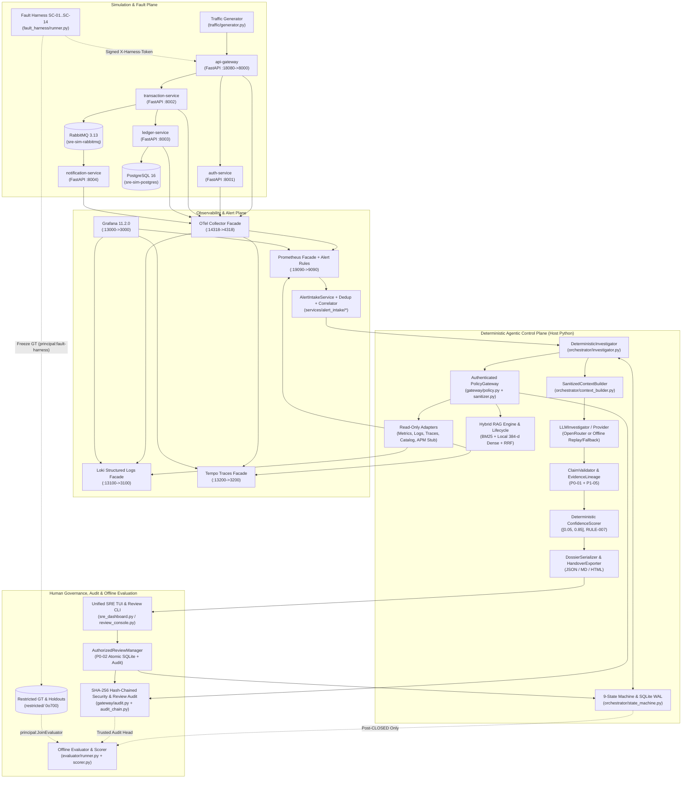
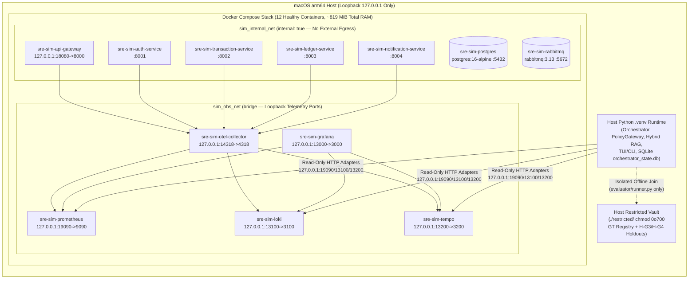
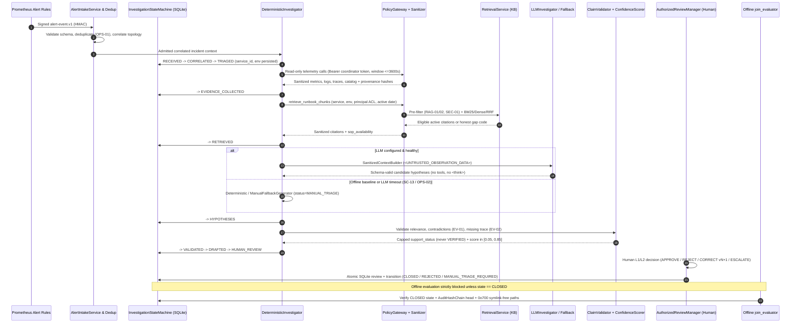
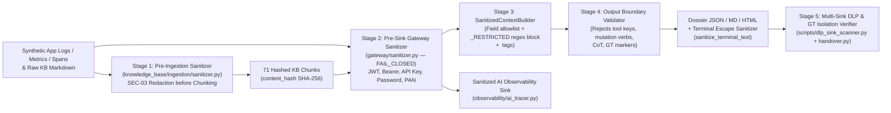
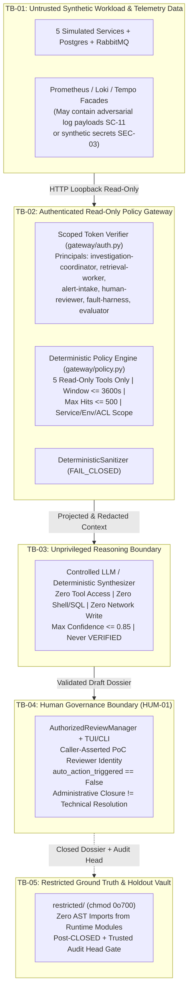
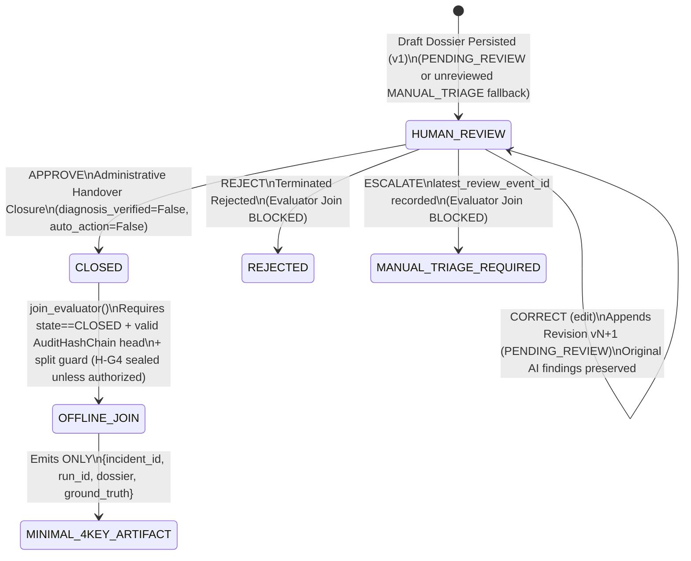

# Deliverable C — As-Built Architecture & Verified System Diagrams
## P2-07 Architecture Compliance Verification

- **Audit Run ID:** `p2-07-architecture-compliance-20261126T040200Z`
- **Authority Baseline:** `AGENTS.md`, `BRD_AI_Agentic_SRE_RAG_Simulation_PoC_v1.0.md`, `Proposal_AI_Agentic_SRE_RAG_Investigation_Engine_Revisi_2.0-2.docx`, `00-IMPLEMENTATION-MASTER-ROADMAP.md`, `ADR-DC02`, `ADR-S01`–`ADR-S08`, `ADR-TBD05`, `C17-evaluation-protocol-owner-decision.md`
- **Verification Basis:** Direct source inspection across all 9 Python packages, live 12-container Docker Compose runtime (`docker compose ps`, `docker stats --no-stream`), Grafana datasource proxy probes, and live `SC-01`–`SC-14` execution.

---

## 1. Component-by-Component As-Built Classification

| # | Architectural Component | Classification | Actual Repository Implementation | Runtime Verification Evidence | Architectural Nuance / Deviation |
|---|---|---|---|---|---|
| 1 | Synthetic banking microservices (overall) | **Implemented and operational** | 5 Python 3.12 / FastAPI services in `services/*/app.py` packaged via `Dockerfile` & `docker-compose.yml` | All 5 containers `Up (healthy)`; `test_c03_compose_live.py` (`4/4 PASS`); live `SC-01`–`SC-14` probes | Exceeds `FR-SIM-001` minimum of 3 interdependent services |
| 2 | API Gateway (`api-gateway`) | **Implemented and operational** | `services/api_gateway/app.py` (`127.0.0.1:18080 -> :8000`) | Live HTTP 200/201/403/500/503 routing, W3C `traceparent`, signed `/_sim/fault/*` control plane | Only service publishing microservice port to host loopback |
| 3 | Authentication service (`auth-service`) | **Implemented and operational** | `services/auth_service/app.py` (internal `:8001`) | Live token validation (`SYNTH-TOKEN-ACTIVE-001`) and `SC-06`/`SC-08` HTTP 403 policy mismatch | Internal `sim_internal_net` + `sim_obs_net` |
| 4 | Transaction service (`transaction-service`) | **Implemented and operational** | `services/transaction_service/app.py` (internal `:8002`) | Live orchestration of auth -> ledger -> RabbitMQ publish; `SC-02` 500 & `SC-04` 503 cascade | Internal network only |
| 5 | Ledger service (`ledger-service`) | **Implemented and operational** | `services/ledger_service/app.py` (internal `:8003`) | Live PostgreSQL double-entry write, idempotency check, `SC-03` slow query, `SC-05` pool exhaustion | Internal network only |
| 6 | Notification service (`notification-service`) | **Implemented and operational** | `services/notification_service/app.py` (internal `:8004`) | Live RabbitMQ consumer + `/stats` backlog telemetry; `SC-07`/`SC-08` queue lag verified | Internal network only |
| 7 | PostgreSQL (`postgres`) | **Implemented and operational** | Real upstream `postgres:16-alpine` container (`sre-sim-postgres`) | Healthy `pg_isready`; real SQL ledger persistence verified across restarts (`test_c03_compose_live.py`) | Strict `sim_internal_net` (`internal: true`) |
| 8 | RabbitMQ (`rabbitmq`) | **Implemented and operational** | Real upstream `rabbitmq:3.13-management-alpine` container (`sre-sim-rabbitmq`) | Healthy AMQP broker; queue `notifications.transaction.completed` + DLQ verified | Strict `sim_internal_net` (`internal: true`) |
| 9 | Synthetic traffic generation | **Implemented and operational** | `traffic/generator.py` (`normal` and `spike` seeded profiles) + `scripts/run_banking_simulator.py` | Seeded reproducibility (`seed=20261109`) verified in `test_c03_services.py`, `E22`, and `test_banking_simulator.py` | 100% synthetic accounts (`SYNTH-ACC-*`) |
| 10 | Controlled fault scenarios `SC-01`–`SC-14` | **Implemented and operational** | `fault_harness/scenarios.py`, `fault_harness/runner.py`, `services/common/fault_control.py` | All 14 scenarios executed live against Docker stack in `P2-07` (`sc01_sc14_live_verification.json`) with clean recovery | Signed `X-Harness-Token` + `principal:fault-harness`; completely excluded from agent tool registry |
| 11 | OpenTelemetry instrumentation | **Implemented and operational (lightweight OTLP JSON)** | `services/common/telemetry.py` + `observability/backends.py` (`otel_collector_app` on `:14318`) | Live W3C `trace_id`/`span_id` propagation, structured JSON logs, RED counters/histograms | Lightweight Python OTLP HTTP/JSON emitter & collector facade per `ADR-S02` (not heavy upstream Java/Go OTel Collector binary) |
| 12 | Prometheus metrics | **Implemented via protocol facade (PoC-approved)** | `observability/backends.py` (`prometheus_app` on `127.0.0.1:19090`) | Live `/api/v1/query`, `/api/v1/query_range`, `/api/v1/alerts`, and Grafana PromQL proxy HTTP 200 | Custom FastAPI PromQL-compatible facade (`ADR-S02`), not upstream Prometheus TSDB binary |
| 13 | Loki logs | **Implemented via protocol facade (PoC-approved)** | `observability/backends.py` (`loki_app` on `127.0.0.1:13100`) | Live `/loki/api/v1/query_range` and Grafana Loki proxy HTTP 200 | Custom FastAPI LogQL-compatible facade (`ADR-S02`), not upstream Grafana Loki binary |
| 14 | Tempo traces | **Implemented via protocol facade (PoC-approved)** | `observability/backends.py` (`tempo_app` on `127.0.0.1:13200`) | Live `/api/traces/{trace_id}`, `/api/search`, `/_sim/outage` (`SC-09`), and Grafana Tempo proxy HTTP 200 | Custom FastAPI Tempo-compatible facade (`ADR-S02`), not upstream Grafana Tempo binary |
| 15 | Grafana dashboards | **Implemented and operational** | Real upstream `grafana/grafana:11.2.0` (`127.0.0.1:13000`) with provisioned datasources & `sre-sim-overview-v1` | Live `/api/health` (200), `/api/datasources` (3 datasources), `/api/search` (200), and live datasource proxy queries all HTTP 200 | Genuine upstream Grafana container |
| 16 | Alertmanager / alerting mechanism | **Replaced via PoC-approved embedded alert evaluator** | `observability/alerts.py` + `observability/alert-rules.yml` inside `prometheus_app` + `services/alert_intake/` | Signed HMAC webhook (`X-Alert-Signature`) & `/api/v1/alerts` verified in `test_c05_*`, `test_c10_*`, and live `P2-07` | No standalone Alertmanager container (`ADR-S02`). Note: `LiveAlertWatcher` (`orchestrator/live_watcher.py`) polls `/api/v1/alerts` directly (`UNAPPROVED COUPLING DEVIATION`, documented in Deliverable O) |
| 17 | Alert deduplication & dependency correlation | **Implemented and operational (single-primary limitation on `SC-08`)** | `services/alert_intake/intake.py`, `dedup.py`, `correlation.py` | `OPS-01` 100->1 duplicate storm (`SC-12`) & `SC-04` cascade attribution (`AT-016`) verified | Concurrent independent faults (`SC-08`) isolate primary fault (`1.0`) but miss secondary root cause (`KPI-02=0.0`, tracked in `CAP-01`) |
| 18 | Deterministic investigation orchestration | **Implemented and operational** | `orchestrator/state_machine.py` (`WorkflowStateStore` SQLite WAL + 9-state `InvestigationStateMachine`), `investigator.py`, `resilience.py` | Sequential 9-state progression, quotas (`<=30` calls), circuit breaker, DLQ, and `DEF-P207-02` metadata persistence verified | Approved Option C (`ADR-TBD05`) replacing Dify |
| 19 | Authorized read-only Policy Gateway | **Implemented and operational** | `gateway/policy.py`, `auth.py`, `config.py`, `sanitizer.py`, `dispatcher.py`, `gateway/adapters/*` | 7 scoped principals, 5 read-only tools (`get_apm_health` explicit `SOURCE_UNAVAILABLE` stub per `ADR-S07`), `KPI-09=0` across all tests & live runs | In-process Python boundary rather than separate network container (`ADR-S03` consolidation nuance) |
| 20 | Hybrid RAG (`BM25 + Dense + RRF + Reranker`) | **Partially implemented (deterministic local dense fallback)** | `knowledge_base/retrieval/{embeddings,engine,prefilter,service}.py` | 4 modes (`lexical_only`, `dense_only`, `hybrid_rrf`, `hybrid_rerank`) verified on 28 DEV (`100%` Hit@5) and 6 H-G4 (`83.33%` Hit@5) | `MultilingualDenseEmbedder` defaults to `deterministic_local_384d` (TF-IDF + bilingual synonyms + 384-d Gaussian projection) because `sentence-transformers` / `fastembed` are NOT installed in `requirements.txt` or `.venv` |
| 21 | Qdrant / retrieval backend | **Replaced through approved ADR** | In-process `RetrievalEngine` (`knowledge_base/retrieval/engine.py`) | Approved in `evidence/c07-20261111T160000Z/C07/retrieval-adr.md` (`RSS ~6.89 MiB`, `P95 ~1.29 ms`) | No Qdrant container or client dependency in repository |
| 22 | SOP lifecycle & applicability validation | **Implemented and operational** | `knowledge_base/ingestion/lifecycle.py`, `knowledge_base/retrieval/prefilter.py`, `orchestrator/verification_plan.py` | Pre-retrieval + post-retrieval `RAG-01` (`obsolete` blocked), `RAG-02` (service/env isolation), `SEC-01` (`allowed_groups` ACL), and `P1-03` availability taxonomy (`KPI-11=0`) | Cross-service shared architecture doc `ARCH-SIM-ECOSYSTEM.md` filtered out on `QRY-HLD-012` (`CAP-02`) |
| 23 | Controlled LLM reasoning | **Implemented and operational (verified via controlled/replay & fallback; live cloud optional)** | `orchestrator/llm_investigator.py`, `llm_provider.py`, `context_builder.py` | Strict JSON output schema, `<UNTRUSTED_OBSERVATION_DATA>` framing, `<think>` rejection, token/latency ledger, live-telemetry RAG-to-LLM delivery verified in `P2-07` | Default `.env` leaves `OPENROUTER_API_KEY` empty (`$0.00` cash cap); `OpenRouterProvider` sets `"data_collection": "allow"` for `:free` tier (`CAP-05`) |
| 24 | Deterministic hypothesis/evidence validation | **Implemented and operational** | `orchestrator/claim_validator_contract.py` (`P0-01` + `C14`), `orchestrator/evidence_lineage.py` (`P1-05`) | Rejects irrelevant/fabricated evidence IDs, enforces `EV-01` contradiction downgrade & `EV-02` trace outage `INCONCLUSIVE`, bans `VERIFIED` (`RULE-007`) | Verified in `test_c14_*`, `test_p1_04_*`, `test_p1_05_*`, `test_p2_07_*` |
| 25 | Evidence-aware confidence scoring | **Implemented and operational** | `orchestrator/confidence.py` (`compute_evidence_confidence`, `rank_hypotheses`) | Bounded `[0.05, 0.85]`, `is_calibrated_probability=False`, duplicate-resistant, order-invariant, SOP weight `0.0` | Calibration (`evaluator/calibration.py`) explicitly labeled `EXPLORATORY ONLY` on small PoC sample |
| 26 | Structured incident dossiers | **Implemented and operational** | `orchestrator/dossier.py` (`DossierSerializer`, `DossierMarkdownRenderer`) + `orchestrator/handover.py` (`HTML` + `JSON` + `MD`) | Schema-valid against frozen `dossier.v1.schema.json`, canonical SHA-256 hash, append-only `vN+1` human revisions | Verified across all 14 live scenarios in `P2-07` |
| 27 | Human Review CLI & terminal dashboard | **Implemented and operational (with `DEF-P207-01` fix)** | `orchestrator/review.py`, `orchestrator/usability_console.py`, `orchestrator/console_view_models.py`, `scripts/sre_dashboard.py`, `scripts/review_console.py` | `APPROVE`, `REJECT`, `CORRECT`, `ESCALATE` atomic SQLite locking, 2-step confirmation modal, `SC-13` fallback review unlocked in `P2-07`, terminal escape stripping | Caller-asserted PoC identity (`sre_reviewer`) — not enterprise SSO/OIDC (`CAP-05`) |
| 28 | Append-only SHA-256 audit logging | **Implemented and operational** | `gateway/audit.py` (`SecurityAuditLogger`) + `observability/audit_chain.py` (`AuditHashChain`) + `reconcile_review_audit()` | Tamper-evident `prev_hash -> event_hash` chains verified across all gateway calls and human reviews; separated from `observability/ai_tracer.py` (`ADR-S06`) | Single-writer file lock; crash window between JSONL append & SQLite commit mitigated via `reconcile_review_audit` |
| 29 | Isolated post-closure offline evaluation | **Implemented and operational** | `evaluator/runner.py` (`join_evaluator`), `evaluator/scorer.py`, `fault_harness/gt_registry.py`, `restricted/` (`0o700`) | Zero runtime AST imports (`85` files checked), symlink traversal blocked, non-`CLOSED` incidents blocked, minimal 4-key join output, `H-G4` seal guard intact | Holdout sample size (`N=2` `H-G3`, `N=1` `H-G4`) below proposal target `30–50` (`TBD-08` / `CAP-03`) |

---

## 2. Verified As-Built Architecture Diagrams

### 2.1 Component Architecture Diagram

### 2.2 Container & Host Deployment Topology (`docker-compose.yml` As-Built)

### 2.3 End-to-End Investigation Sequence Diagram

### 2.4 Data-Flow & Multi-Stage Sanitization Diagram

### 2.5 Security & Trust-Boundary Diagram

### 2.6 Human Review & Post-Closure Evaluator Isolation Diagram

